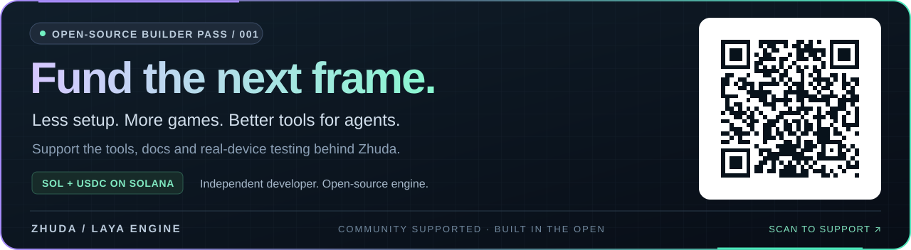

<a href="#support-this-engine"></a>

## Support this engine

Help an independent developer keep building open-source game tools. Your support goes toward engine work, documentation and testing on real devices.

**SOL / USDC · Network: Solana** — scan the card above or copy this wallet address:

```text
E4ZEhFCYy4b5pYXJUbMC9KjRitkypyqtZvpSRerLWHCb
```

[View wallet on Solscan](https://solscan.io/account/E4ZEhFCYy4b5pYXJUbMC9KjRitkypyqtZvpSRerLWHCb) · [Open QR code](docs/assets/solana-qr.png) · [About supporting Zhuda](docs/SUPPORT.md)

---

# Drive the waterfront.

English · [简体中文](docs/zh-CN/README.md)

<a href="https://zhudaandzhuer.github.io/zhuda-neon-racer/harbor-film.html"><picture><source type="image/webp" srcset="https://raw.githubusercontent.com/zhudaandzhuer/zhuda-neon-racer/main/docs/media/harbor-preview.webp?v=harbor-01" /></picture></a>

### HARBOR / 01 · built with zhuda-laya-engine

**Light, surface and motion in a world you can enter.** Drive the S800 across the waterfront: photographed PBR surfaces, HDR lighting, soft shadows, wet-road reflections and an authored dock warehouse. Explore with momentum, steering, independently animated wheels and a chase camera.

**[EXPLORE THE HARBOR →](https://zhudaandzhuer.github.io/zhuda-neon-racer/visual.html?view=dock)** · **[WATCH IN 4K / 60 FPS →](https://zhudaandzhuer.github.io/zhuda-neon-racer/harbor-film.html)**

Keyboard and touch controls. Auto / Performance / Balanced / High settings. The film uses the actual High preset at **3840 × 2160 / 60 FPS**, captured frame by frame; playback cadence is not a live-performance claim. The page also offers a lighter 1080p / 60 FPS version. [Capture details](https://github.com/zhudaandzhuer/zhuda-neon-racer/blob/main/docs/media/harbor-recording.json).

---

# zhuda-laya-engine

**An agent-friendly game SDK and toolchain built on LayaAir 3.4.2.**

[](https://github.com/layabox/LayaAir) [](LICENSE) [](package.json) [](#support-this-engine)

Build 2D, 3D and Spine 4.2 projects with TypeScript, a CLI and coding agents. This fork adds dependency ordering, component registration, public SDK types, visual migration checks and an MCP server to the upstream engine. The shipped workflows run without the LayaAir IDE.

Maintained by [Zhuda](https://github.com/zhudaandzhuer). Rendering and physics come from [LayaAir / Layabox](https://layaair.com/). This is an independent fork; donations support Zhuda's work on this repository.

## Deterministic movie production (1.13.0)

Sample native bone/Morph animation at exact timestamps, use a physical camera
with aperture/shutter samples, capture bounded offscreen frames, and export a
soundtrack through the existing audio mixer. `zhuda-film-export` verifies the
sequence and encodes H.264/AAC with atomic replacement of the previous movie.
The glTF unlit importer also preserves authored colors on WebGPU.

[Public movie workflow](docs/cinematics.md) · [Runnable example](examples/cinematic-capture/)
· [Verification and limits](docs/plans/cinematic-production/verification.md).
Neutral macOS WebGL/WebGPU fixtures cover actual 4K24 output, exact replay,
DPR/resize, focus/motion effects, audio timing and repeated disposal. Accumulation
is display-linear SDR after tone mapping. Scene-linear HDR/EXR, path tracing,
Windows hardware and physical mobile/XR remain unverified or unimplemented.

## Asset delivery and deterministic evidence (1.12.0)

Optional pinned Meshopt decoding now feeds the existing provider/model cache;
chunk delivery shares leases and rejects late, oversized or corrupt downloads.
Deterministic timelines, a bounded frame recorder and `zhuda-sequence-check`
provide reproducible presentation evidence. The Electron example now stages the
consumer bundle inside the package. See [model loading](docs/model-showcase.md),
[timelines](docs/cinematics.md), [desktop packaging](examples/windows-webgpu/)
and the [measured scope](docs/plans/desktop-and-agent-gates/hardening-verification.md).
macOS WebGL/WebGPU neutral-model checks pass; Windows hardware, Draco, KTX2,
GPU-driven/HLOD and XR remain separate work; the 1.13.0 movie route is above.

## WebGPU backend and delivery (1.11.0)

Choose `renderer: "webgpu"` in the consumer compiler, or a `2d-webgpu`,
`3d-webgpu` or `3d-gltf-webgpu` browser bundle. The SDK uses the real upstream
GPU backend, reports the actual adapter, bounds initialization and retires lost
devices through the existing runtime lifecycle. Default WebGL is preserved.
[Setup, fallback and platform limits](docs/webgpu.md) include reproducible Windows
browser checks. macOS hardware rendering is measured; Windows hardware, native
EXE/Steam and physical mobile acceptance remain unverified.
The [`examples/windows-webgpu`](examples/windows-webgpu/) host provides a
reproducible Electron entry for the next Windows packaged acceptance step.

## White-label, themes and presentation recovery (1.10.0)

Keep the default 豬大 × LayaAir splash, use your own brand, or explicitly disable
it through the public compiler and browser bundle. Immutable theme mappings,
SHA-verified assets, cancellable prepared replacement and authoritative-result
presentation/checkpoint coordination support a same-core, two-theme workflow.
`zhuda-laya-init --template 2d` creates a strict 2D consumer with shared isolated
Prefab definitions. See [contracts, examples and adoption limits](docs/white-label-themes.md)
and the [verification record](docs/plans/records/slot-factory-foundation/verification.md).
Slot-specific rule kits, math/RGS/wallet and Factory products belong outside
this engine repository. Signed Native and device acceptance are separate checks.

## Model inspection and import reliability (1.9.0)

Required glTF extensions now fail explicitly when unsupported; node Morph weights
and CUBICSPLINE Morph animation are preserved. Public compatibility reports,
a model inspector and same-instance Raw / Gameplay / Cinematic presentation
are available, with a `3d-gltf` HTML bundle. See the [model showcase contract](docs/model-showcase.md)
for the tested subset and unsupported features. Cinematic is real-time postprocessing,
not an offline movie renderer or a guarantee of Unreal Engine parity.

## Crowd presentation and measurable budgets (1.8.0)

Provider-backed model templates now share animation clips and release native
model resources deterministically. Crowd/snapshot presentation scheduling,
native animation LOD, important-effect fallback, adjustable particle simulation
and bounded P50/P95/P99/raw GPU profiling are available through the public SDK.
[Integration and platform boundaries](docs/crowd-runtime.md) include a reproducible
25/50/100 skinned-character consumer benchmark and 100/300/500 ordinary-instance
comparisons. These fixtures do not certify a production MMO or Windows/Steam.

## Runtime reliability (1.7.0)

DPR-independent CSS design coordinates, provider-backed streaming BGM, bounded
FIFO/priority voice retirement, a sample-backend extension and an optional
Worker frame driver are available. The full vendor declaration audit now passes
with `skipLibCheck:false` and runs inside `npm run verify`.
See [audio](docs/audio.md), [runtime sizing and recovery](docs/platform-adapters.md),
and the [measured scope and migration notes](docs/plans/records/astra-runtime-feedback/verification.md).
Physical iOS/Android, speaker latency and a production Worklet DSP mixer remain
unverified; the extension and desktop reference test do not establish full SOP compliance.

## Single-HTML browser entry (1.13.0)

Use the [hosted SDK and runnable examples](https://game.qianlongxundao.com/play/zhuda-engine-sdk/)
to load the real runtime with one pinned script. [Browser SDK guide](docs/browser-sdk.md)
includes fixed URLs, SRI, 2D/3D HTML templates and sandbox limits. The existing
consumer/Prefab/device gates still apply to a complete game.

## Official mini-game packaging without the IDE (1.14.0)

An independent consumer can call the installed LayaAir 3.4.2 CLI directly
through the public build API for WeChat, ByteDance, OPPO, VIVO, Xiaomi,
Alipay, Taobao, Bilibili and Huawei targets. The route pins the toolchain,
retains the official platform adapter, stages output atomically and records
the package fingerprint. See [mini-game packaging](docs/minigame-packaging.md).
Kuaishou, store submission and device execution are not claimed without an
official adapter and separate platform evidence.

## Start here: build a real consumer

Use the engine checkout for SDK work. Put a game in its own repository and
start from the canonical [consumer route](docs/consumer-route.md):

```sh
# after npm install in this engine checkout
node packages/compiler/zhuda-init.mjs /absolute/path/to/my-game
cd /absolute/path/to/my-game
npm install
npm run verify
```

The starter pins this engine to a commit, creates `public/index.html` with the
`ZHUDA_LIBS` / `ZHUDA_ENTRY` markers, and creates `src/Main.ts` that imports
the public SDK and calls `ZhudaEngine.boot`. The consumer then owns its rules,
assets, prefabs, scenes and deployment. Read [AGENTS.md](AGENTS.md) and the
[visual prefab workflow](docs/prefab-workflow.md) before adding authored
visuals. A static pass does not establish real WebGL or device support.

Do not use a Three.js renderer, an inline `ZhudaEngine` facade, a copied
`packages/core`, or a deep engine import and call the result Zhuda-backed. The
consumer Doctor reports these cases with a file and line. Use the claim levels
in the [consumer route](docs/consumer-route.md) when writing project reports.

[Play Neon Apex](https://zhudaandzhuer.github.io/zhuda-neon-racer/) · [Explore 100 particle effects](https://zhudaandzhuer.github.io/zhuda-particle-lab/) · [Try the 3D terrain lab](https://zhudaandzhuer.github.io/zhuda-3d-lab/?terrain=1)

## Consumer runtime additions (1.5.0)

Doctor now selects the current project and rejects empty scans. The existing
mixer accepts provider-backed audio samples with loops, fades and disposal.
The shared Prefab library/preview accepts typed primitive 3D trees with named
nodes, states, material slots and sockets. See [audio](docs/audio.md),
[3D Prefabs](docs/procedural-prefabs.md) and the
[verification scope](docs/plans/records/consumer-runtime-hardening/verification.md).
These additions do not establish physical mobile acceptance or approve game art.

The RPG integration adds explicit lifecycle completion checks, official
`zhuda-laya-build --candidate` / `zhuda-laya-accept` commands, conservative
component dependency proofs and opt-in shared primitive Prefab resources.
Start with [candidate and evidence configuration](docs/consumer-tooling.md)
and [shared resource ownership](docs/procedural-prefabs.md). Existing consumers
keep whole-payload validation and independent resource ownership by default.

## More games

The separate racer and four arcade games offer keyboard/touch input, levels, a win/loss state and saved progress.

| Game | Play |
| --- | --- |
| NEON APEX · four racing circuits, garage and upgrades | [Race](https://zhudaandzhuer.github.io/zhuda-neon-racer/) |
| STARFALL · space combat | [Launch](https://zhudaandzhuer.github.io/zhuda-arcade/?game=starfall) |
| EMBERBOUND · arena survival | [Enter](https://zhudaandzhuer.github.io/zhuda-arcade/?game=ember) |
| COREKEEP · tower defense | [Defend](https://zhudaandzhuer.github.io/zhuda-arcade/?game=corekeep) |
| TIDEBREAK · arcade rebounds | [Dive in](https://zhudaandzhuer.github.io/zhuda-arcade/?game=tidebreak) |

Game rules, art, media and deployment live in separate consumer repositories: [Neon Apex](https://github.com/zhudaandzhuer/zhuda-neon-racer) and [Arcade](https://github.com/zhudaandzhuer/zhuda-arcade). [Racing verification](https://github.com/zhudaandzhuer/zhuda-neon-racer/blob/main/docs/browser-verification.json) covers a complete live race, progress, touch input and bounded scene resources.

## Explore the engine

### 100 particle effects

[](https://zhudaandzhuer.github.io/zhuda-particle-lab/showcase.html)

91 2D and 9 true 3D effects: body-wrapping racing airflow, magic, explosions, weather, water and UI feedback.

[Try the effects](https://zhudaandzhuer.github.io/zhuda-particle-lab/) · [Watch the 60 FPS film](https://zhudaandzhuer.github.io/zhuda-particle-lab/showcase.html) · [Verification](https://github.com/zhudaandzhuer/zhuda-particle-lab/blob/main/VERIFICATION-100.md)

### Terrain and shaders

[](https://zhudaandzhuer.github.io/zhuda-3d-lab/?terrain=1)

Editable 2D tile maps and 3D heightfields, chunk streaming, LOD 1/2/4, closed sides/undersides and camera boom collision probes. The inspector includes an explicit underground view. PBR, textured, fog, dissolve and 2D tint/atlas variants are checked in real WebGL draws; sky materials can opt out of scene fog.

[Open the terrain / shader lab](https://zhudaandzhuer.github.io/zhuda-3d-lab/?terrain=1) · [Terrain and shader API](docs/terrain-shader.md) · [Verification scope](docs/3d-acceptance.md)

## What the fork adds

| Area | Public tools and behavior |
| --- | --- |
| Module loading | `TopologyResolver` orders 29 runtime modules and selects the required features. The 2D light profile reduces the included library payload by about 83%. |
| CLI builds | `zhuda-laya-build` uses esbuild and TypeScript AST scanning; it emits Web builds and ESM/CJS SDK bundles. |
| Component registration | `@zhudaComponent` and the AST scanner register classes before prefab deserialization. |
| Runtime guards | `EngineGuard` handles known 3.4.2 integration issues, including the `Graphics.setState` / `Button` failure. |
| Typed construction | `ZhudaEngine`, `Zhuda3D`, `ZhudaUI` and `ZhudaPrefab` provide code-first construction. Public types omit IDE-only declarations. |
| Agent integration | The MCP server supplies API guardrails, dependency resolution, examples, diagnostics and asset/particle validators. |
| Visual migration | Asset audits compare Spine 4.2 presentation data and require explicit mappings for Unity animation/material wrappers. |
| Visual state contracts | `SpineVisualContract` rejects incomplete fallback presentation; `VisualFocusContract` gives focus, empty selection and reset distinct meanings. |
| Static assets and UI | `.lh` / `.ls` serialization, explicit `percent:false`, pixel bounds and color comparison, nine-slice checks and safe-area fixtures. |
| Effects | Seeded 2D/3D particles, pooling, ribbons, flipbooks, collision events, VFX materials, timelines, anchors and quality budgets. |
| Runtime hardening | Scaled/unscaled and layered clocks/timers, deferred scene mutations, explicit local/world/overlay render passes, defensive Graphics calls, bounded object pools, consumer-owned combat queries, action frame data and buffered input. See [runtime hardening](docs/runtime-hardening.md) and [combat runtime contracts](docs/combat-runtime.md). |

### 3D terrain, shaders and integration

The public 3D SDK adds independent consumer builds, resource leases, PBR/custom surfaces, dynamic meshes, camera/input/query contracts, clocks, 2D tile terrain and 3D heightfields with chunk streaming, editing and LOD 1/2/4.

The engine passes 91 automated tests. The existing integration has 41 real WebGL checks covering atlas UVs, tint, alpha, clipping, textured/fog/dissolve variants and compiler diagnostics. [Documentation](docs/3d-integration.md), [terrain/shader contracts](docs/terrain-shader.md) and [acceptance limits](docs/3d-acceptance.md) describe that scope. The [independent consumer](https://github.com/zhudaandzhuer/zhuda-3d-lab) pins a specific engine commit and stores its device reports. Small-scene results do not establish full-game map or server performance.

The [filmic rendering API](docs/filmic-rendering.md) adds native-lit procedural PBR hooks, UV-derived tangents, explicit normal-map conventions, offline GGX/SH HDR lighting, an HDR/AO/bloom/ACES/TAA camera pipeline and horizontal planar reflections. A separate [HARBOR visual study](https://zhudaandzhuer.github.io/zhuda-neon-racer/visual.html) checks the rendered effects and resource teardown. This is an initial quality slice, with further scene and asset work required.

### Asset source boundary

Consumer code addresses assets with stable logical IDs through `AssetProvider`. `DirectoryAssetProvider` is the current development and web default: it provides timeout, cancellation, bounded reads, manifest checksums and progress reporting. A future CDN-chunk, ZIP or Rust/WASM provider can implement the same contract without changing gameplay or scene code. See the [asset loading contract](docs/asset-loading.md).

### Audio lifecycle

Embedded consumers use [`IframeSoundAdapter`](docs/audio.md) as one WebAudio
authority. It bounds the pre-gesture queue, applies master/channel gain once,
checks bridge origins and disposes voices and listeners with the owner.
Consumers must not create a second `AudioContext` for an event.

### Platform adapters

[`NoSleepAdapter`](docs/platform-adapters.md) is built into the SDK for native
Screen Wake Lock. FairyGUI stays consumer-owned: projects that need it install
their own compatible runtime and adapter.

Planned engine work is tracked in the [development plans](docs/plans/README.md) directory. Plans are proposals until their measurements and acceptance gates pass.

## Quick start

Requires Node.js 24 or newer.

```sh
git clone https://github.com/zhudaandzhuer/zhuda-laya-engine.git
cd zhuda-laya-engine
npm install
npm run verify
npm start
```

Open `http://localhost:8890/` for the local workbench.

```ts
import { ZhudaEngine, Zhuda3D } from 'zhuda-laya-engine';

const { rootScene } = await ZhudaEngine.boot({
  width: 1280,
  height: 720,
  features: ['core', '3d'],
});
const scene = Zhuda3D.createScene3D(rootScene);
Zhuda3D.createCamera(scene, {
  position: [0, 4, 8],
  rotationEuler: [-25, 0, 0],
});
Zhuda3D.createDirectionalLight(scene);

const cube = new Laya.MeshSprite3D(
  Zhuda3D.createPrimitiveMesh('box', { width: 1.5, height: 1.5, depth: 1.5 }),
);
cube.meshRenderer.sharedMaterial = Zhuda3D.createMaterial({
  albedoColor: [0.2, 0.7, 1, 1],
  shininess: 48,
});
scene.addChild(cube);
```

Consumer projects must load the selected Laya runtime modules before booting the SDK. Use the compiler's dependency ordering rather than mixing engine generations. Clone this repository to work on the SDK; use a packaged build or a pinned Git commit in consumer projects.

The commands above start the **engine workbench**. They are not the game
integration path. For an external game, use [`docs/consumer-route.md`](docs/consumer-route.md)
or the installed `zhuda-laya-init` binary, then run the consumer's own `npm run verify`.

### Commands

| Command | Purpose |
| --- | --- |
| `node packages/compiler/zhuda-init.mjs /absolute/path/to/consumer` | Create a pinned public-SDK consumer skeleton |
| `npm run build` | Generate the demo build and SDK bundles |
| `npm run typecheck` | Check public/runtime types and application sources |
| `npm run audit:declarations` | Audit all SDK declarations without `skipLibCheck`; required clean vendor and public SDK audit |
| `npm run doctor` | Check module order, registration, known legacy API usage and the agent/documentation contract |
| `npm run agent:contract` | Print the machine-readable agent boundary, workflow and evidence contract |
| `npm test` | Run Node unit and integration tests |
| `npm run verify` | Run build, typecheck, doctor and tests |
| `npm run pack:tarball` | Create an installable package in `dist/` |

## Connect a coding agent

Read [`AGENTS.md`](AGENTS.md) and [`docs/agent-development.md`](docs/agent-development.md) before delegating a complex change. The MCP server exposes `get_agent_contract` and `validate_task_spec` so another agent can retrieve the same boundaries, workflow and evidence rules without relying on this conversation.

Add the bundled MCP server to your client configuration:

```json
{
  "mcpServers": {
    "zhuda-laya-engine": {
      "command": "node",
      "args": ["/absolute/path/to/zhuda-laya-engine/packages/mcp-server/index.mjs"]
    }
  }
}
```

The same tools can run directly from the terminal:

```sh
node packages/mcp-server/index.mjs --tool resolve_topology --args '{"features":["3d","spine42"]}'
node packages/mcp-server/index.mjs --tool get_golden_example --args '{"id":"boot-declarative-3d"}'
```

Use the guardrails and validators before generating a scene. Schema validation checks data contracts; successful rendering and shader compilation require an actual WebGL draw.

## Migrate assets before gameplay

Build each visual component as a consumer-owned prefab. Verify its named
nodes against source references in an isolated preview, verify the assembled
panel, then mount that same definition in the scene. The
[prefab workflow](docs/prefab-workflow.md) includes rules to adopt in a
consumer project. The [tooling roadmap](docs/plans/prefab-toolchain.md)
distinguishes the current built-in examples from planned consumer tooling.

Inventory the source assets first, map their presentation requirements, validate them in isolation, then connect existing game rules.

```sh
node packages/compiler/visual-asset-audit.mjs \
  --source /absolute/path/to/unity/Assets/Game \
  --target /absolute/path/to/consumer/assets \
  --strict \
  --report /absolute/path/to/consumer/dist/visual-migration.json

node packages/compiler/visual-contract-audit.mjs \
  --project /absolute/path/to/consumer
```

The asset audit checks Spine animations, skins, bones, slots, constraints, atlases and textures. Unknown shader mappings are blocked rather than silently replaced. Unity `.anim`, `.controller` and `.mat` wrappers need explicit target contracts; the converter does not promise compatibility with arbitrary Unity code.

A consumer's `visual-presentation-manifest.json` describes source/target presentation, scope, runtime states, non-focused targets and restoration. Declaring `visualContract` in `zhuda.config.json` makes these requirements part of the build gate.

```ts
import { VisualFocusContract } from 'zhuda-laya-engine';

VisualFocusContract.apply(targets, VisualFocusContract.focus(winningIds));
VisualFocusContract.apply(targets, VisualFocusContract.clear());
```

Explicit mappings can be saved in `visual-migration-manifest.json`:

```json
{
  "schemaVersion": 1,
  "animations": [
    { "sourcePath": "Art/BigWin_in.anim", "targetAnimation": "BigWin_in" }
  ],
  "materials": [
    { "sourcePath": "Art/BigWin_Additive.mat", "targetMaterial": "SpineStandard", "blendMode": "additive" }
  ]
}
```

## Particles and effects

`ZhudaParticleSystem` / `ZhudaParticleSystem3D` provide deterministic fixed-step simulation, seeded replay, bounded pools, local/world space and distance emission. Laya renderers support textured particles, 3D billboards, historical ribbons and authored flows that reveal along a path.

Additional APIs cover VFX materials, camera pass budgets, flipbooks, plane collisions, event chains, effect timelines, 3D anchors and draw-call profiling. Game-specific effect recipes and artwork remain in consumer repositories.

[Particle API and limits](packages/core/particles/README.md) · [Effects API](packages/core/effects/README.md)

## Repository map

```text
packages/core/          SDK, effects, particles and engine adapters
packages/compiler/      CLI builds, AST registration and visual audits
packages/mcp-server/    Agent tools, API guardrails and examples
packages/types/         Public and vendor runtime declarations
packages/ci-gate/       Browser first-frame checks and reports
vendor/laya-3.4.2/      Upstream runtime libraries
assets/                 Generic fixtures and serialized prefabs
src/                    Engine workbench and isolated asset preview
docs/                   Project documentation, support assets and translations
tests/                  Unit, integration and public-type checks
```

## License and upstream credit

[MIT](LICENSE). LayaAir is developed by [Layabox](https://github.com/layabox/LayaAir); visit [layaair.com](https://layaair.com/) for the upstream engine. This repository adds tooling and integration work maintained by [Zhuda](https://github.com/zhudaandzhuer).

If the engine saves you time, [support the next build](#support-this-engine). Thank you for keeping it open.
