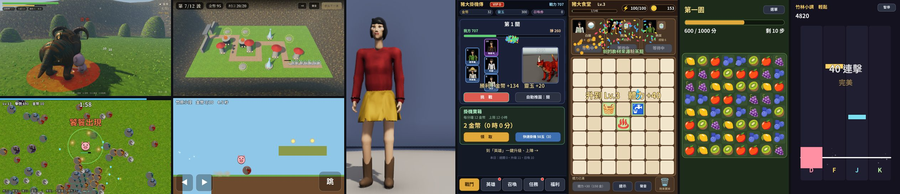

# zhuda-laya-engine

English · [简体中文](docs/zh-CN/README.md)

**An agent-friendly game SDK and toolchain built on LayaAir 3.4.2.** Build 2D, 3D and Spine 4.2
games with TypeScript, a command line and coding agents. Every way of building something on this
engine is written down as a **route**, and the games those routes were written from live in this
repository and are rebuilt and tested with the engine.

[](https://github.com/layabox/LayaAir) [](LICENSE) [](https://nodejs.org/)

<a href="#support-this-engine"></a>

## Start a game

Requires Node.js 24 or newer. A game lives in its own repository and pins the engine to a commit:

```sh
git clone https://github.com/zhudaandzhuer/zhuda-laya-engine.git && cd zhuda-laya-engine && npm ci
node packages/compiler/zhuda-init.mjs /absolute/path/to/my-game
cd /absolute/path/to/my-game && npm install && npm run verify
```

The starter creates `public/index.html`, `src/Main.ts` (which imports the public SDK and calls
`ZhudaEngine.boot`) and a `verify` script: build, types, Doctor, tests. From there the
[consumer route](docs/consumer-route.md) is the contract, and a route tells you how to build the
thing you have in mind.

## Find your route

A route is one page in [`docs/routes/`](docs/routes/README.md), always in the same format: when to
take it, tools, steps with the values that worked, pitfalls, engine gaps, checks, what was **not**
checked, boundaries. Read the route before designing: it starts you where the last builder stopped.

```sh
node packages/mcp-server/index.mjs --tool list_routes
node packages/mcp-server/index.mjs --tool get_route --args '{"id":"new-game-project"}'
```

| You want to | Route |
| --- | --- |
| Start a game or app | [new-game-project](docs/routes/new-game-project.md) |
| Keep a game checkable: tested rules, bots, a recorded run | [game-rules-first](docs/routes/game-rules-first.md) |
| Build a 2D game or a game's interface | [game-2d](docs/routes/game-2d.md) |
| Build a game of a known kind | [platformer](docs/routes/platformer-2d.md) · [match-three](docs/routes/match-three-2d.md) · [rhythm](docs/routes/rhythm-2d.md) · [merge](docs/routes/merge-2d.md) · [idle with summons](docs/routes/idle-gacha-2d.md) · [survivors-like](docs/routes/survivors-2d.md) · [tower defence](docs/routes/tower-defence-3d.md) · [hunting action](docs/routes/hunting-action-3d.md) |
| Dress a 3D character at run time | [outfit-swap-3d](docs/routes/outfit-swap-3d.md), body made by [humanoid-from-shapes](docs/routes/humanoid-from-shapes.md), clothes that nothing comes through by [clip-free-garments](docs/routes/clip-free-garments.md) |
| Make a 3D scene look good | [good-looking-3d-scene](docs/routes/good-looking-3d-scene.md), the [quality route](docs/quality-route.md) |
| Build a scene, a still or a film as data | [film-as-data](docs/routes/film-as-data.md) |
| Bring in a model from Blender | [model-from-dcc](docs/routes/model-from-dcc.md) |
| Add or change anything a player sees | [visual-content-prefab](docs/routes/visual-content-prefab.md) |
| Write one HTML page | [single-html-page](docs/routes/single-html-page.md) |
| Package a mini-game | [mini-game-build](docs/routes/mini-game-build.md) |
| Build a kind of scene someone already built | [scene routes](docs/routes/README.md#scenes) |
| Change the engine | [`AGENTS.md`](AGENTS.md) |

## Reference games

[](games/README.md)

Nine small games under [`games/`](games/README.md) are consumers of the engine in this checkout:
a 3D hunting action game, a 3D tower defence, a 3D wardrobe, an idle game with summons, a
survivors-like, a merge board, a tile platformer, a match-three and a rhythm game. Each is the worked example of one route,
and `npm run verify:games` builds, type-checks, doctors and tests all of them against the engine
as it is in this commit, so an engine change that breaks a game is caught here.

They are test consumers, not finished products: rules are covered by tests and bots, and each has
a recorded run with real input in a headless browser, but none has been played by a person or run
on a phone, and their art is placeholder.

## The prefab library

[`prefabs/`](prefabs/README.md) holds what several games use and none should rewrite: interface
components, input, saving and languages; a side-view duel, a dungeon line slot and a cascade slot's
client as modules; three finished islands with their characters, walking, sound and light; a
seaside with a pier; a low-poly rigged figure; sounds; a mini-game host bridge; the Go packages of
a game server. A game copies the modules it names
(`npx zhuda-prefab-sync . ui/dialog 3d/sky-island`) and a lock file records them; two viewers show
every module (`?scene=<id>`); `npm run verify:prefabs` checks the library against this checkout.
It came into the repository with 2.0.0: [the prefab library](docs/prefab-library.md).

## Built with this engine

[](https://zhudaandzhuer.itch.io/zhuda-rainy-night-murder)

**[Zhuda: Murder on a Rainy Night](https://zhudaandzhuer.itch.io/zhuda-rainy-night-murder)** is a ten-minute mystery built with zhuda-laya-engine 1.18.0: an isometric neon alley in the rain, a torch that reveals hidden clues, seven neighbours to question, full Chinese voice acting and three languages. It plays in the browser on desktop and mobile.

**[PLAY ON ITCH.IO →](https://zhudaandzhuer.itch.io/zhuda-rainy-night-murder)**

The game, its art, voices and deployment belong to its own project and are not part of this repository.

## What is in the engine

- **A typed SDK over LayaAir 3.4.2**: `ZhudaEngine`, `Zhuda3D`, `ZhudaUI`, `ZhudaPrefab`, module
  ordering, component registration and guards for known 3.4.2 problems; WebGL by default, WebGPU
  by choice ([WebGPU](docs/webgpu.md), [backend delivery](docs/backend-delivery.md)).
- **Scenes and films as data**: an agent writes a scene as JSON, gets previews back, and renders
  stills or MP4 ([film scenes](docs/film-scenes.md), [cinematics](docs/cinematics.md)); the
  [quality route](docs/quality-route.md) is the order in which a 3D scene is made to look lit,
  grounded and deep.
- **Runtime for action games**: layered clocks and timers, action frame data, input buffering,
  model animation control ([combat runtime](docs/combat-runtime.md),
  [animation control](docs/animation-control.md)).
- **Assets**: providers with leases, timeouts and cancellation, glTF with Meshopt and KTX 2,
  levels of detail, procedural textures, props and synthesised sound
  ([asset loading](docs/asset-loading.md), [model pipeline](docs/model-pipeline.md),
  [procedural assets](docs/procedural-assets.md)).
- **2D, UI and effects**: design-pixel layout, prefabs with isolated previews, tile terrain,
  seeded particles and ready effects, one audio owner
  ([layout](docs/layout-and-media.md), [prefab workflow](docs/prefab-workflow.md), [audio](docs/audio.md)).
- **Tools for agents**: an MCP server with routes, API guardrails, examples and validators, a
  Doctor that points at file and line, a consumer build with evidence gates
  ([agent development](docs/agent-development.md), [consumer tooling](docs/consumer-tooling.md)).
- **Delivery**: web builds, a single-HTML browser SDK, mini-game packaging, white-label branding
  ([browser SDK](docs/browser-sdk.md), [mini-games](docs/minigame-packaging.md),
  [white-label](docs/white-label-themes.md)).

The [documentation index](docs/README.md) lists every guide and says where the code is; the
[overview](docs/overview.md) is the longer tour; the [changelog](CHANGELOG.md) says what each
release added. Each guide states what was measured and what was not: a passing validator or a
desktop check is never presented as a device result.

## The smallest scene that draws

```ts
import { ZhudaEngine, Zhuda3D } from 'zhuda-laya-engine';

const { rootScene } = await ZhudaEngine.boot({
  width: 1280,
  height: 720,
  features: ['core', '3d'],
});
const scene = Zhuda3D.createScene3D(rootScene);
Zhuda3D.createCamera(scene, { position: [0, 4, 8], rotationEuler: [-25, 0, 0] });
Zhuda3D.createDirectionalLight(scene);

const cube = new Laya.MeshSprite3D(
  Zhuda3D.createPrimitiveMesh('box', { width: 1.5, height: 1.5, depth: 1.5 }),
);
cube.meshRenderer.sharedMaterial = Zhuda3D.createMaterial({
  type: 'pbr',
  albedoColor: [0.2, 0.7, 1, 1],
  smoothness: 0.5,
});
scene.addChild(cube);
```

For one that looks good (shadows, sky, fog, an HDR grade, a frame budget) follow the
[quality route](docs/quality-route.md); `zhuda-laya-init` scaffolds a game that starts on it.

Do not use a Three.js renderer, an inline `ZhudaEngine` facade, a copied `packages/core` or a deep
engine import and call the result Zhuda-backed: the consumer Doctor reports these with file and line.

## Work on the engine

```sh
npm ci                  # installs and builds
npm run verify          # build, typecheck, declaration audit, Doctor, tests
npm run verify:games    # the reference games against this checkout
npm start               # the engine workbench at http://localhost:8890/ (not a game scaffold)
```

| Command | Purpose |
| --- | --- |
| `npm run build` | Generate public declarations, the workbench build and the SDK bundles |
| `npm run typecheck` | Check public and runtime types and application sources |
| `npm run audit:declarations` | Audit all SDK declarations without `skipLibCheck` |
| `npm run doctor` | Module order, registration, legacy API use and the agent and documentation contract |
| `npm run agent:contract` | Print the machine-readable agent boundary, workflow and evidence contract |
| `npm test` | Node unit and integration tests |
| `npm run verify:<name>` | One browser check each; the list is in `package.json` |
| `npm run pack:tarball` | Create an installable package in `dist/` |

Read [`AGENTS.md`](AGENTS.md) before changing anything: it is the repository's contract (task
spec, evidence, what must stay true). Unfinished work is in [`HANDOFF.md`](HANDOFF.md).

### Connect a coding agent

```json
{
  "mcpServers": {
    "zhuda-laya-engine": {
      "command": "node",
      "args": ["/absolute/path/to/zhuda-laya-engine/packages/mcp-server/index.mjs"]
    }
  }
}
```

The MCP server exposes `list_routes`, `get_route`, `get_agent_contract`, `get_quality_route`, API
guardrails, golden examples and validators. The same tools run from the terminal:

```sh
node packages/mcp-server/index.mjs --tool resolve_topology --args '{"features":["3d","spine42"]}'
node packages/mcp-server/index.mjs --tool get_golden_example --args '{"id":"boot-declarative-3d"}'
```

A validator checks data; a real draw and a device are separate checks.

## Repository map

```text
packages/core/          The SDK: runtime, 3D, film scenes, effects, particles, terrain, audio
packages/types/         Public declarations, generated from packages/core
packages/compiler/      Command-line tools: build, init, Doctor, editors, audits
packages/mcp-server/    Agent tools: routes, guardrails, examples, the film host
packages/ci-gate/       Sequence and film export gates
vendor/                 LayaAir 3.4.2 runtime and pinned third-party pieces, with licences
games/                  The reference games: consumers of this checkout, and their tools
prefabs/                The prefab library: modules several games share, two viewers, Go packages
docs/routes/            How to build each kind of thing
docs/                   One guide per subsystem (index: docs/README.md); plans and records
examples/               Small runnable hosts (browser SDK, model inspector, film capture)
src/, assets/           The engine's own workbench app and fixtures
scripts/, tests/        Browser checks (npm run verify:<name>) and Node tests
```

## Releases

**This checkout is 2.0.1**, tagged `v2.0.1` on [the engine's own repository](https://github.com/zhudaandzhuer/zhuda-laya-engine); 2.0.0 was tagged in the owner's verification repository only, so the release before it there is [v1.17.0](https://github.com/zhudaandzhuer/zhuda-laya-engine/releases/tag/v1.17.0) · The version source of truth is `package.json`; `zhuda.config.json`, the lockfile and generated manifests must match it. Older tags such as v1.1.0 are historical releases, not the current SDK. What each release added is in the [changelog](CHANGELOG.md).

Maintained by [Zhuda](https://github.com/zhudaandzhuer). Rendering and physics come from [LayaAir / Layabox](https://layaair.com/). This is an independent fork; donations support Zhuda's work on this repository.

## Support this engine

Help an independent developer keep building open-source game tools. Your support goes toward engine work, documentation and testing on real devices.

**SOL / USDC · Network: Solana** — scan the card at the top of this page or copy this wallet address:

```text
E4ZEhFCYy4b5pYXJUbMC9KjRitkypyqtZvpSRerLWHCb
```

[View wallet on Solscan](https://solscan.io/account/E4ZEhFCYy4b5pYXJUbMC9KjRitkypyqtZvpSRerLWHCb) · [Open QR code](docs/assets/solana-qr.png) · [About supporting Zhuda](docs/SUPPORT.md)

## License and upstream credit

[MIT](LICENSE). LayaAir is developed by [Layabox](https://github.com/layabox/LayaAir); visit [layaair.com](https://layaair.com/) for the upstream engine. This repository adds tooling and integration work maintained by [Zhuda](https://github.com/zhudaandzhuer).

If the engine saves you time, [support the next build](#support-this-engine). Thank you for keeping it open.
