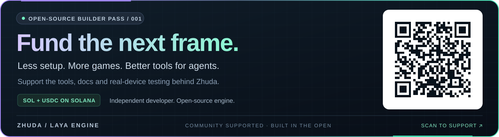
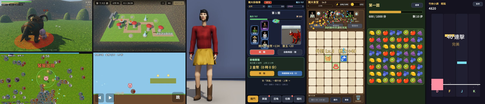

# zhuda-laya-engine

[English](../../README.md) · 简体中文

**基于 LayaAir 3.4.2，为 AI 编程代理打造的游戏 SDK 与工具链。** 使用 TypeScript、CLI 和编程代理开发 2D、3D 与 Spine 4.2 游戏。这个分支在上游引擎基础上增加模块依赖排序、组件注册、公开 SDK 类型、视觉移植检查和 MCP 服务；已提供的工作流可以脱离 LayaAir IDE 执行。
在这个引擎上做每一种东西的做法都写成一份**路线**；写出这些路线的游戏就放在本仓库里，随引擎一起重建、一起测试。

[](https://github.com/layabox/LayaAir) [](../../LICENSE) [](../../package.json)

<a href="#支持这个引擎"></a>

## 开始一个游戏

需要 Node.js 24 或更新版本。游戏放在自己的仓库里，把引擎固定在某个提交：

```sh
git clone https://github.com/zhudaandzhuer/zhuda-laya-engine.git && cd zhuda-laya-engine && npm ci
node packages/compiler/zhuda-init.mjs /absolute/path/to/my-game
cd /absolute/path/to/my-game && npm install && npm run verify
```

脚手架会生成 `public/index.html`、`src/Main.ts`（导入公开 SDK 并调用 `ZhudaEngine.boot`）和 `verify` 脚本：构建、类型、Doctor、测试。之后以[消费项目路线](../consumer-route.md)为准。

## 找到你的路线

一份路线是 [`docs/routes/`](../routes/README.md) 里的一页，格式固定：何时用、工具、步骤与实际用过的数值、踩过的坑、引擎缺口、检查、**没有**检查的、边界。动手设计之前先读路线。

```sh
node packages/mcp-server/index.mjs --tool list_routes
node packages/mcp-server/index.mjs --tool get_route --args '{"id":"new-game-project"}'
```

| 你要做的事 | 路线 |
| --- | --- |
| 开始一个游戏或应用 | [new-game-project](../routes/new-game-project.md) |
| 让游戏可以被检查：规则有测试、机器人试玩、真实输入的录制 | [game-rules-first](../routes/game-rules-first.md) |
| 做 2D 游戏或游戏界面 | [game-2d](../routes/game-2d.md) |
| 做某一类已有做法的游戏 | [平台跳跃](../routes/platformer-2d.md) · [三消](../routes/match-three-2d.md) · [节奏](../routes/rhythm-2d.md) · [合成](../routes/merge-2d.md) · [放置抽卡](../routes/idle-gacha-2d.md) · [割草生存](../routes/survivors-2d.md) · [塔防](../routes/tower-defence-3d.md) · [狩猎动作](../routes/hunting-action-3d.md) |
| 运行时给 3D 角色换装 | [outfit-swap-3d](../routes/outfit-swap-3d.md)，身体的做法见 [humanoid-from-shapes](../routes/humanoid-from-shapes.md)，批量做不穿模的衣服和配件见 [clip-free-garments](../routes/clip-free-garments.md) |
| 让 3D 场景好看 | [good-looking-3d-scene](../routes/good-looking-3d-scene.md)、[质量路线](../quality-route.md) |
| 用数据做场景、静帧或影片 | [film-as-data](../routes/film-as-data.md) |
| 从 Blender 带进一个模型 | [model-from-dcc](../routes/model-from-dcc.md) |
| 增加或修改玩家看得到的任何东西 | [visual-content-prefab](../routes/visual-content-prefab.md) |
| 写成一个 HTML 页面 | [single-html-page](../routes/single-html-page.md) |
| 打包小游戏 | [mini-game-build](../routes/mini-game-build.md) |
| 修改引擎本身 | [`AGENTS.md`](../../AGENTS.md) |

路线正文为英文。

## 参考游戏

[](../../games/README.md)

[`games/`](../../games/README.md) 下的九款小游戏是本仓库引擎的消费项目：3D 狩猎动作、3D 塔防、3D 换装、放置抽卡、割草生存、合成、平台跳跃、三消、节奏。每一款是一份路线的实例；`npm run verify:games` 会用当前提交的引擎把它们全部构建、检查类型、跑 Doctor 和测试，所以引擎的改动弄坏了哪一款，在这里就会发现。

它们是测试用的消费项目，不是成品：规则有测试和机器人覆盖，每款都有在无头浏览器里用真实输入录制的一次运行；但没有人实际玩过，没有在手机上跑过，美术是占位用的。

## 用这个引擎做的游戏

[](https://zhudaandzhuer.itch.io/zhuda-rainy-night-murder)

**[豬大 - 雨夜殺人事件（Zhuda: Murder on a Rainy Night）](https://zhudaandzhuer.itch.io/zhuda-rainy-night-murder)** 是一款约十分钟的推理游戏，使用 zhuda-laya-engine 1.18.0 制作：雨中的等距霓虹小巷、能照出隐藏线索的手电筒、七位街坊可以询问，全程中文配音并支持三种语言。可在电脑和手机浏览器直接游玩。

**[在 itch.io 游玩 →](https://zhudaandzhuer.itch.io/zhuda-rainy-night-murder)**

游戏本身、美术、配音与发布属于独立项目，不在本仓库内。

## 引擎里有什么

- **LayaAir 3.4.2 之上的带类型 SDK**：`ZhudaEngine`、`Zhuda3D`、`ZhudaUI`、`ZhudaPrefab`，模块排序、组件注册、已知问题的防护；默认 WebGL，可选 WebGPU（[WebGPU](../webgpu.md)）。
- **用数据做场景和影片**：代理把场景写成 JSON，取回预览，渲染静帧或 MP4（[film scenes](../film-scenes.md)、[cinematics](../cinematics.md)）；[质量路线](../quality-route.md)是把 3D 场景做得有光、落地、有纵深的顺序。
- **动作游戏运行时**：分层时钟与定时器、动作帧数据、输入缓冲、模型动画控制（[combat runtime](../combat-runtime.md)、[animation control](../animation-control.md)）。
- **资产**：带租约、超时与取消的 provider，glTF、细节层次，程序化贴图、道具与合成音效（[asset loading](../asset-loading.md)、[model pipeline](../model-pipeline.md)、[procedural assets](../procedural-assets.md)）。
- **2D、界面与特效**：设计像素布局、可单独预览的预制体、瓦片地形、带种子的粒子与现成特效、唯一的音频出口（[layout](../layout-and-media.md)、[prefab workflow](../prefab-workflow.md)、[audio](../audio.md)）。
- **给代理的工具**：MCP 服务（路线、API 护栏、范例、校验器）、指出文件与行号的 Doctor、带证据关卡的消费项目构建（[agent development](../agent-development.md)、[consumer tooling](../consumer-tooling.md)）。
- **交付**：Web 构建、单 HTML 浏览器 SDK、小游戏打包、白牌品牌（[browser SDK](../browser-sdk.md)、[mini-games](../minigame-packaging.md)、[white-label](../white-label-themes.md)）。

[文档索引](../README.md)列出每一份指南并说明代码在哪里；[总览](../overview.md)是较长的介绍；[更新记录](../../CHANGELOG.md)写每个版本增加了什么。指南正文为英文；每份都写明量过什么、没量过什么。

## 开发引擎本身

```sh
npm ci                  # 安装并构建
npm run verify          # 构建、类型、声明审计、Doctor、测试
npm run verify:games    # 用当前提交的引擎验证参考游戏
npm start               # 引擎工作台 http://localhost:8890/（不是游戏脚手架）
```

修改之前先读 [`AGENTS.md`](../../AGENTS.md)：它是本仓库的约定（任务说明、证据、必须保持成立的事）。未完成的工作在 [`HANDOFF.md`](../../HANDOFF.md)。

## 仓库结构

```text
packages/core/          SDK：运行时、3D、film 场景、特效、粒子、地形、音频
packages/types/         公开类型声明，由 packages/core 生成
packages/compiler/      命令行工具：构建、初始化、Doctor、编辑器、审计
packages/mcp-server/    代理工具：路线、护栏、范例、film host
packages/ci-gate/       序列与影片导出检查
vendor/                 LayaAir 3.4.2 运行时与固定版本的第三方组件（含授权）
games/                  参考游戏：本仓库引擎的消费项目，及其工具
docs/routes/            每一类东西怎么做
docs/                   每个子系统一份指南（索引：docs/README.md）；计划与记录
examples/               可运行的小宿主（浏览器 SDK、模型检查器、影片捕获）
src/、assets/           引擎自己的工作台应用与测试资产
scripts/、tests/        浏览器检查（npm run verify:<name>）与 Node 测试
```

## 版本

**当前稳定版：[v1.17.0](https://github.com/zhudaandzhuer/zhuda-laya-engine/releases/tag/v1.17.0)** · 版本唯一来源是根目录 `package.json`；`zhuda.config.json`、lockfile 与生成的 manifest 必须保持一致。v1.1.0 等旧 tag 仅代表历史发行版，不是当前 SDK。 每个版本增加了什么见[更新记录](../../CHANGELOG.md)。

由 [豬大 Zhuda](https://github.com/zhudaandzhuer) 维护。底层渲染与物理由 [LayaAir / Layabox](https://layaair.com/) 提供。本项目是独立分支，捐助用于支持豬大在这个仓库的开发工作。

## 支持这个引擎

帮助独立开发者持续制作开源游戏工具。你的支持将用于引擎开发、文档完善，以及真实手机上的兼容性与性能测试。

**SOL / USDC · 网络：Solana** — 扫描页面顶部的二维码，或复制下面的钱包地址：

```text
E4ZEhFCYy4b5pYXJUbMC9KjRitkypyqtZvpSRerLWHCb
```

[在 Solscan 查看钱包](https://solscan.io/account/E4ZEhFCYy4b5pYXJUbMC9KjRitkypyqtZvpSRerLWHCb) · [打开独立二维码](../assets/solana-qr.png) · [赞助说明](../SUPPORT.md)

## 授权与致谢

[MIT](../../LICENSE)。LayaAir 由 [Layabox](https://github.com/layabox/LayaAir) 开发，上游网站为 [layaair.com](https://layaair.com/)。本仓库的工具链与接入工作由 [豬大 Zhuda](https://github.com/zhudaandzhuer) 维护。

如果这些工具替你省下了时间，欢迎[支持下一次构建](#支持这个引擎)。谢谢你让开源继续。
