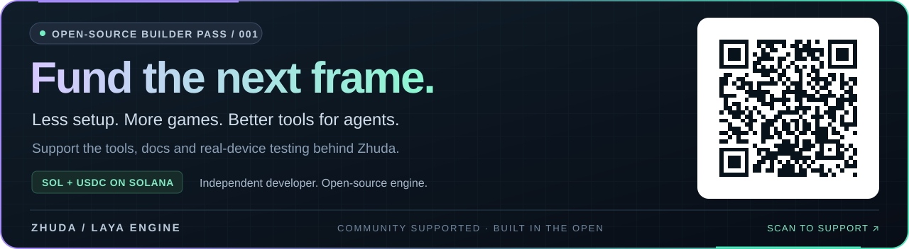

<a href="#支持这个引擎"></a>

## 支持这个引擎

帮助独立开发者持续制作开源游戏工具。你的支持将用于引擎开发、文档完善，以及真实手机上的兼容性与性能测试。

**SOL / USDC · 网络：Solana** — 扫描上方二维码，或复制下面的钱包地址：

```text
E4ZEhFCYy4b5pYXJUbMC9KjRitkypyqtZvpSRerLWHCb
```

[在 Solscan 查看钱包](https://solscan.io/account/E4ZEhFCYy4b5pYXJUbMC9KjRitkypyqtZvpSRerLWHCb) · [打开独立二维码](../assets/solana-qr.png) · [赞助说明](../SUPPORT.md)

---

# 驾车进入这片滨水港湾。

[English](../../README.md) · 简体中文

<a href="https://zhudaandzhuer.github.io/zhuda-neon-racer/harbor-film.html"><picture><source type="image/webp" srcset="https://raw.githubusercontent.com/zhudaandzhuer/zhuda-neon-racer/main/docs/media/harbor-preview.webp?v=harbor-01" /></picture></a>

### HARBOR / 01 · 使用 zhuda-laya-engine 制作

**光照、材质与动态，组成可以进入的港湾。** 驾驶 S800 探索滨水场景：实拍 PBR 表面、HDR 光照、柔和阴影、湿路反射与专门制作的码头仓库。车辆具有惯性、转向、独立车轮动画和跟随相机。

**[进入港湾驾驶 →](https://zhudaandzhuer.github.io/zhuda-neon-racer/visual.html?view=dock)** · **[观看 4K / 60 FPS 影片 →](https://zhudaandzhuer.github.io/zhuda-neon-racer/harbor-film.html)**

支持键盘和触控，以及自动、效能、平衡、高画质设置。影片使用实际 High 画质，以 **3840 × 2160 / 60 FPS** 逐帧采集；影片播放帧率不代表设备实时运行帧率。播放页另提供较轻的 1080p / 60 FPS 版本。[录制记录](https://github.com/zhudaandzhuer/zhuda-neon-racer/blob/main/docs/media/harbor-recording.json)。

---

# zhuda-laya-engine

**基于 LayaAir 3.4.2，为 AI 编程代理打造的游戏 SDK 与工具链。**

[](https://github.com/layabox/LayaAir) [](../../LICENSE) [](../../package.json)

使用 TypeScript、CLI 和编程代理开发 2D、3D 与 Spine 4.2 游戏。这个分支在上游引擎基础上增加模块依赖排序、组件注册、公开 SDK 类型、视觉移植检查和 MCP 服务；已提供的工作流可以脱离 LayaAir IDE 执行。

由 [豬大 Zhuda](https://github.com/zhudaandzhuer) 维护。底层渲染与物理由 [LayaAir / Layabox](https://layaair.com/) 提供。本项目是独立分支，捐助用于支持豬大在这个仓库的开发工作。

[进入游戏馆](https://zhudaandzhuer.github.io/zhuda-arcade/) · [体验 100 种粒子效果](https://zhudaandzhuer.github.io/zhuda-particle-lab/) · [操作 3D 地形工坊](https://zhudaandzhuer.github.io/zhuda-3d-lab/?terrain=1)

## 更多游戏

独立赛车游戏和四款小型街机游戏作为辅助案例，均包含操作、关卡、胜负与进度保存。

| 游戏 | 入口 |
| --- | --- |
| NEON APEX · 四条赛道、车库与升级 | [开跑](https://zhudaandzhuer.github.io/zhuda-neon-racer/) |
| 星港突围 STARFALL · 太空弹幕 | [开始](https://zhudaandzhuer.github.io/zhuda-arcade/?game=starfall) |
| 烬火远征 EMBERBOUND · 竞技场生存 | [开始](https://zhudaandzhuer.github.io/zhuda-arcade/?game=ember) |
| 晶核守卫 COREKEEP · 塔防 | [开始](https://zhudaandzhuer.github.io/zhuda-arcade/?game=corekeep) |
| 潮汐碎光 TIDEBREAK · 弹球破礁 | [开始](https://zhudaandzhuer.github.io/zhuda-arcade/?game=tidebreak) |

游戏规则、美术、媒体与发布保存在独立的 [Neon Apex](https://github.com/zhudaandzhuer/zhuda-neon-racer) 和 [Arcade](https://github.com/zhudaandzhuer/zhuda-arcade) 仓库。[赛车验收](https://github.com/zhudaandzhuer/zhuda-neon-racer/blob/main/docs/browser-verification.json) 覆盖实时完赛、存档、触控与场景资源释放。

## 探索引擎能力

### 100 种粒子效果

[](https://zhudaandzhuer.github.io/zhuda-particle-lab/showcase.html)

91 种 2D 与 9 种真实 3D 效果，覆盖车身包覆气流、魔法、爆破、天气、水体与界面反馈。

[体验全部效果](https://zhudaandzhuer.github.io/zhuda-particle-lab/) · [观看 60 FPS 影片](https://zhudaandzhuer.github.io/zhuda-particle-lab/showcase.html) · [验证记录](https://github.com/zhudaandzhuer/zhuda-particle-lab/blob/main/VERIFICATION-100.md)

### 地形与 Shader

[](https://zhudaandzhuer.github.io/zhuda-3d-lab/?terrain=1)

可编辑的 2D tile 地图与 3D 高度场，支持分块载卸、LOD 1/2/4、封闭侧壁/底面及相机 boom 避障射线。检视器提供明确的地下观察模式。PBR、贴图、雾、溶解、2D tint/atlas 均通过实际 WebGL draw 检查，天空材质可以单独关闭场景雾。

[打开地形 / Shader 工坊](https://zhudaandzhuer.github.io/zhuda-3d-lab/?terrain=1) · [API 用法](../terrain-shader.md) · [验收范围](../3d-acceptance.md)

## 分支增加了什么

| 领域 | 公开工具与行为 |
| --- | --- |
| 模块载入 | `TopologyResolver` 为 29 个运行时模块进行依赖排序并按需选取功能；2D light 配置的库体积减少约 83%。 |
| CLI 构建 | `zhuda-laya-build` 结合 esbuild 与 TypeScript AST，生成 Web 产物和 ESM/CJS SDK。 |
| 组件注册 | `@zhudaComponent` 与 AST 扫描器在预制体反序列化前注册组件。 |
| 运行时防护 | `EngineGuard` 处理已知的 3.4.2 接入问题，包括 `Graphics.setState` / `Button` 错误。 |
| 类型化构建 | `ZhudaEngine`、`Zhuda3D`、`ZhudaUI`、`ZhudaPrefab` 提供代码式构建；公开类型排除 IDE 专用声明。 |
| Agent 接入 | MCP 服务提供 API 护栏、模块依赖、范例、诊断与资产/粒子验证。 |
| 视觉移植 | 资产审计核对 Spine 4.2 呈现数据，Unity 动画和材质包装必须有明确映射。 |
| 视觉状态契约 | `SpineVisualContract` 拒绝缺少呈现数据的替代物；`VisualFocusContract` 区分聚焦、空选择与还原。 |
| 静态资产与 UI | `.lh` / `.ls` 序列化、明确 `percent:false`、像素边界/颜色对照、九宫格与安全区检查。 |
| 特效 | 定种子 2D/3D 粒子、对象池、拖尾、序列帧、碰撞事件、VFX 材质、时间轴、挂点与质量预算。 |

### 3D 地形、Shader 与接入

公开 3D SDK 补充独立消费端构建、资源 lease、PBR/自定义材质、动态网格、相机/输入/查询契约、时钟、2D tile 地图与支持分块载卸、编辑、LOD 1/2/4 的 3D 高度场。

该接入通过 81 项引擎测试与 41 项真实 WebGL 检查。Shader 验证包含图集 UV、染色、透明度、裁切、贴图/雾/溶解变体与真实编译诊断。具体用法和范围见[3D 接入文档](../3d-integration.md)、[地形/Shader 契约](../terrain-shader.md)与[验收限制](../3d-acceptance.md)。[独立消费端](https://github.com/zhudaandzhuer/zhuda-3d-lab)固定引擎 commit，并保存实机报告；小场景数据不能推导完整游戏地图与服务器性能。

### 资产来源边界

消费项目通过 `AssetProvider` 使用稳定的逻辑资产 ID。当前开发与 Web 默认使用 `DirectoryAssetProvider`，提供超时、取消、有界读取、manifest 校验和进度回报。未来可以接入 CDN 分块、ZIP 或 Rust/WASM provider，而不改动游戏规则和场景代码。详见[资产加载契约](../asset-loading.md)。

预计的引擎工作统一放在[开发计划目录](../plans/README.md)。计划在完成测量与验收门槛前都只是提案。

## 快速开始

需要 Node.js 24 或更新版本。

```sh
git clone https://github.com/zhudaandzhuer/zhuda-laya-engine.git
cd zhuda-laya-engine
npm install
npm run verify
npm start
```

打开 `http://localhost:8890/` 查看本地工作台。

```ts
import { ZhudaEngine, Zhuda3D } from 'zhuda-laya-engine';

const { rootScene } = await ZhudaEngine.boot({
  width: 1280, height: 720, features: ['core', '3d'],
});
const scene = Zhuda3D.createScene3D(rootScene);
Zhuda3D.createCamera(scene, {
  position: [0, 4, 8], rotationEuler: [-25, 0, 0],
});
Zhuda3D.createDirectionalLight(scene);
const cube = new Laya.MeshSprite3D(
  Zhuda3D.createPrimitiveMesh('box', { width: 1.5, height: 1.5, depth: 1.5 }),
);
cube.meshRenderer.sharedMaterial = Zhuda3D.createMaterial({
  albedoColor: [0.2, 0.7, 1, 1], shininess: 48,
});
scene.addChild(cube);
```

消费项目需要先载入选定的 Laya 运行时模块，再启动 SDK。使用编译器计算模块顺序，避免混用不同代际 API。SDK 开发使用本仓库；游戏消费端使用打包产物或固定 Git commit。

| 指令 | 用途 |
| --- | --- |
| `npm run build` | 生成工作台与 SDK 产物 |
| `npm run typecheck` | 检查公开/运行时类型与应用源码 |
| `npm run doctor` | 检查模块顺序、注册与已知旧 API 使用 |
| `npm test` | 执行 Node 单元与集成测试 |
| `npm run verify` | 完整构建、类型、体检与测试 |
| `npm run pack:tarball` | 在 `dist/` 生成可安装包 |

## 接入编程代理

在 MCP 客户端中加入：

```json
{
  "mcpServers": {
    "zhuda-laya-engine": {
      "command": "node",
      "args": ["/absolute/path/to/zhuda-laya-engine/packages/mcp-server/index.mjs"]
    }
  }
}
```

也能直接从终端调用：

```sh
node packages/mcp-server/index.mjs --tool resolve_topology --args '{"features":["3d","spine42"]}'
node packages/mcp-server/index.mjs --tool get_golden_example --args '{"id":"boot-declarative-3d"}'
```

先查护栏并验证数据，再生成场景。Schema 验证只检查数据契约；渲染与 shader 编译需要通过真实 WebGL draw 验收。

## 先移植资产，再接游戏规则

先盘点来源资产、确认呈现要求、进行独立验证，再连接已有的游戏规则。

```sh
node packages/compiler/visual-asset-audit.mjs \
  --source /absolute/path/to/unity/Assets/Game \
  --target /absolute/path/to/consumer/assets \
  --strict \
  --report /absolute/path/to/consumer/dist/visual-migration.json

node packages/compiler/visual-contract-audit.mjs \
  --project /absolute/path/to/consumer
```

资产审计检查 Spine 动画、皮肤、骨骼、插槽、约束、图集和贴图。未知 shader 映射会被阻挡；Unity `.anim`、`.controller`、`.mat` 包装需要明确目标契约，转换器不承诺兼容任意 Unity 程序。

`visual-presentation-manifest.json` 定义来源/目标呈现、作用域、状态、非聚焦目标及还原规则。在 `zhuda.config.json` 声明 `visualContract` 后，构建会执行这道检查。

```ts
import { VisualFocusContract } from 'zhuda-laya-engine';
VisualFocusContract.apply(targets, VisualFocusContract.focus(winningIds));
VisualFocusContract.apply(targets, VisualFocusContract.clear());
```

Unity 动画与材质的明确映射放在 `visual-migration-manifest.json`；[英文说明](../../README.md#migrate-assets-before-gameplay)附有可复制的 JSON 范例。

## 粒子与特效

`ZhudaParticleSystem` / `ZhudaParticleSystem3D` 提供固定步长模拟、定种子重播、有界对象池、本地/世界空间及按距离发射。Laya renderer 支持贴图、3D billboard、历史拖尾及沿路径逐步显现的气流。

还包含 VFX 材质、相机 pass 预算、序列帧、平面碰撞、事件链、时间轴、3D 挂点与 draw-call profiler。游戏专属特效配方、美术和规则保存在消费项目。

[粒子 API 与限制](../../packages/core/particles/README.md) · [特效 API](../../packages/core/effects/README.md)

## 仓库结构

```text
packages/core/          SDK、特效、粒子与引擎适配
packages/compiler/      CLI 构建、AST 注册与视觉审计
packages/mcp-server/    Agent 工具、API 护栏与范例
packages/types/         公开类型和上游运行时声明
packages/ci-gate/       浏览器首帧检查与报告
vendor/laya-3.4.2/      上游运行时库
assets/                 通用测试资产与预制体
src/                    引擎工作台与独立资产预览
docs/                   文档、赞助图像与语言版本
tests/                  单元、集成与公开类型检查
```

## 授权与致谢

[MIT](../../LICENSE)。LayaAir 由 [Layabox](https://github.com/layabox/LayaAir) 开发，上游网站为 [layaair.com](https://layaair.com/)。本仓库的工具链与接入工作由 [豬大 Zhuda](https://github.com/zhudaandzhuer) 维护。

如果这些工具替你省下了时间，欢迎[支持下一次构建](#支持这个引擎)。谢谢你让开源继续。
