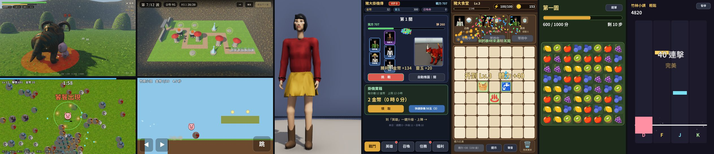

# Reference games

Nine small games built on the engine in this checkout. They exist for two reasons: each is the
worked example behind one [route](../docs/routes/README.md), and together they are a regression
test for the engine: `npm run verify:games` builds, type-checks, doctors and tests every one of
them against the engine as it is in this commit.



They are **test consumers, not finished products**. Their rules are covered by tests and by bots
that play them through; each has a recorded run with real mouse, key or pointer input in a headless
browser. None has been played by a person, run on a phone or on a GPU, or had its sound listened
to. Art is placeholder (see [ASSETS.md](ASSETS.md)).

| Game | Kind | What it exercises in the engine | Route | Tests |
| --- | --- | --- | --- | --- |
| [`zhuda-hunt`](zhuda-hunt/) 豬大狩荒 | 3D hunting action | action frame specs and state machine, input buffer, film scenes, model library and animation, time layers and timers, 3D effects | [hunting-action-3d](../docs/routes/hunting-action-3d.md) | 9 |
| [`zhuda-guard`](zhuda-guard/) 豬大守關 | 3D tower defence | film scenes, pooled glTF models, primitive meshes and materials, world-to-screen markers, profiler | [tower-defence-3d](../docs/routes/tower-defence-3d.md) | 5 |
| [`zhuda-wardrobe`](zhuda-wardrobe/) 豬大衣櫥 | 3D character dressed at run time from 32 parts cut to real measurements, with a measure that nothing comes through | `bindZhudaSkinToSkeleton`, `setZhudaTriangleMask`, model library, `setTint`, animation crossfades, film scene, profiler; parts made and measured by the kit in `tools/characters/` | [outfit-swap-3d](../docs/routes/outfit-swap-3d.md), [clip-free-garments](../docs/routes/clip-free-garments.md), [humanoid-from-shapes](../docs/routes/humanoid-from-shapes.md) | 10 |
| [`zhuda-idle`](zhuda-idle/) 豬大掛機傳 | Idle game with summons, portrait | 2D stage, vector UI, 2D effects, runtime timers, synthesised sound | [idle-gacha-2d](../docs/routes/idle-gacha-2d.md) | 9 |
| [`zhuda-swarm`](zhuda-swarm/) 豬大割草 | Survivors-like | hundreds of things drawn from one atlas in a few draw calls, world pause, profiler | [survivors-2d](../docs/routes/survivors-2d.md) | 7 |
| [`zhuda-merge`](zhuda-merge/) 豬大食堂 | Merge board, portrait | 2D pointer drags in design space, atlas drawing | [merge-2d](../docs/routes/merge-2d.md) | 6 |
| [`zhuda-jump`](zhuda-jump/) 豬大跳跳 | Tile platformer | `ZhudaTerrain2D` and its renderer, `ZhudaInputBuffer`, `ZhudaPointerInput` | [platformer-2d](../docs/routes/platformer-2d.md) | 6 |
| [`zhuda-match`](zhuda-match/) 豬大果園 | Match-three, portrait | atlas drawing, round-by-round playback, 2D effects | [match-three-2d](../docs/routes/match-three-2d.md) | 7 |
| [`zhuda-beat`](zhuda-beat/) 豬大打鼓 | Four-lane rhythm, portrait | the synth (a song mixed in the page), `IframeSoundAdapter`, timing | [rhythm-2d](../docs/routes/rhythm-2d.md) | 5 |

What all nine share is its own route: [game-rules-first](../docs/routes/game-rules-first.md).
Each game's `README.md` (what was built, what was checked, what was not, what the engine lacked)
and `AGENTS.md` are written in Traditional Chinese.

## Run them

```sh
npm ci                      # at the repository root: installs and builds the engine
npm run verify:games        # every game: build, tsc, Doctor, tests
```

One game:

```sh
cd games/zhuda-jump
npm install                 # links the engine in this checkout (file:../..) and installs TypeScript
npm run verify
npx serve dist/web          # or any static server; then open it
```

Useful addresses: `index.html?auto=1` lets the game's bot play; most games also take `?seed=`,
`?level=` and `?fresh=1`. Every page reports its state on `window.__GAME__`.

`tools/characters/` is the kit the wardrobe's body and garments are made and measured with: a
character from shapes on a skeleton, clothes that nothing comes through, in Node
([its README](tools/characters/README.md)).

## Record a run

`tools/shot.mjs` serves a built game, opens it in headless Chromium, waits for
`window.__GAME__.ready` and runs the game's own `tools/play.mjs` with real input, writing
screenshots and a log. It needs Playwright, which is not a dependency of this repository:

```sh
npm i -g playwright && npx playwright install chromium
cd games/zhuda-match
node ../tools/shot.mjs . --size 540x960 --query "fresh=1&seed=5" --script tools/play.mjs --out play-out/hands --name hands
```

On a machine with a graphics card, `--gpu` drives the browser installed there (`--channel`, default
`chrome`; `playwright-core` is enough, no browser download) and the log's `renderer` names the card;
`--headed` opens a window, `--dpr 2` sets the pixel ratio, `--root dist/webgpu` serves another build.
Pictures taken with and without `--gpu` are not comparable. A real Chrome asks for `favicon.ico`
and logs the 404 as an error, which `shot.mjs` counts as a failure: each game's page carries an
empty icon (`<link rel="icon" href="data:,">`) so that it does not ask.

```sh
# frame rate, triangles, draws and memory of a page that reports on window.__GAME__ (30 s; MEASURE_SOAK_MINUTES=30 for memory over time)
cd games && node tools/shot.mjs zhuda-wardrobe --gpu --dpr 2 --query "look=hair-bob.shirt.trousers.boots._._.pack.straw-hat" --script tools/device-measure.mjs --out /tmp/measure --name stand
```

`tools/blender/` holds scripts for Blender run without a window (`blender -b -P <script> -- …`):
`inspect-parts.py` says what Blender makes of the kit's `.glb` parts (skeleton, weights, normals,
clips, pictures, the parts exported again), `cloth-truth.py` simulates a garment as cloth on the
body and measures how far the kit's garment is from it, `model-sheet.py` draws a model's front,
side and back and gives its sizes. What they found on the wardrobe is in
[`local-results/A2`](../local-results/A2/notes.md) and [`D3`](../local-results/D3/notes.md).

## Add a game

1. Read [game-rules-first](../docs/routes/game-rules-first.md) and the genre route nearest to it.
2. `games/<name>/` with its own `package.json` (`"private": true`, the engine as `file:../..`),
   `zhuda.config.json`, `public/index.html`, `src/Main.ts`, `test/`.
3. Import the engine only through its public entry (`zhuda-laya-engine`); the Doctor checks.
4. `npm run verify` green, a recorded run in `docs/evidence/`, a row in the table above.
5. If it is a new kind of game, write its route from `docs/routes/TEMPLATE.md`.

A reference game is here to check the engine. A game made to be shipped belongs in its own
repository, pinned to an engine commit ([consumer route](../docs/consumer-route.md)).
