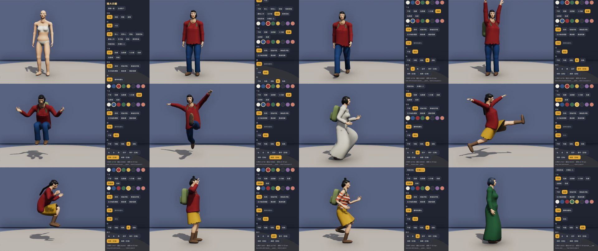
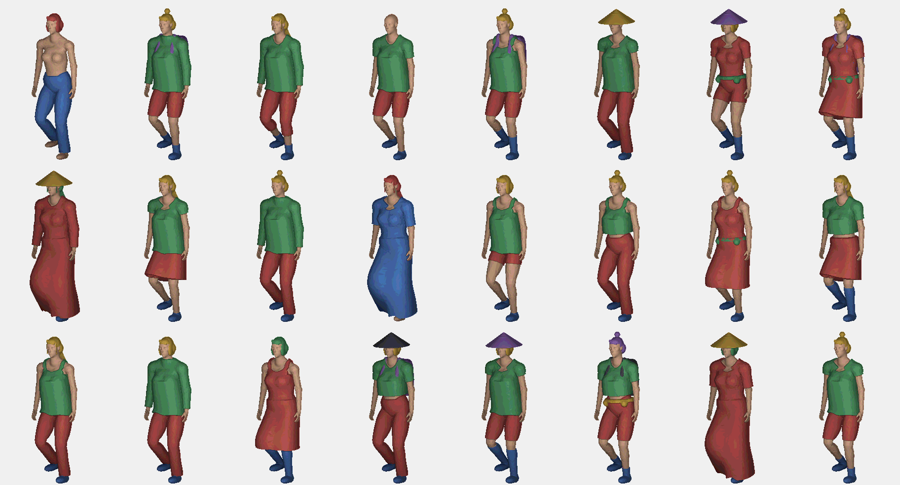

# 豬大衣櫥

原創的 3D 換裝：一個角色、32 件零件、八個部位（頭髮、帽、上衣、下身、整套、腰、背、鞋），每件可換色，換了之後照樣走、跑、招手，還能定格在舉手、深蹲、高踢三個極限姿勢。用同一個倉庫裡的 zhuda-laya-engine 做。它驗兩件事：

1. 衣服做成獨立的模型，執行時穿到同一副骨架上（`bindZhudaSkinToSkeleton`）。
2. **衣服可以用幾個數字量產，而且不穿模**：31 件工具包做的零件，在 153 個姿勢裡沒有一件讓身體穿出來（容許 1 mm）；被蓋住的皮膚和內層布料根本不畫（`setZhudaTriangleMask`）。
3. **身材和版型是照真實的尺寸做的，不是憑感覺**：身體的 13 個圍度都在真人尺碼表的 6% 以內，衣服拿同一把尺量、和真的成衣規格比（`npm run measure`），哪幾項對不上也列出來。

```
npm run verify            # 建置、型別、體檢、11 個測試
npm run parts             # 重新產生並量測 assets/parts/*.glb、wardrobe.json、masks.json（約兩分鐘）
npm run look              # 從 26 個方向看每一件和 24 套搭配（約九分鐘）
npm run measure           # 拿尺量身體和衣服，和真實的尺寸比（docs/evidence/measure-report.json）
index.html?look=hair-bob.shirt.trousers.boots._.belt-pouch~shirt:2,trousers:1
index.html?auto=1&spin=1  # 每兩秒換一套、慢慢轉
```

操作：右邊（直式在下面）點部位和顏色；在畫面上左右拖可以轉動角色；下面的鈕換動作，「定格」三個鈕停在極限姿勢上。虛線的鈕代表和身上某件不能同穿，點了會把那一件換掉；帶 ⚠ 的是量測沒過的外來零件。



## 一件衣服怎麼做

目錄在 `tools/catalogue.mjs`，一件一行，例如短袖是「從肩頸點往下 64 公分、短袖、圓領」，長裙是「從腰往下 90 公分、下襬外擴 7.3 公分」。長度和寬度來自真的成衣規格（`tools/reference.mjs`），位置從身體本身讀出來（哪裡是胸、腰、臀，各往外多遠），沒有手填的座標。`games/tools/characters/garment.mjs` 把它變成模型：

- **布是身體表面往外移一個厚度**，只留在指定的範圍裡（軀幹一段、手臂腿各一個圓柱範圍、袖口下襬用平面切齊）。厚度決定誰在外面：鞋 6 mm、下身 11、上衣 17、整套 22、腰帶 27。
- **每個布的頂點用它正下方皮膚的權重**，所以布和皮膚在任何姿勢、任何動畫下都一起動，衣服不需要自己的骨頭。
- **鬆的布是另外加的體積**（裙子的鐘形、腰包）：它用「身體在那個位置會有的權重」，比較柔，只跟指定的關節（裙子跟臀和腿，不跟垂在旁邊的手），離開身體的 3 公分內從皮膚的權重漸漸過渡。大腿前面那半邊裙子就跟著那條大腿走。鬆的布做成兩面。
- **每個開口都封起來**：袖口是一圈伸進手臂 5 mm 的面，裙底是從裙襬連到腿的面。沒有人能看進袖子或裙子裡，衣服加上裡面的身體是一個封閉的實體。
- **蓋住的不畫**：做衣服的工具知道布底下是什麼，把「三個角都在布面下 3 mm、離邊 8 mm 以上」的身體三角形和內層布料三角形記成遮罩（`assets/masks.json`，一個三角形一個位元）。執行時把身上各件的遮罩合起來交給引擎。

## 和真實的比對

上一版的身材和衣服是我自己想的，量了才知道差多少：胸圍只有真人的 76%、脖子 68%、大腿中段 67%；T 恤像潛水衣一樣貼著腰、只到腰；褲管貼著小腿收到腳踝；短裙只有 26 公分長；斗笠是一個圓盤加半球。這一版先查資料、看真的照片，再改。

**查了什麼**（來源和數字都在 `tools/reference.mjs`，照片沒有放進庫裡）：

- 身體：ASTM D5585 女裝尺碼表 8 號（胸 88.9、腰 68.6、臀 95.3、頸 34.9、上臂 27.3、大腿 55.2、膝 35.9、小腿 34.6、腳踝 23.2 公分，肩斜 23 度），腳長用 ANSUR II 的比例。
- T 恤：MUJI、QVC、Macquarie 的成衣規格（胸圍鬆份、衣長、袖長、袖口、前後領深）。牛仔褲：QVC（內長、膝圍、褲口、前襠）。裙子：Lands' End 等（裙長、下襬圍）。斗笠：博物館藏品和賣家標的尺寸。背包：五家 20 公升背包的長寬厚。
- 照片：維基共享資源上穿 T 恤的人、1952 年穿牛仔褲和襯衫的人、穿上衣和裙子的人台。看到的是：T 恤從胸和肩胛直直垂到臀、不貼腰；袖子是到上臂中間的寬筒；褲管是直筒、不跟著小腿收；肩膀是斜的。

**量出來的**（`npm run measure`，同一把「皮尺」量身體和衣服：切一個平面、量外圍一圈）：

| | 真實 | 現在 | 上一版 |
| --- | --- | --- | --- |
| 胸圍 | 88.9 | 87.3 | 67.7 |
| 腰圍 | 68.6 | 69.3 | 58.1 |
| 臀圍 | 95.3 | 92.5 | 79.2 |
| 頸圍 | 34.9 | 35.8 | 23.8 |
| 大腿中段 | 50.2 | 52.2 | 33.5 |
| 小腿 | 34.6 | 34.5 | 26.9 |
| 肩斜 | 23° | 25° | 約 6° |
| 腳長 | 25.4 | 25.1 | 約 20 |

衣服 22 項裡 19 項在真實成衣的範圍內：T 恤胸圍鬆份 14.8（真實 5–24）、衣長 65.4（62–69.5）、前領深 10.4（9.5–13.7）、後領深 4.5（3–5）、袖長 15.8（14.6–21）、袖口 35（33–46）；長褲內長 69.5（68.5–81）、膝圍 41.7（34–44）、褲口 39.4（32–48）；裙長 48.2 和 90.1、下襬圍 123 和 149.5；斗笠 42 × 15.5；背包 42 × 26 × 18.3。

**對不上的三項**（測試把這三項寫死，變了就會失敗）：

- T 恤下襬圍是胸圍的 1.14 倍（真實 0.9–1.05）。真的 T 恤是一個筒，在胸下會往身體收，才繞得過臀。照這樣收的版本，底下穿裙子深蹲時裙子會穿出來，所以留著直直垂下的版本。
- 兩件裙子的臀圍鬆份 13.3（真實 4–10）。布畫成 11 mm 厚，再加上裙子用的是方一點的橢圓、不是身體真正的輪廓。

**為了像真的而加進工具包的**：鬆的布現在可以是「從胸垂下來的筒」（上衣）和「膝蓋以下的直筒」（褲管）；領口照規格的寬度和前後領深切；硬的東西（斗笠的圓錐、背包的方盒）是有稜角的實體，不是軟的球。

**試過但拿掉的**：真實長度的迷你裙（43 公分）和長版上衣（69 公分以上）在極限姿勢的劈腿踢裡過不了畫面量測，所以不在目錄裡。連身褲和連身短褲改用和長褲一樣薄的布才過。

## 怎麼知道沒穿模

兩種量法，都不開瀏覽器，在 Node 裡照引擎的方式算蒙皮：

| 量法 | 做法 | 結果 |
| --- | --- | --- |
| **表面**（`npm run parts`，`docs/evidence/clip-report.json`） | 站姿時在布底下、而且還會被畫出來的每個頂點，在每個姿勢都要還在布底下；同時超過「原本蓋住它的那片布」和「當下最近的布」1 mm 才算穿出，開口邊不算。153 個姿勢：站、走、跑、招手，加上遊戲動作到不了的極限姿勢（雙手高舉加轉身、深蹲、高踢）。 | 31 件工具包零件，3,189 個頂點，**0 個穿出**。91 組會重疊的搭配只有 1 組不過（高領配長髮，2.5 mm），清單把它排開；另外 8 組是目錄依版型排開的（垂過腰帶的上衣配腰包、髮髻配斗笠、長髮配背包）。17 件有鬆布的，站姿時身體沒有一個頂點站在布外面；斗笠和背包在站姿沒有東西穿過。 |
| **畫面**（`npm run look`，`docs/evidence/look-report.json`） | 整套穿好擺好姿勢，從 26 個方向用深度緩衝畫出來，數兩種像素：最近的面是背面（看穿了，是洞）；最近的面是「應該被外層蓋住」的皮膚或內層布料。 | 32 件各自單穿加 24 套搭配，各 1,066 個視角。工具包的：最糟的一個視角看穿 0.89 cm²、露出 0.78 cm²；上限 1 cm²。 |



**對照組**：`tools/foreign-part.py` 是一支和工具包不共用程式的腳本，用最直覺的做法做一件針織衫（把身體表面往外推 16 mm、權重照抄、邊不封口）。同樣量：21 個頂點穿出、最深 8.5 mm，開口處看穿 150 cm²。它照樣列在清單裡，標成沒過，畫面上帶 ⚠。

瀏覽器裡（無頭 Chromium、真的點擊，`tools/play.mjs`）另外確認：引擎實際藏掉的三角形就是遮罩指定的那些（從載入後的十個網格讀回來、和檔案比對邊長總和）。

## 沒查的

- **「像不像真的」只比了尺寸和輪廓，沒有人看過。** 圖是我自己拿軟體繪製的結果和查到的照片比的。衣服還是很素：沒有皺褶、車縫、扣子、口袋、貼圖。只有 T 恤、長褲、兩件裙子、斗笠、背包拿規格比過；其他件用同樣的版型，沒有各自的規格。
- 代價：垂下來的布有正反兩面，長袖加長褲加靴子比光著的身體多畫約 3,200 個三角形（上一版貼身的布不到 2,000）。
- 走路時下襬底下會垂出幾個三角形的「牙齒」：那是把下襬封起來的那一面，它的內緣貼在腿上、跟著腿往下，外緣跟著臀。還沒解決（做法寫在根目錄 `HANDOFF.md`）。肩帶和袖口也看得到布的厚度形成的一圈邊。
- 衣服是單一顏色，沒有滾邊：之前領口、袖口、下襬的深色邊是畫在頂點顏色上的，會沿著三角形變成鋸齒，還會在臀部出現深色斑塊（真顯卡上看到的，`local-results/B1`），已經拿掉。車縫、羅紋要等貼圖。
- 長髮離背太遠（像一條硬的馬尾）：靠近一點就會和整套的衣服互穿。
- 背包的背帶只做到胸口，沒有繞過腋下接回包底。
- 沒有實機、沒有 GPU：畫面是軟體繪製，量測用的是自己寫的光柵器。
- 只量了這個身體的五段動作。別的動畫如果彎得比極限姿勢還多，就超出量過的範圍；要用之前把它的姿勢加進去量。
- 量法本身是我自己寫的，對照的只有我自己看過的圖。
- 沒有用過建模軟體真的匯出的衣服：這個環境沒有 Blender。
- 腋下、膝蓋後面這種摺起來的地方，布會跟皮膚一樣自己疊進去；有記數（`foldedCm2`），沒有判定。
- 硬的東西（斗笠、背包）只在站姿量：頭和頭髮不能穿出圓錐、同穿的衣服不能在盒子裡。動起來沒量。髮髻和斗笠、長髮和背包列為不能同穿。
- 一次只有一個角色、一種身材。

## 過程中踩到的

1. **引擎載入後的三角形順序和檔案相反**：LayaAir 3.4.2 讀 glTF 的每個 primitive 是從最後一個索引讀起。第一次錄影時自己的檢查就失敗了——如果沒查，遮罩會藏錯三角形而且不報錯。現在 `setZhudaTriangleMask` 會換算，錄影會把藏掉的三角形讀回來比對。
2. **袖孔用一個平面切，把整個下半身軀幹也切掉了**：上衣變成圍兜，而所有量測都過。是看圖才發現的，所以流程裡有「先看一張總表」。
3. 化簡後的身體比原本的形狀往內縮最多 4 mm，袖口停在原本的表面就會有一圈縫；所以開口的面要伸進皮膚。
4. 化簡不加 `Regularize`，四肢會剩下 20 公分長的三角形：袖口切在它中間就藏不掉，彎起來也難看。
5. 只照頭動的頭髮，頭轉 35 度脖子就穿出 5.7 mm；貼著皮膚的頭髮現在跟皮膚走。
6. 硬的腰包跨在髖關節上，深蹲一定穿（11 mm）；改成軟的體積後和每一件都過。
7. 裙子原本是掛在自己骨頭上的六片布，動畫要另外驅動、片與片之間有縫；改成跟著腿走的鐘形後不需要額外的骨頭。

## 對引擎的發現

1. 沒有把零件綁到另一個模型骨架上的方法 → `bindZhudaSkinToSkeleton`。
2. 沒有「這個網格的一部分不要畫」的方法 → `setZhudaTriangleMask`（`docs/animation-control.md`）。被遮罩的網格是自己的一份拷貝。
3. 直接設 `material.albedoColor` 對 glTF 材質沒有作用也不報錯；要用 `ModelInstance.setTint`（線性值）。
4. 身體每一區、每件零件都是一次繪製（每個 pass 各一次），一個角色連陰影 65 次。沒有把目前顯示的部分合成一個網格的工具。
5. 做衣服和量測的工具在 `games/tools/characters/`，是這個專案的工具，不是引擎的 API，而且只適用於用同一套形狀做出來的身體。

做法寫成路線：`docs/routes/clip-free-garments.md`（怎麼做、怎麼量）、`docs/routes/outfit-swap-3d.md`（執行時怎麼穿）。
