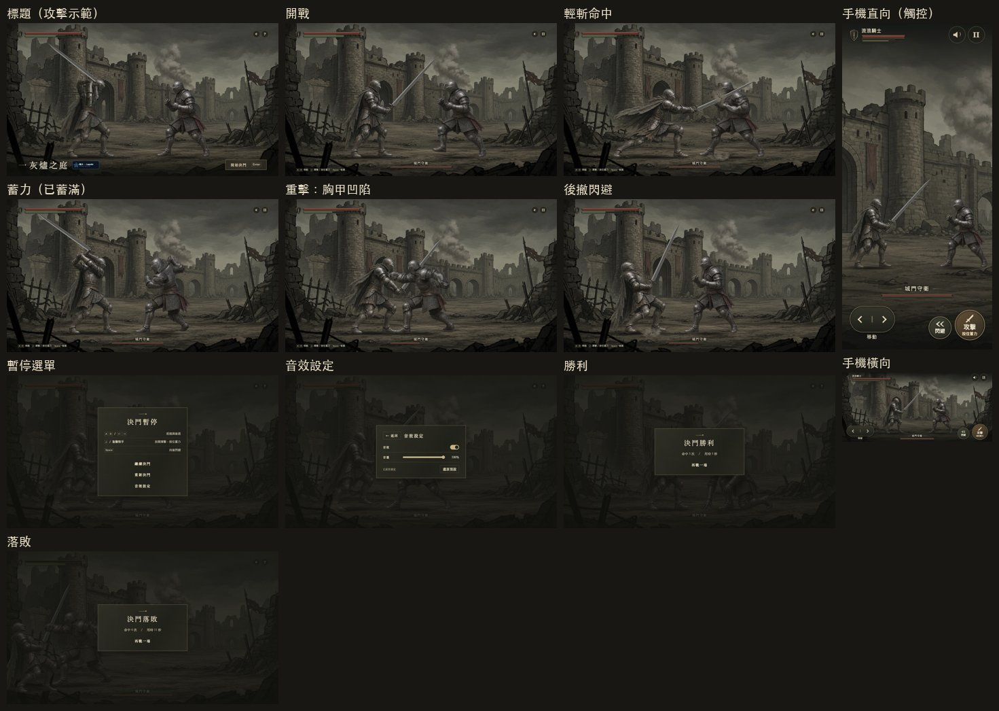

# 2d/ashfall-duel：灰燼之庭（寫實側視單人決鬥）

城門廢墟裡，流浪騎士對城門守衛的一對一決鬥。角色是 AI 生成的八張寫實關鍵姿勢圖集，加上離線烘好的中間幀（騎士 69 張、守衛 61 張）；
劍身與胸甲的局部變形在遊玩時即時計算。`startAshfallDuel()` 一次把整個遊戲跑起來：標題攻擊示範、決鬥、鍵盤、滑鼠蓄力、雙拇指觸控、暫停選單、音效設定、勝敗結算。

拆自 `games/ashfall-duel`（《灰燼之庭》，原作者 CCW；git 6 個提交，HEAD `eb19b87`），2026-11-25。
數值、順序、每一步的算法都沒改：同一組輸入下，原版和這個模組的決鬥狀態 240,000 步逐欄相同；觀看台 `?scene=ashfall-duel` 和原遊戲 18 個畫面（桌機 12、手機直向 6）逐像素相同（見「驗證」）。
通用的「關鍵姿勢＋中間幀」動作系統另外拆成 [`2d/cel-motion`](../cel-motion/README.md)，任何側視角色都能用。



| 檔案 | 內容 |
|---|---|
| `ashfall-duel.ts` | `startAshfallDuel(container, options)`：開引擎（WebGL、1280×720 設計尺寸、`full` 縮放、DPR 上限 2、60 fps）、載入場景 Prefab 與四個音效、120 Hz 固定模擬（`ZhudaSimulationClock(1/120, 16)`，跑在 runtime 的 `duel` 時間層）、每個戰鬥事件出灰塵和聲音、每幀畫面與介面。和原遊戲 `src/Main.ts` 同一個順序 |
| `combat.ts` | `Duel`：模式（title／duel／paused／victory／defeat）、守衛 AI（逼近、蓄勢、拳甲衝擊、受擊後退）、輕斬／蓄力重斬／後撤（引擎 `ZhudaActionStateMachine` 的影格資料）、輸入緩衝（`ZhudaInputBuffer`，0.32 秒、2 筆）、體力、傷害、命中停頓、凹陷彈簧、劍刃接觸。`step(dt)`、`view`、`events` |
| `motion.ts` | 舞台常數、騎士與守衛八張關鍵姿勢（圖集框、腳底原點、十個關節釘）、動作時間表、守衛胸甲表面、劍：形狀、沿畫出的刃（24 段）與盔甲橢圓的交點、懸臂彎曲彈簧。沒有引擎，可在 node 測 |
| `motion-cels.ts` | 烘好的中間幀索引（每頁圖集、每段 `a-b` 的 `[頁, x, y, 寬, 高, 錨點x, 錨點y]`、烘焙比例 0.78）。原本是 `src/motion-cels.json`，資料逐字相同 |
| `render.ts` | `Battlefield`：兩個角色（`CelSprite`，守衛帶凹陷）、劍（24 段三角帶＋護手）、接地陰影、灰塵與碎甲片（固定種子、最多 330 顆）、雙人取景（直向畫面拉近兩人，背景用較慢的視差鋪滿）、螢幕座標轉世界座標 |
| `prefabs.ts` | 場景 Prefab `ashfall.courtyard`（`impact`：全部；`empty`：只有城門）、`createAssetProvider(baseUrl)`、`ASHFALL_ASSETS`。引擎的 Prefab 預覽與比對也讀這個檔 |
| `interface.ts` | `Controls`：鍵盤、滑鼠、觸控、選單、音效設定、血條。用 `input/hold-input`、`ui/game-menu`、`ui/settings-form`、`ui/dom`、`systems/storage` |
| `court-page.ts` | 原遊戲 `<main id="theatre">` 的介面節點（逐字，只有聯名標誌的網址是參數）、`COURT_STYLES`（三張樣式表的順序）、`mountCourtPage()` |
| `court.css` | 金屬血條、選單、比例縮放、直橫向觸控版面（原 `public/court.css`） |
| `assets/` | `courtyard.lh`（Laya 場景分層與錨點）、`art/`（城門 `courtyard.webp`、騎士 `knight.webp` 1536×1024、守衛 `warden.webp` 1774×887、`matter.png` 鋼刃／粉塵／陰影材質、四頁中間幀 `*-motion-*.webp`）、`sound/`（揮劍、撞甲、踏地、後撤）、`branding/zhuda-layaair-mark.svg`（引擎套件裡的「豬大 × LayaAir」聯名標誌，同一個檔） |
| `source/` | 不會 sync：完整 git 歷史、上一版公開發行包、美術提示詞、烘焙腳本、觸控腳本、比對基準、上架紀錄、等價證明工具（見下） |
| `preview/` | 不會 sync：10 個桌機畫面、手機直向與橫向、`sheet.jpg` |

## 用法

```bash
cd <repository root>
node prefabs/scripts/sync.mjs games/<遊戲> 2d/ashfall-duel
# 依賴會一起帶進去：2d/cel-motion、input/hold-input、ui/dom、ui/game-menu、ui/settings-form、systems/storage
```

`src/Main.ts`（整個遊戲兩行；2026-11-25 用這個檔建了一個只靠函式庫的新專案，建置、型別、體檢都過，Prefab 比對見「驗證」）：

```ts
import { mountCourtPage } from "./common/2d/ashfall-duel/court-page.ts";
import { startAshfallDuel } from "./common/2d/ashfall-duel/ashfall-duel.ts";

// 不要用頂層 await：引擎把入口打包成 ES2020 腳本，建置會失敗。
mountCourtPage({ replace: document.querySelector("#game")! })
  .then((host) => startAshfallDuel(host))
  .catch((error) => console.error(error));
```

`public/index.html` 只要有 `<main id="game"></main>` 和引擎的 `<!-- ZHUDA_LIBS -->`、`<!-- ZHUDA_ENTRY -->` 兩個標記；`mountCourtPage()` 會依序連上
`common/ui/game-menu/game-menu.css`、`common/ui/settings-form/settings-form.css`、`common/2d/ashfall-duel/court.css`，等它們套用後把 `<main id="game">` 換成原遊戲的 `<main id="theatre">`。
也可以把 `courtMarkup()` 的內容直接貼進 `index.html`、在 `<head>` 放三個 `<link>`（順序同上）——保留空白，行內元素的版面靠它。

`zhuda.config.json`：`"features": ["core", "2d", "ui"]`（WebGL）、`"branding": { "mode": "engine" }`（保留引擎的 LayaAir 開場；標題畫面另外顯示聯名標誌）、`"viewport": { "width": 1280, "height": 720, "scaleMode": "full" }`。
要 Prefab 預覽與比對：`"prefabPreview": "src/prefabs.ts"`，`src/prefabs.ts` 一行 `export { definitions, createAssetProvider } from "./common/2d/ashfall-duel/prefabs.ts";`，
`prefabChecks` 照 `source/proof/library-game/zhuda.config.json`（三項：全景容許 1000 像素、騎士 0、守衛 0 並連續載入卸載 30 次），基準圖在 `source/references/`。完整的新專案範本就是 `source/proof/library-game/`。

### 選項與可以叫的

- `startAshfallDuel(container, { assets?, signal?, onFrame? })`：`assets` 是這個模組 `assets/` 的網址（預設 `./common/2d/ashfall-duel/assets/`）；`signal` 中止就全部釋放（`pagehide` 也會）；`onFrame` 每幀最後呼叫。載入失敗時頁面顯示「城門載入失敗。」和重新載入鍵，promise 失敗。
- 傳回的 `AshfallDuel`：`game`（`Duel`）、`picture`（`Battlefield`）、`controls`（`Controls`）、`audio`、`arena`（Prefab 實例）、`context`、`viewport`、`frozen`（true 時模擬停住、畫面不動）、`simulate(秒)`（一次跑完 1/120 秒的步數，含灰塵與聲音，再畫一次）、`draw()`、`dispose()`。
- `Duel`：`press(point?)`／`release(point?)`（按住蓄力、放開出劍；`point` 是世界座標，點在守衛身上就決定打頭盔、胸甲或腰甲）、`evade()`、`direction`（-1／0／1）、`pause()`、`reset()`、`cancelCharge()`、`step(dt)`；讀 `mode`、`heroHp`、`foeHp`、`stamina`、`charge`、`hits`、`elapsed`、`view`（兩人位置與姿勢、劍、凹陷）、`events`（`impact`、`hurt`、`step`、`swing`、`evade`，帶位置與強度）。
- `Controls`：`start()`（開始決鬥）、`toggleMenu()`（Esc）、`openSound()`、`update()`、`play(event)`。音效設定存在 localStorage 的 `ashfall-duel.sound`（`SOUND_KEY`）。
- 觀看台的 `viewer2d/src/presets/ashfall-duel.ts` 就是一個完整的使用範例（加上跳到某個時刻的 `?view=`）。

### 操作（原遊戲 README）

`Enter` 或「開始決鬥」進場；`A`／`D` 或左右鍵移動；`J` 或點守衛放開揮擊，點頭盔、胸甲、腰甲改變攻擊高度；按住 `J` 或滑鼠左鍵約 0.75 秒蓄滿再放開是重斬；`Space` 後撤；`Esc`、`M` 暫停、切換音效。
手機：左拇指按住移動盤，滑過中央換向；右拇指輕點「攻擊」快斬、長按到「已蓄滿」放開重斬，「閃避」後撤；也能直接點守衛選高度。

## 數值（程式裡的，驗證過）

- 模擬：固定 1/120 秒，一幀最多追 16 步；引擎 runtime 一幀最多給 0.1 秒。
- 動作影格（60 fps）：輕斬 30 格（7–19 有效），蓄力斬 48 格（13–32），守衛拳甲 72 格（39–49），後撤 30 格（3–20）。收招最後 30% 可預先輸入下一斬，有效段結束前一格起可接後撤。
- 按住 ≥ 0.34 秒放開是蓄力斬；力道 `(蓄力 − 0.17) / 0.58`，0.75 秒蓄滿。傷害 `16 + 20 × 力道`（輕斬 16、滿蓄 36）；體力消耗 `14 + 15 × 力道`，後撤 19，收招後每秒回 29。守衛一拳 24。
- 命中停頓 `0.043 + 0.052 × 力道` 秒；凹陷 `8 + 12 × 力道` 像素，彈簧 −560x − 15v；劍長 306、24 段、彎曲上限 ±35、加速度造成的負載 ±13。
- 開場距離輕斬從放手到第一次接觸 241.7 ms（原作者在 120 Hz 量的，測試保證 ≤ 0.25 秒）；不動的話約 11 秒落敗。

## 驗證（2026-11-25，Apple M4、macOS Chrome 158、引擎 1.18.0 `def94aa`）

- **原遊戲照樣能建**：工作區的原專案複本（只把 `node_modules` 指向同一份引擎）`npm run verify` 全過；重建的 `dist/game.zip` 和上架紀錄（`source/release-records/public-release-20261125.json`）記的公開站現行發行包 SHA-256 相同（`ea5c7135…49cd`，建置指紋 `32ab17ed…`），所以從 bundle 能逐位元組重做現在上線的那版。
- **戰鬥規則**：原遊戲的 15 項測試搬到 `tests/ashfall-duel.test.mjs`，對這個模組全過。另外 `source/proof/same-duel.mjs` 用 40 組固定種子的亂數輸入（移動、按住、放開、點不同高度、後撤、暫停、重開）同時推原版與模組的 `Duel`，每 1/120 秒比對全部狀態：240,000 步 0 處不同（涵蓋 674 次命中、96 次滿蓄重擊、12 次勝利、8 次落敗、64 次被打中）。
- **畫面逐像素**：`prefabs/tools/detplay.mjs`（虛擬時鐘）在原遊戲與觀看台跑同一份情境（`source/proof/*.json`，輸入是 DOM 事件，兩邊同一套；`run-all.sh` 一次跑完），`pixdiff.py`／`variants.py` 比 18 個時刻：桌機 1280×720 的標題、開戰、輕斬命中、蓄力、重擊（胸甲凹陷）、後撤、走路、暫停選單、音效設定、繼續、勝利、落敗，以及直向 390×844 的標題、開戰、命中、蓄力、重擊、暫停。三輪（第一輪用舊版 detplay，後兩輪用 `Date.now()` 取整數的版本）合計：原遊戲桌機 11 次、觀看台 11 次、只靠函式庫的新專案（`source/proof/library-game/`）2 次；直向兩邊各 4 次、勝利各 6 次、落敗各 4 次。**每一張觀看台截圖都和某一次原遊戲截圖 0 像素差**；每張截圖時的場景格數與頁面狀態（`states.py`：模式、生命、體力、守衛生命、選單、結算文字、按鍵狀態）每一次都相同，`rendererErrors`、`pageErrors` 都是空的。原遊戲自己偶爾畫出另一種血條：11 次裡 3 次在蓄力、重擊、後撤、走路 4 張差 121–2,083 個像素，全部在三根 HTML 血條（`.meter i`，`transform: scaleX()`；生命 y 42–54、體力 57–65、守衛 668–690）裡、每點 1/255，遊戲畫布 0 差；觀看台 11 次裡有 1 次也畫出其中一種（和那次原遊戲逐位元組相同），新專案 2 次都是多數那種。
- **Prefab 比對**（對著函式庫版重跑 `zhuda-laya-accept`）：全景 338 像素（容許 1000；和原遊戲在 Mac 的紀錄相同）、騎士 0、守衛 0（連續卸載載入 30 次）；三張實際截圖的 SHA-256 和原遊戲 `evidence/` 裡的逐位元組相同。
- **觸控與鍵鼠**：原遊戲的 `source/tools/check-controls.mjs`（Playwright 1.61.1 的 playwright-core＋系統 Chrome）對觀看台 `?scene=ashfall-duel` 12 項全過；直向、橫向各按鍵的位置大小和原遊戲在 Mac 的紀錄完全相同。同一天對原遊戲重跑也是 12 項全過。
- **烘焙腳本**：`bake-audio.mjs` 重做的四個 WAV 和 `assets/sound/` 逐位元組相同。`bake-transitions.py` 在這台 Mac（OpenCV 5.0.0、NumPy 2.0.2、Pillow 11.3.0）跑得完（約 5 秒），但結果和出貨的中間幀不同（130 張裡 113 張的裁切框不同、頁面打包不同），見「已知限制」。
- **預覽**：`preview/` 的桌機圖就是上面比對用的觀看台截圖；手機直向、橫向是觸控腳本拍的。都看過。

## 已知限制

- 沒有上過手機實機：手機只用 Chrome 的觸控模擬（直向 390×844、橫向 844×390）。
- 介面只有繁體中文，沒有接 `systems/i18n`。要上國際平台得先補。
- 聲音只驗證能載入、能播、沒有錯誤；沒有人耳聽過音量平衡。
- 一頁一場：介面靠固定的 id（`#theatre`、`#game`、`#hp`…），同一頁不能開兩場。
- 中間幀不能在這台 Mac 重現：`source/tools/bake-transitions.py` 的結果取決於 OpenCV 版本與輸入（它讀的 `knight.webp`、`warden.webp` 是有損 WebP；腳本註解說原作者用的是原始的無損透明圖，那些圖沒有留下來，原作者的 OpenCV 版本也沒記錄）。要重烘就連 `motion-cels.ts` 與四頁圖一起換、逐段看過，再重拍 `preview/` 並重做 Prefab 比對基準。騎士 3→4（高舉→起揮）前幾張中間幀有手臂重影，原本就這樣（每張只顯示約一格）。
- 角色、守衛 AI、介面文字都是這個遊戲自己的內容；要換角色請用 `2d/cel-motion`，別改這個模組。

## source/（不會 sync）

| 路徑 | 內容 |
|---|---|
| `ashfall-duel.bundle` | 原專案的完整 git 歷史。**不在公開倉庫裡**（提交紀錄帶著作者的信箱），由擁有者保存；下面用到它的指令要有那個檔才能跑 |
| `public-release-251a602/` | 上一版公開發行包 `game.zip`（SHA-256 `8be96d17…c4f7`，3,006,811 位元組）＋`release-notes.md`＋`consumer-build.json`。**把這個 zip 上架會讓公開站退回 251a602 那版**（見該資料夾的 README） |
| `ART.md` | 城門、騎士八幀、守衛八幀的原始生圖提示詞與影格排列 |
| `tools/bake-transitions.py` | 從兩張關鍵姿勢圖集烘中間幀（光流＋關節導引＋騎士手臂遮罩）。只改了三處讓它在模組裡跑：根目錄、讀 `./motion.ts`、寫 `motion-cels.ts` |
| `tools/bake-audio.mjs` | 四個音效的合成配方（引擎 `renderZhudaSynthWav`，固定種子 273）。只改了輸出路徑 |
| `tools/check-controls.mjs` | 觸控與鍵鼠回歸（12 項），原樣 |
| `references/` | 三項 Prefab 比對的基準圖（Windows 拍的） |
| `release-records/` | 兩次上架紀錄（`public-release.json`：251a602；`public-release-20261125.json`：ca53724）、首版遊玩紀錄、Mac 觸控紀錄 |
| `proof/` | 等價證明工具：`qa-helpers.js`（DOM 事件輸入）、`original-hook.js`（給沒有掛鉤的頁面用的 DOM 掛鉤）、情境 `duel.json`／`portrait.json`／`victory.json`／`defeat.json`、`run-all.sh`（全部跑一次）、`variants.py`（每張圖有幾種畫法）、`states.py`（每張截圖時的格數與頁面狀態）、`same-duel.mjs`（規則逐步比對）、`library-game/`（只靠函式庫的新專案範本） |

重跑等價證明（原專案移除後，從 bundle 還原）：

```bash
G=<workspace>; P=$G/prefabs/2d/ashfall-duel/source/proof
git clone $G/prefabs/2d/ashfall-duel/source/ashfall-duel.bundle /tmp/ashfall-original
ln -s $G/prefabs/viewer3d/node_modules /tmp/ashfall-original/node_modules
(cd /tmp/ashfall-original && npm run build)
cp -R $P/library-game /tmp/ashfall-library && ln -s $G/prefabs/viewer3d/node_modules /tmp/ashfall-library/node_modules
(cd /tmp/ashfall-library && node $G/prefabs/scripts/sync.mjs . 2d/ashfall-duel && cp -R $P/../references . && CHROME_BIN="/Applications/Google Chrome.app/Contents/MacOS/Google Chrome" npx zhuda-laya-accept)   # 338／0／0
(cd $G/prefabs/viewer2d && npm run build)
ORIG=/tmp/ashfall-original/dist/web LIB=/tmp/ashfall-library/dist/web OUT=/tmp/ashfall-shots zsh $P/run-all.sh   # 約 7 分鐘
cd /tmp/ashfall-shots && python3 $P/variants.py duel-* && python3 $P/variants.py portrait-* && python3 $P/states.py duel-orig-a.log duel-*.log
(cd $G/prefabs && ORIGINAL=/tmp/ashfall-original node 2d/ashfall-duel/source/proof/same-duel.mjs)
```


## 上架（原專案的紀錄）

- 公開入口 <https://game.qianlongxundao.com/ashfall-duel/>，現在是 `ca53724`（版本 `20261124T171318866006Z`，2026-11-25 01:13 上架）；上一版 `20261123T173503291799Z`（251a602）還留在站上。站由公司 Windows 主機承接。
- 重新上架是對外動作，**先問使用者**。走 zhuda-windows 技能的 B 路線：把 `dist/game.zip` 傳到 Windows、在站台外解開，再跑 `scripts/publish.py ashfall-duel <資料夾> --title "灰燼之庭"`。ZIP 上架入口 `ssh_publish.py` 不收 `.lh`（場景檔），會回 422 `file_type`。
- 上架後公開站的 29 個檔裡 27 個和發行包逐位元組相同，兩個 HTML（`index.html`、`prefab-preview.html`）只多了 Cloudflare 統計腳本。照 `source/release-records/public-release-20261125.json` 的格式留紀錄，並對公開網址重跑 `check-controls.mjs`。
- 用這個模組做的新專案，發行包裡的路徑是 `common/2d/ashfall-duel/assets/…`（不是原本的 `assets/…`），一樣有 `.lh`，一樣要走 B 路線。

## 測試

- `tests/ashfall-duel.test.mjs`（15 項，原遊戲的 `tests/combat.test.mjs`）：輕斬只打一塊甲一次且灰塵與畫出的接觸點一致、蓄力改變傷害體力與衝擊、點高低改變命中點、打空不出灰塵、劍身受加速度彎曲並回正、後撤躲拳甲與暫停凍結、勝敗與重開、兩個方向起步落腳煞停、走路蓄力起手劍身筆直且接觸彎曲大於揮空、標題示範只在模擬命中時出灰塵、開場輕斬 0.25 秒內命中、收招時連點只排一下、緩衝的後撤打斷收招並丟掉排隊的揮擊、受擊後同方向仍能走、被打斷的姿勢兩個方向都只走登記過的中間幀。這個檔會在 node 載入引擎的 ESM 建置（`combat.ts` 用引擎的動作狀態機與輸入緩衝；在 `def94aa` 可以），其他函式庫測試不碰引擎。
- `tests/ashfall-page.test.mjs`：介面節點每個 id 都在、聯名標誌網址、樣式表順序。
- 觀看台 `viewer2d/scenarios/ashfall-duel.json`：每個 `view` 跑一次截圖。
