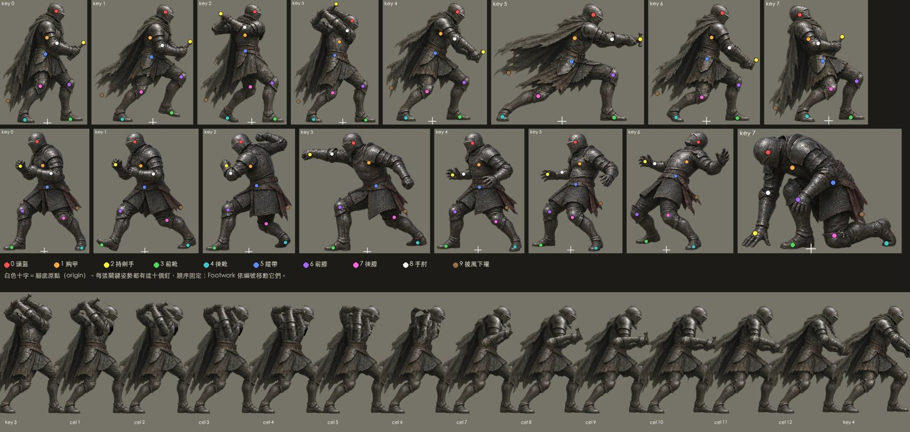

# 2d/cel-motion：關鍵姿勢＋烘好的中間幀（側視角色的連續動作）

不用骨架、不用 Spine，讓一張 AI 生成的「八個關鍵姿勢」圖集像動畫一樣動：
每張關鍵姿勢量好十個關節釘；動作是「時間 → 關鍵姿勢」的表，關節沿表插值；
兩張關鍵姿勢之間有離線烘好的中間幀（光流變形），畫面一次畫一張，切成 16 × 20 的網格，頂點跟著關節變形，所以圖跟著關節走、不會跳。

拆自《灰燼之庭》（`games/ashfall-duel`，原作者 CCW）的 `motion.ts`、`transitions.ts`、`footwork.ts` 與 `render.ts` 的 `ArmoredSprite`；
數值與每一步的運算順序都沒改（`2d/ashfall-duel` 用它，和原遊戲逐像素相同，見那邊的 README）。目前只有灰燼之庭的騎士和守衛用過。



| 檔案 | 內容 |
|---|---|
| `cel-motion.ts` | 沒有引擎，可在 node 測。`Frame`／`frame()`（一張關鍵姿勢：圖集框、腳底原點、十個釘）、`PIN`（釘的順序）、`Pose`（在 a、b 兩張之間的 t，可帶已算好的 `joints`）、`poseAt(keys, time, frames?, scale)`（照時間表插值，經過中間的關鍵姿勢時保留速度、折返時停住）、`curve()`（同樣插值一個數，例如劍的角度）、`pin()`（某個關節相對腳底的位置）、`PoseTrack`（被打斷的動作沿烘好的中間幀走到下一個動作，0.105 秒交接）、`Footwork`（依實際移動距離推進步伐：雙腳交替落地、抬腳、上身起伏與呼吸）、`CelSheet`／`Cel`（中間幀索引的型別） |
| `cel-sprite.ts` | Laya 這一半：`CelSprite`（一個角色節點：選出最近的一張、網格依關節變形、可選的凹陷），`sourceTexture()`（取節點下 `Art` 圖片的材質並把節點歸位） |

## 一個角色要準備什麼

1. **關鍵姿勢圖集**：同一個角色的八個全身姿勢，透明背景、同比例、同光、腳在同一條線上（灰燼之庭的生圖提示詞在 `2d/ashfall-duel/source/ART.md`）。key 0 要是站姿（預備），key 1 是邁步：`Footwork.walkPose()` 在 0 和 1 之間擺盪。
2. **`Frame` 表**：每張的圖集框（像素邊界）、腳底原點、十個釘，順序固定：頭盔 0、胸甲 1、持武器的手 2、前靴 3、後靴 4、腰帶 5、前膝 6、後膝 7、手肘 8、披風下襬 9（`PIN`；`preview/pins.jpg` 畫了兩個角色的釘）。用眼睛在圖上量。
3. **中間幀**：`2d/ashfall-duel/source/tools/bake-transitions.py`（Python＋Pillow＋NumPy＋OpenCV＋Node）。要換角色得改它裡面每個角色自己的資料：`CLIPS`（哪幾對關鍵姿勢之間要烘、各幾張）、`SHOULDERS`（每張的肩）、`FAR_ARM`（遠側手與手肘）、騎士的 `ARM_LAYERS`（手臂橫過頭盔時的三層遮罩多邊形）。輸出幾頁 2048 寬的 WebP 和索引 `{ pages, edges }`（`CelSheet`）與烘焙比例。
4. **Prefab 節點**：角色一個 Sprite 節點，底下一個 `Art` 圖片（關鍵姿勢圖集）和每頁一個隱藏的 `Motion0`、`Motion1`…圖片（中間幀頁）；Prefab 的 `textures` 要列出全部，載入時就有材質。`CelSprite` 只讀它們的材質（範例：`2d/ashfall-duel/assets/courtyard.lh` 的 `Knight`、`Warden`）。

## 用法

```bash
node prefabs/scripts/sync.mjs games/<遊戲> 2d/cel-motion
```

```ts
import { ZhudaEngine, ZhudaPrefabLibrary, DirectoryAssetProvider, type PrefabDefinition } from "zhuda-laya-engine";
import { Footwork, PoseTrack, frame, poseAt, type CelSheet, type Key } from "./common/2d/cel-motion/cel-motion.ts";
import { CelSprite } from "./common/2d/cel-motion/cel-sprite.ts";

// 你的角色：八張關鍵姿勢（atlas 像素框、腳底原點、十個關節釘），這裡只寫兩張示意
const HERO = [
  frame([0, 0, 300, 400], [150, 390], [150, 40], [150, 120], [230, 150], [190, 385], [100, 385], [150, 200], [180, 290], [120, 290], [200, 150], [60, 300]),
  frame([300, 0, 600, 400], [450, 390], [455, 40], [450, 120], [540, 140], [500, 385], [400, 385], [450, 200], [490, 290], [420, 290], [510, 150], [360, 300]),
];
const SHEET: CelSheet = { pages: ["art/hero-motion-0.webp"], edges: { "0-1": [[0, 1, 1, 300, 400, 150, 390]] } };
const CEL_SCALE = 0.78, SCALE = 1;
const SWING: readonly Key[] = [[0, 0], [0.5, 1], [1, 0]];

const definitions: PrefabDefinition[] = [{ id: "hero", asset: "hero.lh", textures: ["art/hero.webp", ...SHEET.pages], states: { idle: {} } }];
async function main() {
  const context = await ZhudaEngine.boot({ container: document.querySelector<HTMLElement>("#game")!, width: 1280, height: 720, features: ["core", "2d", "ui"] });
  const library = new ZhudaPrefabLibrary({ provider: new DirectoryAssetProvider({ baseUrl: "./assets/" }), definitions });
  const hero = await library.instantiate("hero", { parent: context.rootScene });
  // hero.lh 的節點 "Hero" 底下要有 Image "Art"（關鍵姿勢圖集）和隱藏的 "Motion0"…（中間幀頁）
  const sprite = new CelSprite(hero.find("Hero"), HERO, SCALE, SHEET, CEL_SCALE);
  const track = new PoseTrack(HERO, SHEET.edges, SCALE);
  const feet = new Footwork(1, 156, 215);
  let x = 400, time = 0;
  context.runtime.start((dt: number) => {
    time += dt;
    const moved = feet.move(215, dt);
    x += moved;
    feet.travel(moved, dt);
    const target = time % 2 < 1 ? feet.walkPose() : poseAt(SWING, time % 1, HERO, SCALE);
    const shaped = feet.shape(target, HERO, SCALE, time, true);
    sprite.draw({ x, y: 632, pose: track.sample(time % 2 < 1 ? "walk" : "swing", shaped, dt) });
  });
}
void main();
```

（2026-11-25 這段在一個 sync 了這個模組的專案裡對引擎 `def94aa` 型別檢查過；沒有真的圖，所以沒在瀏覽器跑。真的接法是 `2d/ashfall-duel/combat.ts` 的 `combatView()` 與 `render.ts`。）

順序和灰燼之庭一樣：先算目標姿勢（時間表或走路）→ `Footwork.shape()` 放腳、起伏 →（動作自己再微調關節，例如揮劍的手腕）→ `PoseTrack.sample(動作名, 姿勢, dt)` → `CelSprite.draw()`。

### 參數

- `poseAt(keys, time 0..1, frames?, scale)`：`keys` 是 `[時間, 關鍵姿勢編號][]`。給 `frames` 才會帶 `joints`（插值的關節）；不給就只有 a、b、t（`pin()` 直接在兩張之間線性插）。
- `PoseTrack(frames, edges, scale)`：只走 `edges` 裡有的對（沒有直接相連的會繞經別張；目標那一對沒烘過就丟 `缺少動作影格 a-b`）。`sample(group, target, dt)`：`group` 換名字時，從上一個姿勢的關節用 0.105 秒交接；沿中間幀每秒走 36–140 個「格」。`reset()`。
- `Footwork(facing ±1, stride, cruise)`：`move(目標速度, dt)` 加速度最多每秒 `8.5 × cruise`、煞車 `12 × cruise`，傳回這步走的距離；`travel(實際距離, dt)` 推步伐，剛落地的那隻靴傳回 3 或 4（拿來出腳步聲和塵）；`walkPose()`、`shape(pose, frames, scale, time, walking)`、`reset()`、`speed`。站姿佔步伐週期 56%。
- `CelSprite(node, frames, scale, sheet, celScale, name?)`：`draw({ x, y, pose }, dent?)`；`dent = { x, y, displacement }`（世界座標）在接觸點周圍 55 × 29 的橢圓內把網格推進去，`|displacement| ≤ 0.05` 不變形。
- 灰燼之庭的值：騎士 `Footwork(1, 156, 215)`、畫面比例 0.98；守衛 `Footwork(-1, 132, 109)`、0.9；中間幀烘焙比例 0.78。

## 驗證

- `tests/cel-motion.test.mjs`（3 項，沒有引擎、沒有灰燼之庭的資料，用一個假的三張角色）：時間表經過每張關鍵姿勢時關節和那張的釘相同、經過中間那張時手還在動；被打斷的姿勢只走有烘的對（0-1 → 1 → 1-2，不走沒有的 0-2）並且到得了；沒烘過的對會報錯；`Footwork` 起步、雙腳交替落地、0.1 秒內煞停。
- `tests/ashfall-duel.test.mjs` 的最後一項用騎士和守衛的全部中間幀，兩個方向都試。
- 用在灰燼之庭：`2d/ashfall-duel` 和原遊戲 240,000 步狀態相同、12 個畫面逐像素相同。

## 已知限制

- 十個釘的意義是固定的（人形、側視、單手武器）。四足、飛行或兩把武器的角色要另外設計。
- 只用過兩個角色，都是灰燼之庭的；沒有用別的圖集試過整套流程。
- 烘中間幀的腳本不在這個模組（在 `2d/ashfall-duel/source/tools/`），而且每個角色要手量導引點；在這台 Mac 的 OpenCV 5.0.0 重跑，結果和原作者在 Windows 做的不同（見 `2d/ashfall-duel/README.md`）。
- 網格變形只在 2D 平面內：轉身、換手這種需要新畫面的動作要靠關鍵姿勢本身。
