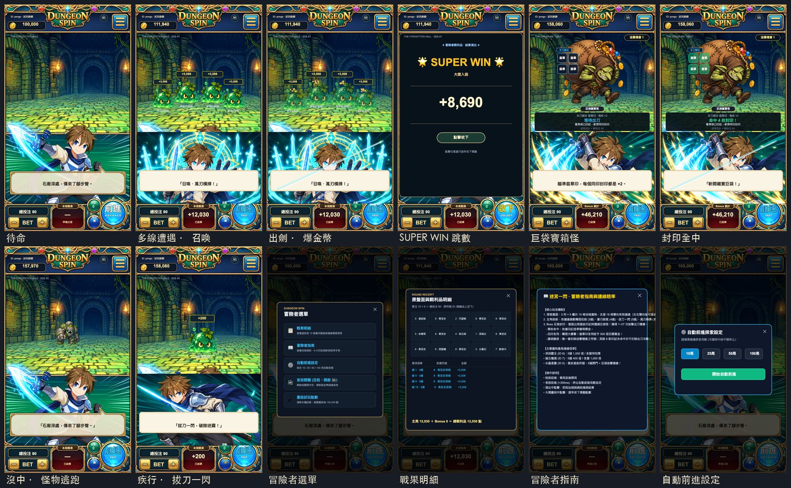

# 2d/dungeon-spin：迷宮一閃（直式地城連線拉霸）

直式 572×1024 的連線拉霸，用「地城探險」來演：5×3 盤面、18 條雙向連線、十組固定情境（fixtures）。
按一下「前進」就是一局：主角在石廊走一段（700 ms，疾行 90 ms）→ 中獎的每一筆變成一隻怪物（最多 5 隻，頭上有金額），
主角擺出招式、劍光一閃、怪物震動消散、噴金幣 → 有 Bonus 時巨袋寶箱怪出現、四枚封印逐刀揭開 → 贏 10 倍總注以上時
BIG／MEGA／SUPER WIN 跳數。點數是本機的試玩帳本（`systems/slot-round` 的 `LocalSession`）：**先記帳再演出**，重新整理也不會掉局。

拆自 `games/dungeon-spin`（迷宮一閃 · Dungeon Spin，2026-11-06 遷入遊戲中心，原釘引擎 `dd9b5fd`）。
觀看台 `viewer2d/?scene=dungeon-spin` 和原遊戲在 26 個狀態、4 種視窗大小逐像素相同（見「驗證」）。



## 檔案

| 檔案 | 內容 |
|---|---|
| `dungeon-spin.ts` | `DungeonSpin`：`init()` 掛三個 Prefab、建怪物／主角／Boss／大獎畫面、頂部列、控制列、四個彈窗、帳本、回合狀態機，接好按鈕與 Space／Enter；常數 `SAVE_KEY`、`RULES_ID`、`BETS`（10、20、50）、`DESIGN`（572×1024） |
| `prefabs.ts` | 三個 Prefab 定義（`visual/template-background`、`visual/creatures-atlas`、`visual/hero-actions`）、`assetManifest`（6 個檔的大小與 SHA-256）、`createAssetProvider(baseUrl?)`（預設 `./common/2d/dungeon-spin/assets/`） |
| `math.ts` | `MathEngine.resolve(fixture, singleBet)`、`PAYLINES`（18 條）、`FIXTURE_TRUTHS`（十組情境）。不碰引擎 |
| `presentation.ts` | `LayaDungeonPresentation`：一局怎麼演（走→遭遇→出招→金幣→Boss→大獎），實作 `systems/slot-round` 的 `PresentationPort` |
| `views/monster-field.ts` | 石廊視窗（7,128，558×453）：待命空無一物、沒中一隻逃跑、中獎 1–5 隻站位與金額、受擊震動＋金幣＋消散 |
| `views/hero-action.ts` | 主角視窗（7,576，558×324）：6 個姿勢（ready、quick、wave、draw、magic、cleave）＋時序 `HERO_TIMINGS`、劍光、羊皮紙台詞 |
| `views/boss-seal.ts` | 巨袋寶箱怪：哥布林（圖集第 9 格）、四枚封印、追擊機會、本刀鎖定與倍率、出刀說明卡 |
| `views/win-celebration.ts` | 大獎：WIN／BIG（≥10×）／MEGA（≥50×）／SUPER（≥100×），二次緩出跳數，點擊提早收下 |
| `ui/header-panel.ts`、`ui/control-bar.ts` | 頂部列（餘額、場景名／回合數、音效、選單）；底部列（總注 −／＋、本局戰果、自動、疾行、前進大球，長按 360 ms 開自動設定） |
| `ui/*-dialog.ts` | 冒險者選單、戰果明細（5×3 原盤面）、冒險者指南、自動前進（10／25／50／100 局） |
| `sound.ts` | `DungeonSoundBridge`：20 個用振盪器＋濾波雜訊即時合成的音效（沒有音檔），第一次點擊解鎖、頁面隱藏就停、最多 24 聲 |
| `assets/` | `template-v2.png`（937×1678，整張畫好的背景：石廊、主角、框、按鈕）、`creatures-v3.png`（1983×793，5×2：9 種怪物＋巨袋寶箱怪，見 `preview/atlas-creatures.jpg`）、`hero-actions-v4.png`（2032×774，3×2：6 個姿勢，見 `preview/atlas-hero.jpg`）、`prefabs/*.lh`（三個 Prefab 的節點） |
| `source/` | 不會 sync：數學表（`math/`）、看不見的 3D 石廊原碼（`hall3d/`）、Prefab 檢查用的最小遊戲（`prefab-check/`）。見 `source/README.md` |
| `preview/` | 12 個狀態各一張（572×1024）＋`sheet.jpg`＋兩張圖集對照 |

依賴：`systems/slot-round`（回合狀態機、帳本）、`2d/prefab-atlas`（從 Prefab 拿貼圖、切格子）。引擎功能只要 `core`、`2d`、`ui`。

## 放進遊戲

```bash
cd <repository root>
node prefabs/scripts/sync.mjs games/<遊戲>/client 2d/dungeon-spin     # 會一起帶 systems/slot-round、2d/prefab-atlas
```

整個遊戲的那一層（`source/prefab-check/src/Main.ts`，2026-11-25 在引擎 def94aa 上建置、型別檢查、體檢都過）：

```ts
import { ZhudaEngine, ZhudaPrefabLibrary } from 'zhuda-laya-engine';
import { DungeonSpin, DESIGN } from './common/2d/dungeon-spin/dungeon-spin.ts';
import { createAssetProvider, definitions } from './common/2d/dungeon-spin/prefabs.ts';

async function main() {   // 引擎建置目標是 ES2020：不能用頂層 await
  const { stage, canvas } = await ZhudaEngine.boot({
    width: DESIGN.width, height: DESIGN.height, bgColor: '#080f19', scaleMode: 'showall', features: ['core', '2d', 'ui'],
  });   // 不給 container：讓 Laya 自己的 show-all 把直式畫面縮進任何視窗
  document.querySelector('#game')?.appendChild(canvas);
  const provider = createAssetProvider();
  const library = new ZhudaPrefabLibrary({ provider, definitions });
  const game = new DungeonSpin(stage, library);
  await game.init();
  window.addEventListener('pagehide', () => { game.dispose(); library.dispose(); provider.dispose?.(); }, { once: true });
  ZhudaEngine.flushRenderFrames(4);
}
main().catch((error) => console.error('迷宮一閃啟動失敗', error));
```

Prefab 關卡（`zhuda.config.json`）：`"prefabPreview": "src/common/2d/dungeon-spin/prefabs.ts"`，三個 `prefabChecks` 照抄 `source/prefab-check/zhuda.config.json`，
基準圖用 `source/prefab-check/references/*.png`；`npm run build:candidate` → `npm run accept:prefabs` → `npm run build`。

### 可以改的

- `new DungeonSpin(stage, library, { storage, keyboard, sound, walk })`：`storage` 換掉 localStorage（觀看台 `?save=memory` 用記憶體）；`keyboard: false` 不聽 Space／Enter；
  `sound` 換一個 `DungeonSoundBridge`；`walk` 是主角走路時要往前推的東西（`{ advanceStep(ms) }`，原遊戲的 3D 石廊用過）。
- `init()` 後全部是公開欄位：`runtime`（`advance()`、`configure({ fixture, singleBet, mode })`、`startAuto(n)`、`stopAuto()`、`subscribe()`、`state`）、
  `session`（`points`、`state`、`reset()`）、`monsterField`、`heroView`、`bossView`、`winView`、`headerPanel`、`controlBar`、`menuDialog`、`receiptDialog`、`rulesDialog`、`autoDialog`、三個 Prefab 實例。
- 選哪一組情境：`runtime.configure({ fixture: 'boss' })`。**原遊戲沒有任何介面能換情境，一律是 `multi`**（重新整理會接上一局的情境，也是 `multi`）。
- 換數學：給 `LocalSession` 別的 `resolve(fixture, bet)`（傳回 `{ p, b }`，形狀照 `math.ts` 的 `MathResult`），演出不用改。

### 十組情境（單注 10、總注 90）

| key | 演出 | 主局 | Bonus | 大獎 |
|---|---|---|---|---|
| `three` | 迅劍（quick），1 隻 | 100 | — | — |
| `empty` | 沒中：1 隻逃跑 | 0 | — | — |
| `multi` | 召喚・萬刃橫掃（magic），4 隻 | 12,030 | — | SUPER |
| `five` | 拔刀一閃（draw），1 隻 | 200 | — | — |
| `four` | 蒼刃劍氣（wave），1 隻 | 200 | — | — |
| `full` | 領域斬（cleave），1 隻 | 4,500 | — | MEGA（剛好 50×） |
| `group` | 破封聖劍（cleave），1 隻 | 6,000 | — | MEGA |
| `word` | 迅劍（quick），1 隻 | 370 | — | — |
| `boss` | 藏寶怪現身（ready），1 隻後巨袋寶箱怪，2 刀 | 850 | 45,360 | SUPER |
| `allzero` | 星紋開門（ready），1 隻後寶箱怪，27 次追擊（演 2 刀） | 450,000 | 57,060 | SUPER |

單注 20、50 時全部等比放大。每一筆獎的金額是「主局獎金平均分」（四捨五入），**不是**每條線的賠率；真正的線表與賠率表在 `source/math/`。

## 驗證（2026-11-25，引擎 def94aa，無頭 Chrome，WebGL）

- **和原遊戲逐像素比對**：原遊戲複製一份、只改釘選到 def94aa（見 `docs/routes/dungeon-line-slot.md`：要重跑 Prefab 驗收才建得起來），
  和觀看台用 `prefabs/tools/detplay.mjs`（虛擬時鐘，`VIEWPORT=572x1024`）跑同一個情境 `viewer2d/scenarios/dungeon-spin.json`：
  待命、選單、明細、指南、自動設定、單注 50、疾行、multi 一局 6 個時刻、明細、boss 一局 5 個時刻、empty、疾行 five、自動 10 局與停止、重設，**26 張全部 0 像素**；
  原遊戲對自己（跑兩次）、觀看台對自己也都是 0。`errors()`、頁面錯誤都是空的，兩邊最後的點數與回合數相同。
- **四種視窗**（1280×720、390×844、572×1024、1024×1366）待命畫面 0 像素。
- **Prefab 檢查**：`source/prefab-check/`（只由本模組組成的最小遊戲）跑原遊戲的三個 `prefabChecks`：三個都過、和原遊戲的基準圖 0 像素、各 30 次載入／釋放，
  定義雜湊（`9cd7c6a1…`、`ad679baf…`、`5738a8e6…`）與來源 SHA-256 和原遊戲的證據完全相同；報告在 `source/prefab-check/evidence/`。
- **回合核心**：原遊戲的 `GameRuntime`／`LocalSession` 和 `systems/slot-round`（帶本模組給的選項）跑同一段腳本（23 個動作，含加速、收下接下一局、演出失敗、自動、停止、重播、重設、120 局進帳），事件、狀態、存檔逐位元組相同。
- **測試**：`tests/dungeon-spin.test.mjs`（原遊戲的 `math-fixtures` 3 項、`consumer-boundary` 3 項、`verify-assets` 併入，加連線表與十組情境的檢查，共 8 項）。
- **3D 石廊看不見**：原遊戲另建了一個 `Scene3D`（石磚、10 根柱、6 個火把點光源、霧，走路時鏡頭前推），但它畫在整張不透明的背景 Prefab 之下。
  在原遊戲裡把它拿掉：0 像素差；觀看台不建它、只開 `core/2d/ui`，以上 26 張照樣 0 像素。所以本模組不建 3D，原碼留在 `source/hall3d/`。

## 已知問題（照原樣保留，沒有修）

- **點彈窗外面關不掉。** 四個彈窗的半透明遮罩是只有 `graphics` 沒有大小的 Sprite，收不到點擊；只能按 ✕（兩邊都量過：點 (20,20) 後選單還開著）。要修就給遮罩 `size(572, 1024)`。
- **冒險者指南的字超出框。** 說明文字是一個寬 440 的 Label，沒開自動換行，長行超出右邊框（`preview/rules.jpg`）。
- **指南寫的魔物和圖不一致。** 指南說「深淵霸主 (ID 8)」、「遠古魔偶 (ID 7)」，圖集與遊戲裡的名字是 8 青苔史萊姆、7 骸骨斥候。
- **時間不照引擎的規矩。** 演出用 `setTimeout`、`performance.now` 和 `Laya.timer`，不是引擎 `game-2d` 路線要的分層時鐘：暫停、hit-stop 停不住它。
- **聲音自己開 `AudioContext`**，不是引擎要的單一 `IframeSoundAdapter`。聲音只驗證過不出錯；好不好聽沒有人耳聽過（無頭 Chrome 沒有聲音輸出）。
- 獎金分配：`multi` 四筆各 3,008（12,030 ÷ 4 四捨五入），加起來 12,032 ≠ 12,030；Go 版是 3,007（截斷）。只影響明細上的數字，餘額用的是主局總額。

## 沒有驗證的

- 沒上手機、沒打包成小遊戲；觸控只用無頭 Chrome 的合成滑鼠事件點過（選單鍵、BET ＋／−、疾行、✕）。前進大球的點擊會先解鎖聲音（真實時間），比對時改用 `runtime.advance()`。
- 長按 360 ms 開自動設定、Space／Enter 沒有在瀏覽器裡測。
- 原遊戲的 `?play=1` 場景驗收（2026-11-06）只留結果，沒有腳本可重跑；本次的 26 張比對取代它。
