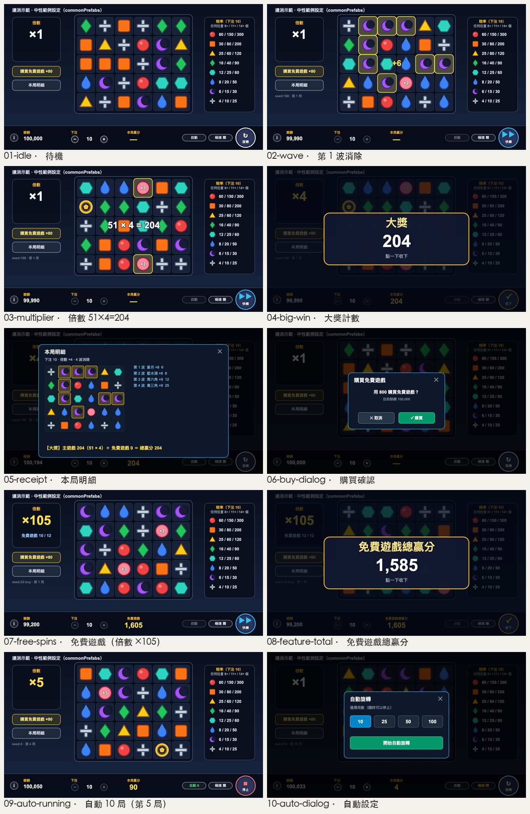

# 2d/slot-ui：連消老虎機的畫面（Laya 2D，程式繪製的中性外觀）

讓一款隨處消除連消老虎機在沒有美術之前就能完整地玩、看、測：盤面、演出順序、控制列、對話框、大獎、音效全部有，外觀用程式畫（形狀符號、圓角面板），
之後換美術只換畫的部分。演出播放器、時鐘、規則都不碰引擎，可以在 node 測。



| 檔案 | 內容 | 引擎 |
|---|---|---|
| `step-player.ts` | `CascadeStepPlayer`（`systems/slot-round` 的 `PresentationPort`）：掉落 → 每一波高亮、消除、補位 → 倍數「base × m = win」→ 金幣 → 免費遊戲（每一轉照同樣順序，倍數看板累積）→ 免費遊戲總贏分 → 大獎。不算錢、不用亂數；畫面、聲音、時間都是注入的介面（`BoardPort`、`CelebrationPort`、`HudPort`、`SoundPort`、`wait`）。`trace` 記下演了什麼 | 不用 |
| `frame-clock.ts` | `FrameClock`：`wait(ms)`、`tween(ms, step, ease)`、`speed`、`finishAll()`，每格 `update(秒)` 推進——演出跟著遊戲迴圈走，暫停、背景分頁、快轉、虛擬時鐘都有效 | 不用 |
| `control-model.ts` | 控制列的規則：五態大鈕的外觀（旋轉／停止／收下／快轉／稍候）、`LONG_PRESS_MS` 360、轉動中不能改注、自動鈕在轉動中只能拿來停、注額增減（夾住或循環） | 不用 |
| `win-tiers.ts` | 贏分級距（贏分 ÷ 下注）：預設大獎 10×、巨獎 25×、超級大獎 50×、傳奇大獎 100×，各自的計數時間 | 不用 |
| `sound-bridge.ts` | `SlotSoundBridge`：音效名 → 已載入的樣本，沒有就排幾個音（`scheduleTone`），全部經過引擎唯一的音訊權威 `IframeSoundAdapter`；附自己做的中性提示音 `NEUTRAL_CUES` | 不用（轉接器注入） |
| `cascade-board.ts` | `CascadeBoard`（`BoardPort`）：cols × rows 格、逐欄掉落、中獎格發光放大消失、存活符號往下掉新符號從上面掉、倍數球顯示 ×n、倍數算式 | Laya |
| `celebration.ts` | `Celebration`（`CelebrationPort`）：暗幕＋級距名稱＋計數，停一下自己關，點一下收下 | Laya |
| `control-bar.ts` | `ControlBar`（也是 `HudPort` 的贏分與標題）：餘額、下注 −／+、本局贏分、自動（顯示剩幾局）、極速、ⓘ、五態大鈕（長按開自動設定）；`MeterPanel`：倍數看板與免費遊戲「第幾轉／共幾轉」 | Laya |
| `dialogs.ts` | `ModalDialog`（暗幕點了就關、✕）、`AutoPlayDialog`（10／25／50／100）、`BuyFeatureDialog`（價格、餘額、不足時不能按）、`ReceiptDialog`（第一個盤面與第一波中獎格、每一波的獎項、base × 倍數 ＋ 免費遊戲 ＝ 總贏分、級距） | Laya |
| `mount-slots.ts` | `MountSlotManager`：五個具名掛載層（上方法規列、底部控制列、側邊、中央覆蓋、彈窗），由下到上 | Laya |
| `symbols.ts` | `shapePainter(styles)`：佔位符號（圓、方、三角、菱、六角、水滴、月、十字、分散環、倍數球）；換成遊戲自己的 `SymbolPainter` 就換了美術 | Laya |

拆自 <original-cascade-slot>（主題與美術未收）：演出順序與節奏來自 `client/src/renderer/StepPlayer.ts`（掉落 700 ms／極速 90 ms、波與波之間 240 ms、倍數前停 360 ms、沒中 380／60 ms、金幣 80／45 ms、免費轉之間 280／50 ms），控制列規則來自 `ui/ControlBar.ts`，對話框行為來自 `ui/dialogs/`，掛載層是 `renderer/MountSlotManager.ts`，音效橋是 `audio/ 的音效橋` 的做法（先樣本、後合成、聲道上限）。**沒有**收：所有主題視圖（盤面背景、角色、倍數風暴、慶祝畫面、3D 神殿）、圖片、WebM 特效、聲音檔、文字。

## 用法

```bash
node prefabs/scripts/sync.mjs games/<遊戲>/client 2d/slot-ui 2d/cascade-math   # 2d/slot-client、systems/slot-round 一起來
```

遊戲的 `zhuda.config.json` 用 `"features": ["core", "2d", "ui"]` 就夠（觀看台就是這樣）。

```ts
import { ZhudaEngine, IframeSoundAdapter } from 'zhuda-laya-engine';
import { GameRuntime } from './common/systems/slot-round/game-runtime.ts';
import { LocalSession } from './common/systems/slot-round/local-session.ts';
import type { CascadeSnapshot } from './common/2d/slot-client/protocol.ts';
import { exampleConfig } from './common/2d/cascade-math/example-config.ts';
import { createSeedResolver, seedKey } from './common/2d/cascade-math/seed-resolver.ts';
import { FrameClock } from './common/2d/slot-ui/frame-clock.ts';
import { CascadeBoard } from './common/2d/slot-ui/cascade-board.ts';
import { Celebration } from './common/2d/slot-ui/celebration.ts';
import { ControlBar } from './common/2d/slot-ui/control-bar.ts';
import { SlotSoundBridge } from './common/2d/slot-ui/sound-bridge.ts';
import { CascadeStepPlayer } from './common/2d/slot-ui/step-player.ts';

const context = await ZhudaEngine.boot({ container: document.querySelector<HTMLElement>('#game')!, width: 1280, height: 720, features: ['core', '2d', 'ui'] });
const cfg = exampleConfig();
const clock = new FrameClock();
const board = new CascadeBoard({ cols: cfg.cols, rows: cfg.rows, clock, multiplierSymbol: cfg.multiplierSymbol });
board.root.pos((1280 - board.width) / 2, 64);
const bar = new ControlBar({ width: 1280, bets: [10, 20, 50], clock });
bar.root.pos(0, 600);
const celebration = new Celebration({ width: 1280, height: 720, clock });
Laya.stage.addChild(board.root);
Laya.stage.addChild(bar.root);
Laya.stage.addChild(celebration.root);

const sound = new SlotSoundBridge(new IframeSoundAdapter({ voiceOverflow: 'fifo', maxActiveVoices: 24 }));
const player = new CascadeStepPlayer({ board, celebration, hud: bar, sound, wait: (ms) => clock.wait(ms), onAccelerate: (on) => (clock.speed = on ? 4 : 1) });
const session = new LocalSession({ storage: localStorage, resolve: createSeedResolver(cfg), saveKey: 'my-slot.v1', rules: 'my-slot-v1' });
await session.open();
let seed = Date.now() >>> 0;
const runtime = new GameRuntime<CascadeSnapshot>({ presentation: player, fsm: true, beforeRound: () => ({ fixture: seedKey(seed++) }) });
runtime.attachSession(session);
runtime.subscribe(({ state }) => bar.updateAction(state.primary));
bar.onAdvance = () => void runtime.advance();
board.show(createSeedResolver(cfg)(seedKey(seed), 10).p.spin.grid, []);
window.addEventListener('pointerdown', () => sound.unlock(), { once: true });
context.runtime.start((dt: number) => clock.update(Math.min(dt, 0.1)));
```

（2026-11-25 對引擎 def94aa 型別檢查過。）加上倍數看板、購買、自動、明細、極速、餘額顯示的完整接法就是觀看台的 `viewer2d/src/presets/cascade-slot.ts`（約 250 行），可以直接照抄成新遊戲的 `Main.ts`。

## 看

```bash
cd prefabs/viewer2d && npm run build && npm run view
# http://127.0.0.1:8931/index.html?scene=cascade-slot
#   &round=seed:168（4 波＋×4）  &round=seed:1457（7 波）  &round=seed:592（自然觸發免費遊戲）  &round=seed:22:buy（購買）
#   &turbo=1  &autoplay=10  &dialog=buy|auto|receipt  &bet=20
```

`preview/` 的十張圖是 `viewer2d/scenarios/cascade-slot*.json` 用虛擬時鐘（`prefabs/tools/detplay.mjs`）拍的，每張都核對過 `state()`（局數、餘額、階段）。

## 驗證（2026-11-25）

- `tests/slot-ui.test.mjs`（不開瀏覽器）：時鐘的等待、補間、速度、`finishAll`；級距；控制列規則；演出播放器用真的種子局（seed 168：4 波＋×4＝204 → 大獎）照原遊戲的順序和時間演、極速不播大獎、沒中會等、快轉與收下、購買的 12 轉免費遊戲一轉一轉演完、看板顯示最後的累積倍數；音效橋（排音的延遲、樣本優先、靜音、未知的提示音）。
- 觀看台 `cascade-slot`（無頭 Chrome，WebGL，1280×720，虛擬時鐘）：待機、第 1 波、倍數、大獎、明細、購買確認、免費遊戲（看板 ×105）、免費遊戲總贏分、自動 10 局、自動設定；`rendererErrors`、`pageErrors` 都是空的；餘額 100,000 → seed 168 後 100,194、購買 seed 22 後 100,805、自動 10 局後 100,033，和 `LocalSession` 的帳一致。

## 已知限制

- 只在桌機無頭 Chrome（WebGL）看過；沒上手機、沒用手指玩過、沒有人耳聽過提示音。
- 外觀是佔位：符號是形狀、面板是圓角方塊，沒有粒子、沒有 Prefab 定義（引擎的 Prefab 流程是 `visual-content-prefab` 路線，換美術時走它）。
- 控制列是 1280 寬的橫式版面；直式（例如原遊戲的 572×1024）要自己排位置（每個元件都是 `root` 可以 `pos`）。
- 盤面掉落動畫不知道「哪一顆是同一顆」，靠欄內順序推算（和數學一致：存活的保持順序往下掉）。
- 文字預設是繁體中文，全部可由選項換掉；沒有接 `2d/slot-client` 的語系管線。
