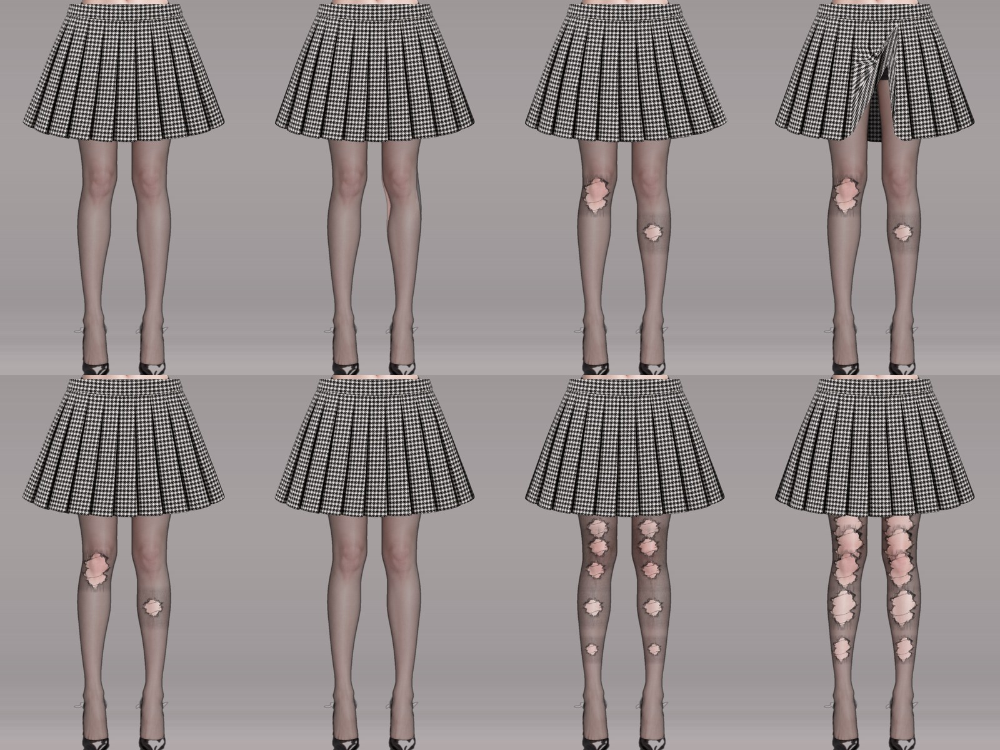

# 2d/spine-tights：Spine 褲襪（拉扯、撕破、掀裙）

一張照片切成零件、綁成一套 Spine 4.2 骨架：腿上一層黑色透膚褲襪，外面一條千鳥格百褶裙。拖曳腿，那一處的絲襪跟著手指被拉開、放手彈回去；拉夠遠就撕破，先小洞、再大洞。拖曳裙子，離手指最近的那條褶用 IK 跟著手指，其他的靠 Spine 物理跟著擺，放手自己落回去。由引擎的 `ZhudaSpineCharacter` 畫；這個模組是「驅動骨架的那隻手」加上骨架本身。



- 出自「撕襪 2D」（原本的 `games/stocking-tear-2d`，2026-11-15）。2026-11-26 搬進元件庫。做法寫成路線 [`spine-character`](../../../docs/routes/spine-character.md)。
- 觀看台：`prefabs/viewer2d` 的 `?scene=spine-tights`（`&torn=L_thigh:2,R_knee:1`、`&torn=all:2`、`&tearAt=0.6`）。
- **圖是生成的**（gpt-image-2.6，2026-11-15）：腿的照片是拿遊戲中心自己的角色沈知微（`zhuda-spacetime-3d`）的正面全身圖當參考生成的成年女性下半身（安全褲、高跟鞋），裙子是另一張商品照，絲襪的布樣和兩種破洞是「黑色 20 丹尼絲襪繃在白卡上」的微距照。原圖、提示詞、生成紀錄都在 `source/blender/`（資料夾名沿用原專案，裡面不是 Blender 檔）。生成紀錄裡的本機路徑和登入資訊已經拿掉，檔內有註明。
- **授權提醒**：骨架用使用者自己的工具組 zhuda-spine2D 做，畫的時候用的是 Spine 的執行庫（引擎的 `spine42` 功能）。Spine Runtimes License 規定：把 Spine 骨架放進產品出貨的人，要有自己的 Spine Editor 授權（路線 `spine-character` 的 Tools 一節）。這個模組不改變這件事。
- **只做成人款式**：提示詞寫明是成年人；裙子是千鳥格毛料百褶裙，不是制服。加新款式時請維持。

## 放進遊戲

```bash
npx zhuda-prefab-sync . 2d/spine-tights
```

遊戲的 `zhuda.config.json` 的 `features` 要有 `spine42`。

```ts
import { ZhudaEngine, ZhudaSpineCharacter } from 'zhuda-laya-engine';
import { TIGHTS_BACKGROUND_CSS, TIGHTS_CANVAS, TIGHTS_IDLE, createSpineTights, fitTights, tightsPath, type TearSite } from './common/2d/spine-tights/spine-tights.ts';

const context = await ZhudaEngine.boot({ container, features: ['core', '2d', 'spine42'], bgColor: TIGHTS_BACKGROUND_CSS });
const [background, templet, sites] = await Promise.all([
  Laya.loader.load(tightsPath('background')),
  Laya.loader.load(tightsPath('rig'), Laya.Loader.SPINE),
  fetch(tightsPath('sites')).then((r) => r.json() as Promise<TearSite[]>),
]);
const picture = new Laya.Sprite(); // 用照片的像素當座標的圖層
context.rootScene.addChild(picture);
picture.graphics.drawTexture(background, 0, 0, TIGHTS_CANVAS.width, TIGHTS_CANVAS.height);
const spine = new ZhudaSpineCharacter({ parent: picture, templet, animation: TIGHTS_IDLE });
const { scale, x, y } = fitTights(Laya.stage.width, Laya.stage.height);
picture.scale(scale, scale);
picture.pos(x, y);

const tights = createSpineTights(spine, sites);
// 指標：先用 spine.stageToCanvas(stageX, stageY) 換成照片的像素，再
//   按下 → tights.press(x, y)（回傳 'skirt'、'leg' 或 null）；移動 → tights.drag(x, y)；放開 → tights.release()
// 每幀：spine.update(); tights.step(delta);
// 不靠拖曳也能撕：tights.tear('L_knee')；全部復原：tights.reset()
```

完整的接法（事件、連點兩下復原、等引擎開場畫面走掉）在 `viewer2d/src/presets/spine-tights.ts`，約 110 行。

## 骨架裡有什麼

| | |
| --- | --- |
| 畫布 | 1024×1536（照片的像素），骨架原點在底邊中間 |
| 骨頭 | 48 根：九條褶鏈各三節（`pleat<i>_1…3`）加抓取點（`grab<i>`）；十個撕裂點各一根（`pull_<部位>`） |
| 約束 | 9 個 IK（`grab<i>_ik`，平常 mix 是 0）；27 個物理約束（每節一個） |
| 插槽 | 24 個；每個撕裂點有 `tear_<部位>`、`lip_<部位>` 兩個，各有 `_small`、`_large` 兩張貼片，平常是空的 |
| 動畫 | 只有 `idle`：裙子自己慢慢左右擺，4 秒一個來回（下襬約 ±13 像素） |
| 圖集 | 一張 2048×4096、直通 alpha（`pma:false`）、3.5 MB |
| 撕裂點 | `sites.json`：每條腿五處（`thigh`、`lowthigh`、`knee`、`calf`、`shin`），都在裙擺以下 |

破洞的做法：每個洞是兩張貼片，洞外完全透明（露出皮膚的那張、捲邊多一層絲襪的那張），所以不管怎麼混色都沒有接縫。原專案試過把破洞烤成一張不透明的補丁，在 LayaAir 上會出現色帶（它混半透明黑色的方式和顯示值不同，沒有哪個 gamma 對得起來）。

## LayaAir 的 Spine 節點要注意的（`ZhudaSpineCharacter` 已經處理）

- `useFastRender` 要關，否則改骨頭、換貼片都不會顯示。
- `physicsUpdate` 要設 2；LayaAir 的預設 0 表示 Spine 物理永遠不走。
- 它照骨架的包圍盒擺放骨架、自己改 `skeleton.x/y`：骨頭的世界座標要扣掉那個偏移。
- Spine 4.2 的骨頭沒有 `worldRotationX`，用 `localToWorld`。

## 重做骨架

`source/spine/outfit/` 的三支腳本照順序：`make_parts.py`（把腿和裙子的照片切成零件）、`make_tights.py`（從布樣算褲襪的透光：白卡上的亮度就是透光率；產生十個撕裂點和每個洞的貼片）、`rig.py`（綁骨架）。它們用使用者自己的工具組 **zhuda-spine2D**（`spk.py`、`spinekit`），那個工具組不在這個倉庫裡（遊戲中心的 `engines/zhuda-spine2D`）；相對路徑照原專案保留，所以 `source/` 底下還是 `spine/outfit/` 和 `blender/` 兩層。`source/spine/outfit/build/008/` 是最後一次建置的檢查報告，`evidence/004/` 是工具組拍的壓力測試圖。

## 檢查過的（2026-11-26，Apple M4，Chrome 158，引擎 `e4ba0212` 加這次的修改）

- **真顯卡、真滑鼠跑 `source/look-book.mjs`**（WebGL，600×900，8 張圖）：繪製錯誤 0、頁面錯誤 0、輸入錯誤 0。拉右膝 60 像素：絲襪跟著被拉開 55 像素、沒破，放手 0.9 秒後回到 0.1 像素以內。左膝拉兩次：小洞、大洞；右小腿一次：小洞。抓中間那條褶往上拖：下襬從 (515, 565) 到 (559, 277)，那條褶的 IK 是 1、其他是 0，兩側的褶跟著動了 11 和 23 像素；放手 0.7 秒後回到待機擺動的範圍內。背景上連點兩下：全部復原。
- **和原專案的程式對照**：把原專案原封不動接上現在的引擎建置（一行都不用改），和這個模組拍同樣三個靜止狀態（完好、十處小洞、十處大洞）。裙擺邊緣以下（900 列裡的第 342 列起：腿、褲襪、破洞、鞋）差超過 8／255 的像素是 0 個；裙子因為自己在擺，兩邊拍到的不是同一刻，整張圖有 17% 到 18% 的像素不同，全在裙子和它的下緣（`preview/original-code-vs-module.jpg`：原專案、模組、差異）。
- `prefabs/tests/spine-tights.test.mjs`（8 個，不用瀏覽器）：骨架檔有驅動程式叫得到的每根骨頭、約束、插槽、貼片和圖集區塊；撕裂點左右對稱、都在腿上；用替身跑拉扯、兩段撕破、掀裙的 IK、復原。

## 沒檢查的

- **沒有人看過**，只有我（Claude）看圖。
- **Spine 版沒有上過手機**，原專案也沒有（原紀錄：要測的時候手機正被別的工作階段用著）。`preview/2026-11-15/v40-*.jpg` 兩張手機截圖是更早的著色器版。
- 這次只在 WebGL 上跑（2D 觀看台固定 WebGL）。原專案在 WebGPU 上也跑過（`preview/2026-11-15/gpu-tears.jpg`），那是舊引擎。
- 沒有重跑三支製作腳本（需要 zhuda-spine2D）；骨架、圖集、零件都是原專案那一份，逐位元組沒動。

## 已知的樣子（原專案的紀錄，這次沒動）

- 拉開的時候腿的邊緣會露出一道淺色的帶子（`preview/look-book.jpg` 上排第二格的右膝）。
- 圖集 2048×4096，在顯示卡上佔 32 MB，給手機用值得縮小。
- 一個姿勢、一個鏡頭；裙子掀起來只看得到照片裡的安全褲和裙子的深色背面。

## 原專案沒有搬過來的

- `spine/outfit/build/008/` 的 `outfit.json`、`outfit.atlas`、`outfit.png`：和 `assets/` 裡的逐位元組相同，只留一份。`spine/outfit/bg.png`、`public/assets/spine/sites.json` 同理。
- `BRIEF.md`、`WORKLOG.md`：工具組的空白範本，沒有填。
- `package.json`、`package-lock.json`、`tsconfig.json`、`zhuda.config.json`（引擎釘在 `552736a`，功能 `core`／`2d`／`spine42`，WebGPU）、`public/index.html`。
- 精選截圖裡的 PNG 轉成了 JPEG；兩張手機截圖裁掉了最上面的狀態列和網址列。

其餘都在 `source/`：原專案的主程式原樣（`Main-2026-11-15.ts`，模組的 `spine-tights.ts` 和觀看台的 preset 是從它拆出來的）、三支製作腳本和零件、生成原圖與提示詞、更早的著色器版（`attic/Main-shader.ts`，在 vivo V40 上實測過 60 fps；它用的兩張圖在 `attic/art/`）、沒用 `ZhudaSpineCharacter` 之前的寫法（`attic/Main-spine-raw.ts`）、原專案的工具和交接紀錄。
