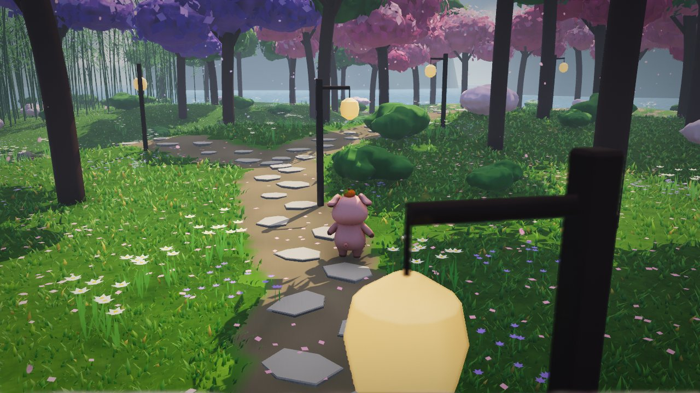
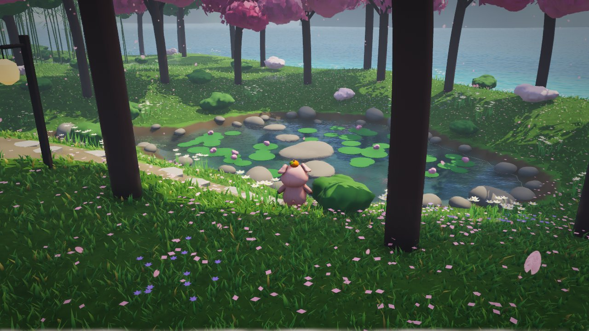
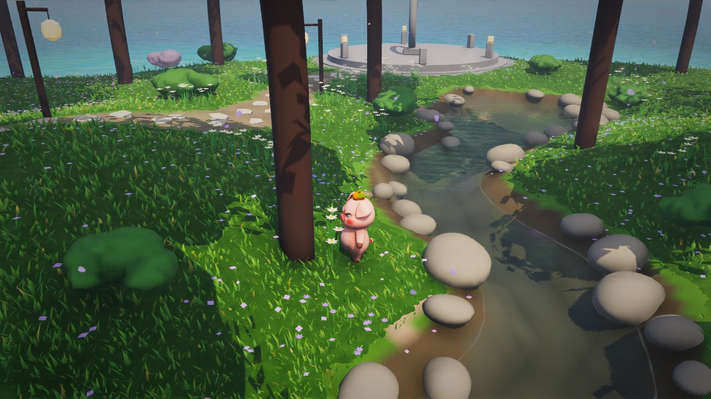
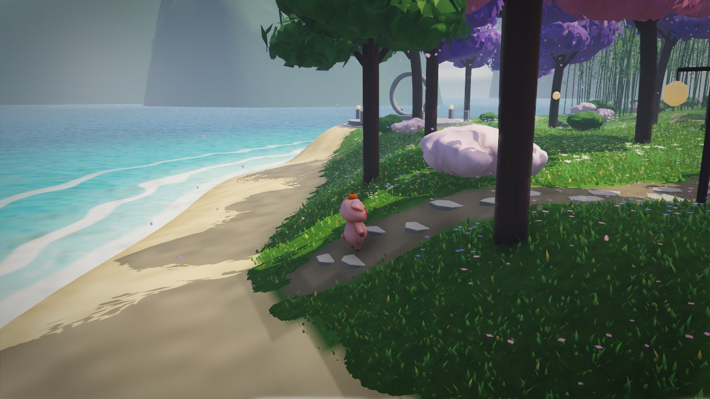
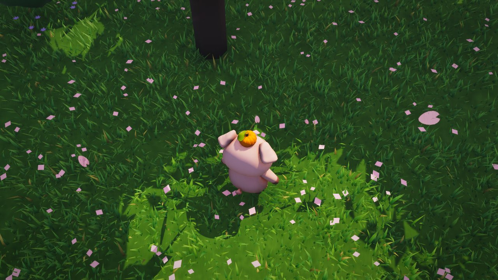
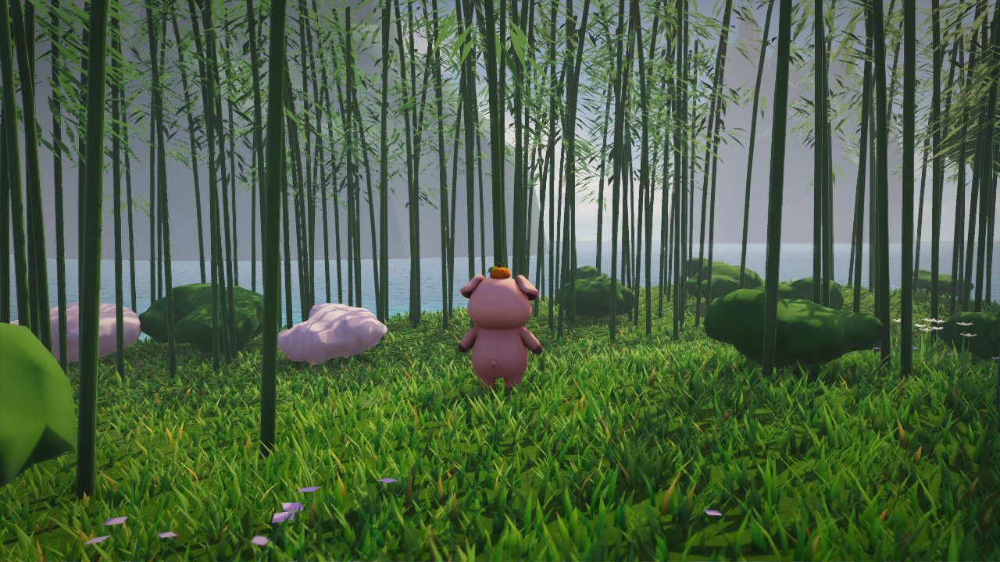
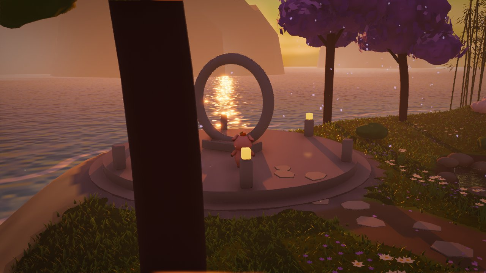
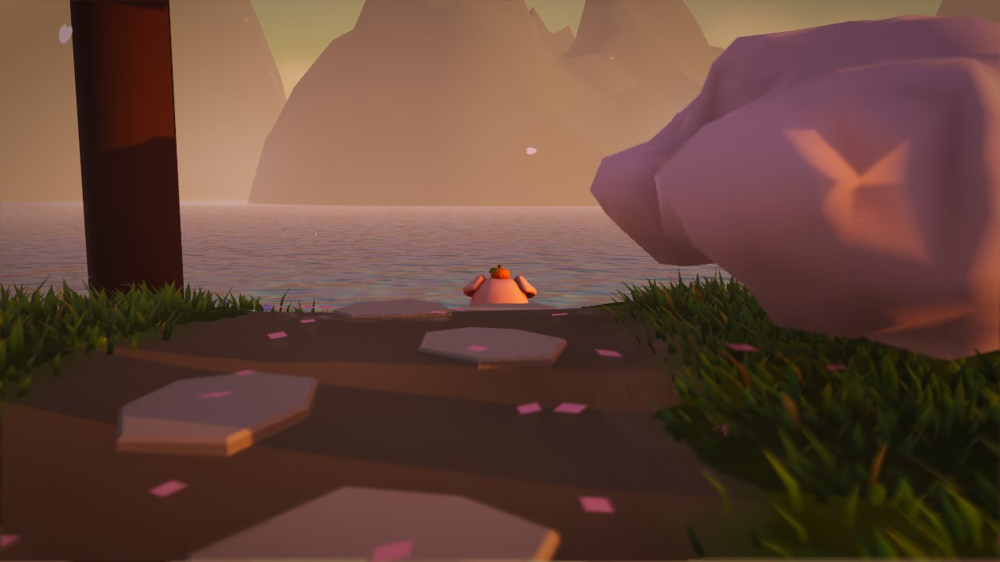
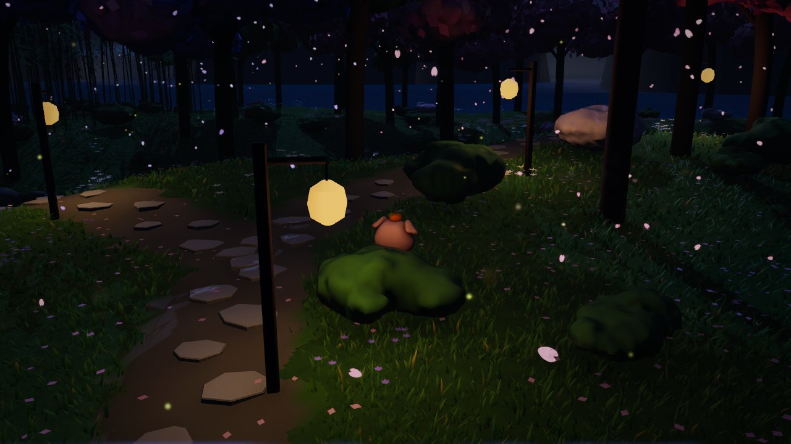

# 3d/garden-island：豬大花園島

一座約 80 m 寬、四面是海的花園島，第三人稱走動用。**全部由程式生成**，沒有任何美術檔（只有走在上面的豬大是模型，來自 `3d/zhuda-characters`）：

- 起伏的草地與烘色地面（176×176 格、512 貼圖：草、沙、濕沙、石板路、岸、池底、落瓣），會被角色踩倒的草（`ZhudaGrassField`）
- 一張 `ZhudaWaterSurface` 同時是**睡蓮池、溪流、遠處小水潭**（同一水位，其他地方被地面蓋住），有鏡像、波紋，角色涉水時有水圈
- 從南邊沙灘經燈籠石板路到池邊，再分岔到西邊海邊的**圓石台與石環門**；池上七塊踏石
- 粉、玫紅、紫、綠四種樹（SDF 樹冠＋葉片卡），竹林、灌木（綠、白花）、溪邊石頭、睡蓮葉與花苞、草地花叢、樹下落瓣
- 會動的海（`ZhudaLitSurfaceMaterial`：湧浪、近岸淺色、一道道推上沙灘的泡沫），海平線上 11 座遠島與低霧
- 花瓣（粉、紫）飄落、陽光浮塵、夜晚螢火蟲與星空；燈籠與石台燈夜晚發光並有點光源
- 一天的光用 `3d/day-look`（`OCEAN` 設定），畫質分四級與幀預算用 `3d/quality-tiers`

| 石板路 | 睡蓮池 | 溪流 |
|---|---|---|
|  |  |  |
| **海灘** | **俯瞰** | **竹林** |
|  |  |  |
| **黃昏石台** | **黃昏海邊** | **夜晚** |
|  |  |  |

整張：[`preview/sheet.jpg`](preview/sheet.jpg)。圖是觀看台 `garden-island`、`fx=high&governor=0`、1280×720、無頭 Chrome（WebGPU）在虛擬時鐘上拍的（2026-11-25），每張是到那個地點後 4 秒（第一張 5 秒）。

**看它**：`cd prefabs/viewer3d && npm run build && npm run view`，開 `http://127.0.0.1:8930/index.html?scene=garden-island`（走動，時間會走）或加 `&view=pond` 等（見下面「取景點」）。

## 放進遊戲

```bash
cd <repository root>
node prefabs/scripts/sync.mjs games/<遊戲> 3d/garden-island 3d/island-walker 3d/zhuda-characters
# 3d/math、3d/day-look、3d/quality-tiers 會一起帶進去；三個角色模型（約 11 MB）複製到 public/common/3d/zhuda-characters/assets/
```

遊戲的 `zhuda.config.json` 要有 `"features": ["core", "3d", "gltf", "postProcess"]`。最小的完整遊戲（`src/Main.ts`；2026-11-25 把這段原樣放進一個空專案、sync 上面三個模組，對引擎 def94aa 型別檢查、建置都過，無頭 Chrome 開起來是豬大站在睡蓮池邊、沒有錯誤）：

```ts
import { ZhudaEngine, Zhuda3D, ZhudaModelLibrary, DirectoryAssetProvider } from 'zhuda-laya-engine';
import { createGardenIsland, GARDEN_TIERS } from './common/3d/garden-island/garden-island.ts';
import { GARDEN_VIEWS } from './common/3d/garden-island/views.ts';
import { Walker } from './common/3d/island-walker/walker.ts';
import { FollowCamera } from './common/3d/island-walker/follow-camera.ts';
import { WalkInput } from './common/3d/island-walker/walk-input.ts';
import { startTier } from './common/3d/quality-tiers.ts';
import { characterPath } from './common/3d/zhuda-characters/zhuda-characters.ts';

async function main() {
  const params = new URLSearchParams(location.search);
  const container = document.querySelector<HTMLElement>('#game')!;
  const ceiling = startTier(params).tier; // ?fx=low|mid|high|max；沒給時手機低、其他中
  const context = await ZhudaEngine.boot({
    container,
    width: window.innerWidth,
    height: window.innerHeight,
    dprCap: GARDEN_TIERS[ceiling].dpr,
    features: ['core', '3d', 'gltf', 'postProcess'],
    bgColor: '#9fb6d2',
    maxLights: 16, // 6 盞燈籠＋3 盞石台燈
  });
  const scene = Zhuda3D.createScene3D(context.rootScene);
  const camera = Zhuda3D.createCamera(scene, { position: [9, 9, 30], rotationEuler: [-20, 10, 0], fov: 42, near: 0.15, far: 1500 });
  const island = createGardenIsland(scene, camera, { ceiling, hour: 9 });

  const provider = new DirectoryAssetProvider({ baseUrl: './', timeoutMs: 240_000 });
  const models = new ZhudaModelLibrary({ provider, timeoutMs: 240_000 });
  const pig = await models.instantiate(characterPath('zhuda'), { retries: 2, independentMaterials: true });
  const walker = new Walker(pig, island, GARDEN_VIEWS.pond.at); // 島本身就是 WalkWorld
  scene.addChild(walker.root);
  const follow = new FollowCamera(camera, walker.feet, { ground: island.groundAt, obstacles: island.crowns });
  const input = new WalkInput(container.querySelector('canvas')!, follow.goal);
  window.addEventListener('resize', () => context.resize());

  let hour = 9;
  context.runtime.start((dt: number) => {
    hour = (hour + dt * 0.06) % 24; // 一小時約 17 秒
    walker.update(dt, input.stick(follow.orbit.yaw));
    const eye = follow.update(dt, walker.feet);
    const sky = island.update({ dt, hour, eye, target: follow.target, bodies: [walker] });
    void sky; // sky.night、sky.sun（0..1）：遊戲自己的燈、音樂、介面可以跟著
  });
}
void main();
```

和原版遊戲完全相同的接法（網址參數、`window.__SCENE__`、`?view=`）是 `viewer3d/src/presets/garden-island.ts`。
它的 `window.__SCENE__` 就是原遊戲的 `window.__ISLAND__`：`state()`（backend、view、feet、hour、fps、grass、particles、quality、setting、renderScale）、
`set({ hour, run, yaw, pitch, distance, at, walkTo, lookAt, face })`（`run: false` 停住時鐘；`at: [x, z]` 瞬移；`walkTo: [x, z]` 自己走過去；`lookAt: [x, y, z]` 或 `null`）、`errors()`、`ready`，
另外掛著 `walker`、`island`、`follow`、`input`、`fx`。檢查情境：`viewer3d/scenarios/garden-island.json`（原 tour.json）、`garden-island-views.json`（九個取景點，`preview/` 的圖就是它拍的）：

```bash
cd prefabs/viewer3d && OUT=/tmp/garden node tools/play.mjs scenarios/garden-island.json "scene=garden-island&fx=high&governor=0"
```

### `createGardenIsland(scene, camera, options)` 的選項

| 選項 | 預設 | 原遊戲的網址參數 |
|---|---|---|
| `ceiling` 選定的畫質（`GARDEN_TIERS` 的索引 0 低、1 中、2 高、3 滿）：調速器階梯的頂、細節量、葉片投影 | 1 | `?fx=low\|mid\|high\|max`（`startTier(params).tier`） |
| `quality` 固定的光影等級 0..3（給了就不跟階梯，也不開調速器） | 無 | `?quality=` |
| `hour` 第一幀的時間 | 10 | `?hour=` |
| `weather` `'clear'\|'rain'\|'storm'\|'mist'`（只改光影；這座島沒有雨滴粒子） | `'clear'` | `?weather=` |
| `off` 關掉光影的某些部分：`fog`、`dof`、`ao`、`clouds`、`shafts`、`ssr`、`exposure`、`blur`、`flare`、`msaa` | `[]` | `?off=fog,dof,…` |
| `fStop` 景深光圈 | 4（`off` 有 `dof` 時 22） | `?fstop=` |
| `grass` 草 | true | `?grass=0` |
| `detail` 葉片卡、落瓣、花叢 | true | `?detail=0` |
| `detailShare` 細節量 0..1 | `GARDEN_DETAIL_SHARE[ceiling]`＝低 0.4、中 0.65、高 1、滿 1 | |
| `detailShadows` 樹冠葉片投影 | 高、滿才投 | |
| `mirror` 水面鏡像（光影 2 以上每幀畫，以下每三幀） | true | `?mirror=0` |
| `governor` 幀太長時降級、有餘裕再升回（預算 `GARDEN_BUDGET_MS` = 1000/55 ms；先降解析度，再降光影，再降草） | true | `?governor=0` |

觀看台另外認 `?view=<取景點>`、`?distance=`、`?dpr=`、`?width=`／`?height=`。原遊戲的 `?film=1`（影片模式）沒有搬進觀看台，做法見下面「拍片」。

### 每幀：`island.update(frame)` → `SkyState`

在角色走完、鏡頭放好之後呼叫。`frame`：`dt`、`hour`（遊戲自己跑時鐘）、`eye`、`target`、`bodies`（島上的人：第一個是玩家，花瓣、浮塵、螢火蟲圍著他生；每個人都會壓草、涉水時起水圈；`Walker` 就是一個）、`film`（逐幀擷取時：光影每幀設、鏡像每幀畫、不調速）、`fStop`（這一幀的光圈）。
它做的事和原遊戲每幀做的一樣、順序一樣：景深對焦、每 0.1 秒依時間換光影與水面的太陽、水面與光影更新、海與水的時間、水圈、鏡像、燈籠亮度與點光源、草的風與踩踏、粒子、調速器。回傳的 `SkyState` 有 `night`、`sun`（0..1）、`wind`、`look`。

### 傳回的物件

- 地面查詢：`groundAt(x, z)`（站的高度：石台頂、踏石頂；地圖外 `null`）、`walkable(x, z)`（陸地上、不在深水；踏石可走，溪邊淺處可涉水）、`heightAt(x, z)`（地面網格本身）。更多在 `land.ts`：`coverAt`（sea／sand／grass／path／bank／bed／terrace）、`waterEdge`、`insideBy`、`grassGrows`、`petalsAt`，以及 `POND`、`POOL`、`STREAM`、`PATH`、`PATH2`、`TERRACE`、`STEPS`、`TREES`、`CULMS`、`BUSHES`、`ROCKS`、`LANTERNS`、`START`、`WATER_Y`。
- `start`（起點，石板路上）、`crowns`（樹冠球，給 `FollowCamera` 的 `obstacles`）
- `look`（`ZhudaSceneLook`）、`water`、`fx`（`GardenFx`：`budget`、`alive`）、`grass`（可能為 null，換級時會重建）、`lights`（點光源）、`glows`（夜晚發光的材質）
- `steps`、`step`、`applyStep(step)`（自己換畫質）、`seconds`、`sky`、`stats()`（setting、renderScale、quality、grass、particles）、`dispose()`（拆掉島上的一切，不含角色、相機、引擎）

### 取景點（`views.ts` 的 `GARDEN_VIEWS`）

| id | 名稱 | 時間 | 角色位置 | 面向 | 鏡頭 yaw／pitch／距離 | 出處 |
|---|---|---|---|---|---|---|
| `path` | 石板路 | 10.5 | 4.2, 21 | 3.1 | 0.15／0.22／8 | 原遊戲 tour.json |
| `pond` | 睡蓮池 | 10.5 | 15.2, −0.6 | 3.7 | 0.6／0.33／9 | tour.json |
| `stream` | 溪流 | 10.5 | −4.5, 5.6 | 1 | 2.3／0.4／9 | tour.json |
| `beach` | 海灘 | 10.5 | 3, 32.5 | 3.1 | 1.2／0.2／10 | tour.json |
| `above` | 俯瞰 | 10.5 | 9, 14 | 3.1 | 0.4／0.9／26 | tour.json（樹冠擋住，鏡頭會被拉近到樹下） |
| `bamboo` | 竹林 | 15 | −16.5, −5.5 | 4.2 | 1.2／0.06／6.5 | 影片 s08 的起始構圖 |
| `terrace` | 黃昏石台 | 17.9 | −20.6, 18.6 | 4.3 | 1.15／0.2／11 | 影片 s10 的起始構圖 |
| `dusk` | 黃昏海邊 | 17.6 | 3, 33 | 0 | 3.0／0.12／7 | 原遊戲 sea.json |
| `night` | 夜晚 | 21.5 | 4, 16 | 3.1 | 0.2／0.25／8 | tour.json |

## 檔案

| 檔案 | 內容 |
|---|---|
| `garden-island.ts` | 入口：`createGardenIsland()`、`GARDEN_TIERS`、`GARDEN_DETAIL_SHARE`、`GARDEN_BUDGET_MS` |
| `land.ts` | **島的唯一資料來源**：高度、海岸（`rimAt`）、池、溪、水潭、路、石台、踏石，樹／竹／灌木／石頭／燈籠的位置（固定種子），可走範圍。沒有引擎，node 可測 |
| `views.ts` | 取景點 `GARDEN_VIEWS`、`GARDEN_START`、樹冠球 `CROWN_SPHERES`。沒有引擎 |
| `build.ts` | 地面網格與烘色貼圖、樹幹與樹冠、灌木、竹、石頭、踏石、睡蓮、石板、燈籠、石台與石環門 |
| `detail.ts` | 薄片層：樹冠葉片（深淺兩色）、落瓣、花叢（白色六瓣、矮紫花）。正反兩面同一法線（用材質雙面會讓背面變黑） |
| `far.ts` | 海平線上的 11 座遠島 |
| `sea.ts` | 會動的海。**岸線公式和 `land.ts` 的 `rimAt` 相同，改一邊要改另一邊**；自訂 uniform 一定要 `u_Zhuda` 開頭，否則材質建立時丟錯 |
| `fx.ts` | `GardenFx`：花瓣、浮塵、螢火蟲、星空、海霧（引擎 3D 粒子，貼圖用程式畫） |
| `source/` | 不會複製進遊戲：見下面「source/」 |
| `preview/` | 上面的圖與 `sheet.jpg` |

`land.ts`、`build.ts`、`detail.ts`、`far.ts`、`sea.ts`、`fx.ts` 和原遊戲 `src/` 的同名檔逐字相同，只改了 `math.ts` 的 import 路徑（`../math.ts`，就是 `3d/math`）。

## 效能（vivo V40，Android 16，Chrome 157，2026-11-18，引擎 a5dfc6b）

直式 411×818、像素比 2.625；每個地點等畫面穩定後量 6 秒的幀間隔；角色站著不動。

| 建置（實際後端） | 設定 | 每秒幀數 | 95% 幀間隔 |
|---|---|---|---|
| auto（webgpu） | 低，六個地點 | 47.1–52.1 | 33.5 ms |
| auto（webgpu） | 預設（自動調），兩個地點 | 47.6–50.2 | 33.5 ms |
| WebGL | 低，六個地點 | 58.5–59.7 | 16.8 ms |
| WebGL | 中，兩個地點 | 28.0–29.3 | 33.6–50.3 ms |

- 調整前（細節沒跟畫質走、葉片都投影、鏡像每幀畫）：auto 低 39.6–44.8、auto 中 11.5–23.6、WebGL 低 50.2–59.2。現在的 `GARDEN_DETAIL_SHARE`、低中不投影、光影 2 以下鏡像每三幀，就是那次調出來的。
- 分項關掉量過（auto 低，兩個地點，基準 46.4／49.8）：不建細節 47.6／51.4，不長草 49.1／54.1，不畫鏡像 49.9／54.2，三樣都關 56.4／59.7。沒有單一元兇。
- 同樣的低設定，這支手機上 WebGL 比 WebGPU 快約 10 幀，原因沒查。中設定在手機上不夠順。
- 這些是原遊戲在舊引擎（a5dfc6b）上的數字；搬進函式庫後（引擎 def94aa）沒有在手機上重量。iPhone 沒測過。
- 無頭 Chrome（Apple M4）的幀率在 29–60 之間跳動，不能當量測。

## 已知限制

- 沒有涼亭、沒有沙灘上的草叢；樹幹是直筒，沒有分枝細節。
- 溪流是平的（引擎的水面只能水平），沒有落差。
- 沒有聲音、介面、互動（對話、收集、許願燈等玩法一樣都沒有）。
- 鏡頭只避開樹冠，不避樹幹、灌木、竹子。
- 夜晚燈光會把附近樹冠照得偏紅；燈籠光照範圍已從 9 m 改成 6 m，手機上沒再看。
- 只量了站著不動的畫面；在真手機上用手指走動沒人試過（無頭 Chrome 的合成觸控試過，見「驗證」）。

### 做的時候發現的引擎缺口（原遊戲交接時記下，還沒回報成引擎紀錄）

- 沒有樹或樹冠的生成器；等值面做出來是平滑團塊，要葉片感得自己做卡片（`detail.ts`）。
- 地面沒有頂點色或混色（splat）；這裡自己烘一張顏色貼圖。
- 自己組 `MeshData` 時三角形朝向沒有文件說明，第一次地面整片被剔除（`build.ts` 的索引順序是對的那一種）。
- 一個場景只有一面水鏡：池塘和海不能同時是 `ZhudaWaterSurface`（所以海是 `ZhudaLitSurfaceMaterial` 自己寫的表面）。
- 沒有角色控制器、沒有鏡頭對一般網格的碰撞（`3d/island-walker` 自己做，鏡頭只閃球）。

## source/（不複製進遊戲）

原遊戲的微電影《放假的豬》（179 秒，1280×720，24 fps，13 個鏡頭，12 句旁白，聲線「豬大_正式選定_C慵懶吐槽」）是用這座島拍的。成片、逐幀圖和旁白錄音已移到別處，這裡只留重拍需要的文字：

| 檔案 | 內容 |
|---|---|
| `film.ts` | 分鏡：13 個鏡頭的位置、時間、走到哪、動作、鏡頭起訖、光圈 |
| `film.json`、`lines.json`、`timeline.json` | 片名卡、網址參數（`fx=max&governor=0`）；12 句旁白；定剪的每個鏡頭長度與字幕時間 |
| `film.mjs`、`mix.py` | 逐幀擷取（無頭 Chrome，`?film=1`、`window.__FILM__`）與混音（旁白時壓低配樂，-14 LUFS）。和 `~/.claude/skills/zhuda-3d-film` 範本的同名檔相同 |
| `phone.mjs` | 在 vivo V40 的 Chrome 上跑情境並量幀間隔（上面的效能表就是它量的；要 `adb reverse`、`adb forward`、`ZHUDA_PHONE_ADB`、`ANDROID_SERIAL`） |
| `tour.json`、`sea.json` | 原遊戲的檢查情境（`I` 是舊的 `window.__ISLAND__`；觀看台版是 `viewer3d/scenarios/garden-island.json`，`S` 是 `window.__SCENE__`） |
| `lockstep.mjs` | 虛擬時鐘的擷取工具：換掉 `performance.now`、`Date.now`、`requestAnimationFrame`，每步恰好走 wait×60 格；同一場景跑兩次像素相同。下面的逐像素比對和 `preview/` 的圖都是它拍的（從 `viewer3d` 跑，用法在檔頭） |
| `Main.ts` | 原遊戲的入口，照原樣留著：影片模式怎麼接（`applyShot`：換鏡頭時把角色和鏡頭直接放好、鏡頭不閃樹冠、光圈跟鏡頭） |

影片模式本身（`film-mode.ts`）和技能 `zhuda-3d-film` 的範本逐字相同，沒有放在這裡。

### 拍片

用這個模組重拍：照 `zhuda-3d-film` 技能做，`applyShot` 換成這樣（`follow` 是 `FollowCamera`，`walker` 是 `Walker`）：

```ts
follow.avoid = false; // 分鏡是手動構圖，遠景不該被拉進樹裡
// 每一格：
if (cut) {
  walker.place(shot.at[0], shot.at[1]);
  walker.yaw = shot.face; walker.speed = 0; walker.goal = shot.walkTo ?? null;
  follow.target = shot.from.lookAt ?? [walker.feet[0], walker.feet[1] + 1, walker.feet[2]];
  follow.boom = shot.from.distance;
}
follow.set({ yaw: …, pitch: …, distance: … }); // from → to，用 cue.ease
follow.lookAt = …;                              // from.lookAt → to.lookAt，沒有就 null
island.update({ dt: 1 / 24, hour, eye, target: follow.target, bodies: [walker], film: true, fStop: shot.fStop ?? 4 });
```

## 驗證（2026-11-25，Apple M4，無頭 Chrome，WebGPU，1280×720，引擎 def94aa）

- **逐像素比對原遊戲**：原遊戲複製一份（引擎改釘 def94aa、同一份 node_modules、同一個 Chrome）和觀看台的 `garden-island`，跑同一個情境（原 tour.json 的六個畫面：石板路、睡蓮池、溪流、海灘、俯瞰、夜晚，`fx=high&governor=0`）。在虛擬時鐘上跑（`performance.now`、`Date.now`、`requestAnimationFrame` 換掉，每個步驟恰好走 wait×60 格、每格 1/60 秒）：**六張都是 0 個像素不同**；原遊戲自己跑兩次也是六張都 0，所以這個比法本身是準的。
- 用各自原本的 `play.mjs` 照真實時間跑：原遊戲對觀看台 23–53 萬個像素不同，原遊戲對自己再跑一次 27–72 萬個，差別都在花瓣、螢火蟲、草的擺動、角色待機的姿勢（跟幾秒內實際跑了幾格有關），不是場景不同。
- 兩邊都沒有渲染錯誤、沒有頁面錯誤。
- 輸入（觀看台，`view=path&fx=low`，DevTools 送的真事件）：按住 W 1.5 秒走了 4.3 m（離開鏡頭的方向）、滑鼠往右拖 100 px 視角轉 −0.6、滾輪拉遠 8→11.9 m、觸控左側往上拖 80 px 走了 5.1 m 且放開後搖桿歸零、右側觸控拖曳轉視角 +0.48。
- `tests/garden-island.test.mjs`：原遊戲的三項地形測試（照搬）＋樹、竹、灌木、石頭、燈籠的數量（50、150、60、76、6）＋每個取景點都可站＋樹冠球＋走路規則在這座島上不會走進深水。

## 來源

`games/zhuda-garden-island`（2026-11-18 做的：四輪地形、細節、海與遠景、會動的海，vivo V40 調校，微電影《放假的豬》）。2026-11-25 收進函式庫，原專案之後可刪。
