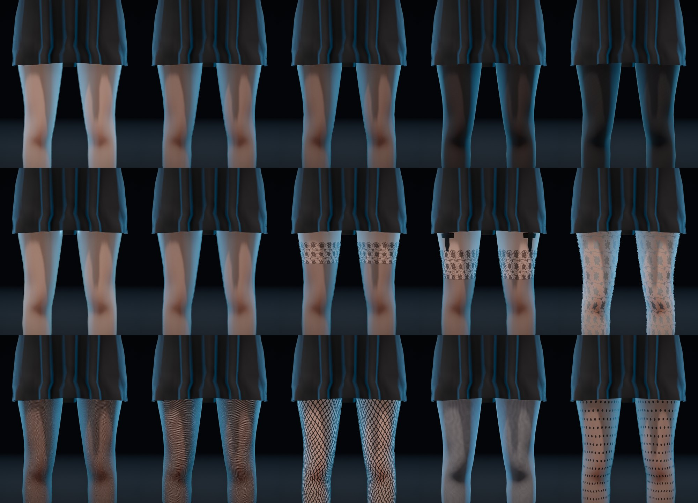
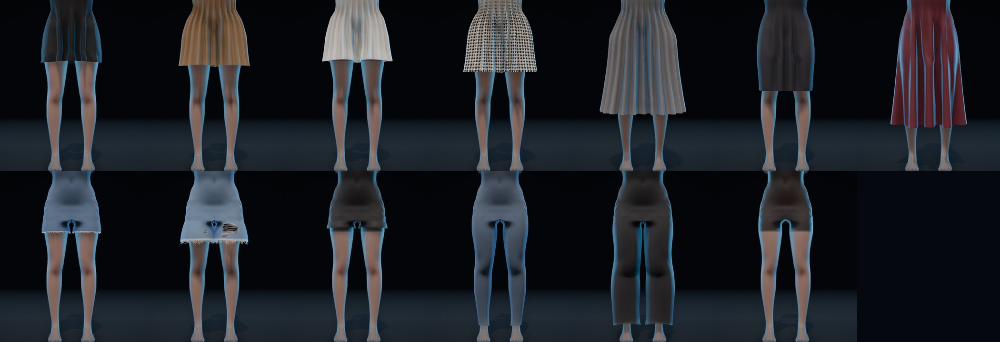
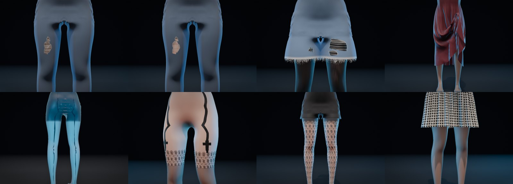

# 3d/layered-hosiery：分層絲襪（拉扯、撕破、裙子與褲子）

一雙建模的腿，貼著皮膚一層絲襪，外面再一層裙子、短褲、長褲或不穿。手指落在哪裡就拉最上面那一層，拉夠遠就撕破；褲子破了洞，從洞裡還能拉到底下的絲襪。15 種絲襪、13 種下身。全部走引擎的公開 API，沒有貼圖檔（織紋是算出來的 128×128 小圖）。







- 出自「撕襪實驗室」（原本的 `games/stocking-tear`，2026-11-15 做的試驗台，不是遊戲：沒有分數、沒有時間）。2026-11-26 搬進元件庫；程式逐像素對過（見「檢查過的」）。做法寫成路線 [`layered-cloth-on-body`](../../../docs/routes/layered-cloth-on-body.md)。
- 觀看台：`prefabs/viewer3d` 的 `?scene=layered-hosiery`（`&type=garter&bottom=none`、`&hud=0` …，網址列在預設檔開頭）。
- **身體的授權**：`assets/legs.json` 是 MakeHuman 基礎網格經 MPFB 2.0.18 產生的輸出，CC0。MPFB 這個 Blender 外掛本身是 GPL-3，**不在倉庫裡**；要重做身體才需要自己裝（見「重做身體」）。
- **只做成人款式**。身體是成年人的比例（`source/export_legs.py` 的 `age: 0.5`），下身沒有學生制服裙：原專案刻意不做，這裡照舊。加新款式時請維持。

## 放進遊戲

```bash
npx zhuda-prefab-sync . 3d/layered-hosiery
```

遊戲的 `zhuda.config.json` 要有 `core`、`3d`、`postProcess`。

```ts
import { ZhudaEngine, Zhuda3D, ZhudaSceneLook } from 'zhuda-laya-engine';
import { LEGS_PATH, HOSIERY_VIEW, createHosieryWearer, frameHosiery, hosieryLook, mountHosieryStudio, pointerRay, type LegsFile } from './common/3d/layered-hosiery/layered-hosiery.ts';
import { TYPES } from './common/3d/layered-hosiery/patterns.ts';
import { BOTTOMS } from './common/3d/layered-hosiery/bottoms.ts';

const context = await ZhudaEngine.boot({ container, features: ['core', '3d', 'postProcess'], bgColor: '#05080f' });
const scene = Zhuda3D.createScene3D(context.rootScene, { ambientColor: [0.3, 0.3, 0.32, 1] });
const view = { ...HOSIERY_VIEW };
let { eye, target } = frameHosiery(view, width, height);
const camera = Zhuda3D.createCamera(scene, { position: eye, fov: view.fov, near: 0.03, far: 60 });
const look = new ZhudaSceneLook(scene, camera, hosieryLook(), { quality: 3 });
mountHosieryStudio(scene, camera); // 攝影棚反射＋背後兩盞青色的邊光

const wearer = createHosieryWearer(scene, (await (await fetch(LEGS_PATH)).json()) as LegsFile, { type: TYPES[1], bottom: BOTTOMS[0] });
// 指標：按下 → wearer.press(pointerRay(eye, target, view.fov, box, x, y))，回傳 'leg'、'skirt' 或 null（沒碰到，自己拿去轉鏡頭）
//       移動 → wearer.drag(dx, dy)（離按下處幾個 CSS 像素）；放開 → wearer.release(true)
// 每幀：wearer.step(delta); look.update(eye, target, view.fov, width / height);
// 換裝：wearer.dress(TYPES[8]); wearer.wear(BOTTOMS[10]); wearer.reset();
```

模組不碰指標事件、不管時鐘：遊戲給它射線、每幀叫 `step`。完整的接法（鏡頭轉動、滾輪、面板、手機畫質）在 `viewer3d/src/presets/layered-hosiery.ts`，約 170 行。

## 檔案

| 檔 | 內容 |
| --- | --- |
| `layered-hosiery.ts` | `createHosieryWearer`：腿、絲襪、裙子、褲子、拉扯的彈簧、撕破、選取。另有試驗台的光（`hosieryLook`、`mountHosieryStudio`）、取景（`frameHosiery`）、指標射線（`pointerRay`） |
| `meshleg.ts` | **核心**。每個頂點知道自己繞腿多遠、多高：拉扯、拉伸量、撕破的起點、褲子層（`createLayer`）、胯下補平（`bridgeCrotch`）、給布料用的腿部碰撞表（`legTable`）、裙子用的臀圍（`hipReach`）。換一副身體只要頂點資料的格式相同 |
| `shaders.ts` | 三個 `ZhudaLitSurfaceMaterial` 的表面掛鉤：`HOSIERY`（針織、透光、蕾絲、縫線、吊帶、破洞與抽絲）、`GARMENT`（丹寧、毛料、毛邊、破洞）、`SKIRT`（壓褶、千鳥格） |
| `patterns.ts` | 15 種絲襪：8D 到 120D、亮面、後縫線、蕾絲大腿襪、十字吊帶襪、蕾絲褲襪、三種網襪、羅紋、點點。每種的小圖、密度、光澤、多用力會破（`tearAt`）、抽絲多長、破洞大小、顏色 |
| `bottoms.ts` | 13 種下身：七條裙子（引擎的布料，每款重建）、五件褲子（腿上的第二層）、不穿 |
| `bench-hud.ts` | 試驗台的 DOM 面板（窄螢幕是抽屜）。有自己介面的遊戲不用拿 |
| `assets/legs.json` | 身體：兩條腿各約 8,000 個頂點、15,800 個三角形，含 Blender 做好的絲襪靜止形狀（離皮膚中位數 2.3 mm） |
| `source/` | `export_legs.py`（身體怎麼做的）、`look-book.mjs`（預覽圖怎麼拍的）、原專案的 `Main-2026-11-15.ts`、交接紀錄、工具、改用 Blender 之前手刻的腿 |

## 寫掛鉤時三件踩過的事

1. **`fwidth`／`dFdx` 不能放在 `if` 底下，也不能放在從 `if` 裡呼叫的函式裡。** WebGL 編得過，WebGPU 編不過（WGSL 只准在一致的控制流裡取導數），結果是材質照畫但沒有破洞，唯一的訊號在 `renderer.errors`。做法：在掛鉤最前面取一次導數，當參數傳進去。測試會擋。
2. **表面材質不收 uniform 陣列。** 12 個破洞是 24 個有編號的 uniform（`u_ZhudaTearPlace0…11`、`u_ZhudaTearShape0…11`）。
3. **同名著色器的每個材質，建立時的起始值要一樣。** 用零建立，再 `set()` 自己的值（左右腿、換款式都是這樣）。原專案的整理紀錄說引擎在 2026-11-17 修過這一條；這裡沒有改寫法，也沒有去驗放寬之後的行為。

## 重做身體

需要 Blender 5.2.2 和 MPFB 2.0.18（從 extensions.blender.org 裝進 Blender 的 `user_default` 擴充；GPL-3，不要放進倉庫）。指令在 `source/export_legs.py` 開頭；輸出寫回 `assets/legs.json`。腳本做的事：瘦長的成年女性、烘體型、在腰線（1.115 m）切開並去掉手臂、併腿、把胯部抹成素面（沒有解剖細節）、細分一次、做絲襪的 shape key、從中線分成左右兩條腿。

## 檢查過的（2026-11-26，Apple M4，Chrome 158，引擎 `e4ba0212` 加這次的修改）

- **搬移沒有改變畫面。** 把原專案的程式原封不動接上現在的引擎建置（一行都不用改就建得起來），和這個模組用同一支腳本各跑兩輪（WebGPU，1280×720，真滑鼠）：穿著、兩腿各撕一洞、蕾絲大腿襪、牛仔長褲、長裙、網襪配破洞短褲。六張圖裡差超過 8／255 的像素都是 0.000%；牛仔長褲和破洞短褲兩張完全相同（最大差 0），其餘最大差 26，和原專案自己兩輪之間的差（最大 18）同一個量級。`preview/original-code-vs-module.jpg` 上排原專案、下排模組。
- **WebGPU 和 WebGL 各跑一遍 `source/look-book.mjs`**（39 張圖）：引擎回報的繪製錯誤 0、頁面錯誤 0。真滑鼠拖曳：兩邊大腿各撕一洞；牛仔褲撕一洞（計數 `[0,0,1,0]`），同一處再拖一次，底下的網襪也破（`[1,0,1,0]`）；長裙下襬平均高度從 0.285 m 掀到 0.435 m，放手 1.2 秒後回到 0.286 m。原專案紀錄裡「換成 Blender 身體之後沒驗過」的三項（WebGL、每一款逐一看、吊帶的位置）這次都拍了。
- 不帶面板的 36 張，WebGL 和 WebGPU 逐張比：除了掀裙那張（手還抓著、是動態的），差超過 32／255 的像素最多 0.05%。
- `prefabs/tests/layered-hosiery.test.mjs`（9 個，不用瀏覽器）：款式目錄、身體資料、掛鉤的三條規則、在真的身體資料上跑拉扯、放鬆、撕破起點、褲子層、碰撞表。

## 沒檢查的

- **沒有人看過**，只有我（Claude）看圖。
- **這一版引擎沒有上手機。** 原專案 2026-11-15 在 vivo V40 上量過（WebGPU 待機約 51–55 fps、拉扯中約 37 fps，裙子布料 64×14 約 6 ms），那是舊引擎（`ed1ddbc`）加原專案的數字，紀錄在 `source/HANDOFF-2026-11-15.md`。
- **花費沒有量準。** 這次量的時候這台 Mac 的負載平均是 6：有裙子時布料每幀從約 5 ms（60 fps 的那一次）到 30 ms 以上（畫面掉到 30 fps 以下時，每幀補的步數變多），同一支腳本每次跑都不一樣，原專案的程式和模組是同樣的分布。原紀錄寫 3–9 ms。兩版引擎之間 `Cloth.ts`、`ParticleCore.ts` 沒有改過，所以我判斷是機器忙，但沒有在閒置的機器上重量。
- 拍圖時每款只看一個角度；聲音沒有（原專案也沒有）。
- 沒有重跑 `export_legs.py`（需要另外裝 MPFB）；`legs.json` 是原專案那一份，逐位元組沒動。

## 已知的樣子（這次沒動）

- 原專案的紀錄寫的：腳背比腿亮一點（正對主光）；手機上牛仔褲還看得到淡淡的橫紋。
- 這次看圖看到的：「不穿下身」配吊帶襪時，帶子一路往上畫到腰（`preview/by-hand.jpg` 下排第二格）。
- 拖曳轉鏡頭只到左右各約 52 度（`HOSIERY_VIEW_LIMITS`）；要看背後的縫線用網址的 `yaw`（度）。

## 原專案沒有搬過來的

`package.json`、`package-lock.json`、`tsconfig.json`、`zhuda.config.json`（引擎釘在 `ed1ddbc`，功能 `core`／`3d`／`postProcess`，WebGPU）、`public/index.html`、它自己的 `AGENTS.md` 和 `README.md`（引擎範本產生的）。`.gitignore`（兩行）也沒搬。其餘都在這個資料夾：程式在模組檔裡，改寫過的三個檔另外留了原樣對照：`src/Main.ts` 在 `source/Main-2026-11-15.ts`，`src/hud.ts` 在 `source/hud-2026-11-15.ts`（模組用的是 `bench-hud.ts`），`test/patterns.test.mjs` 在 `source/old-patterns-test-2026-11-15.mjs`（模組的測試是 `prefabs/tests/layered-hosiery.test.mjs`，包含它那兩個）。`tools/` 裡三支腳本的引擎路徑改過（原本寫死在一台機器的家目錄）；四張手機截圖裁掉了狀態列。
