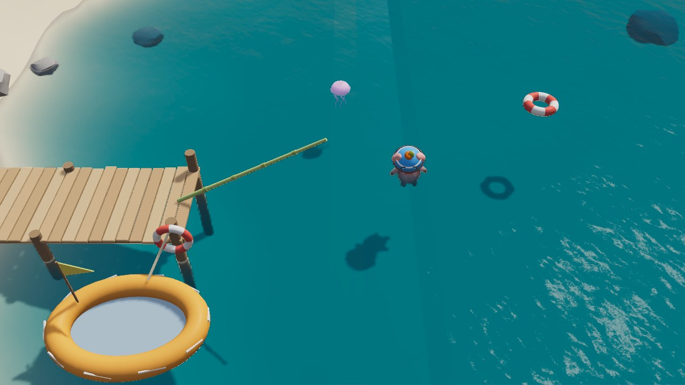
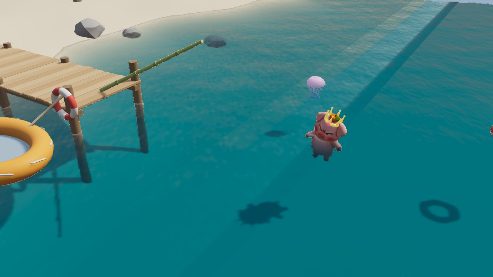
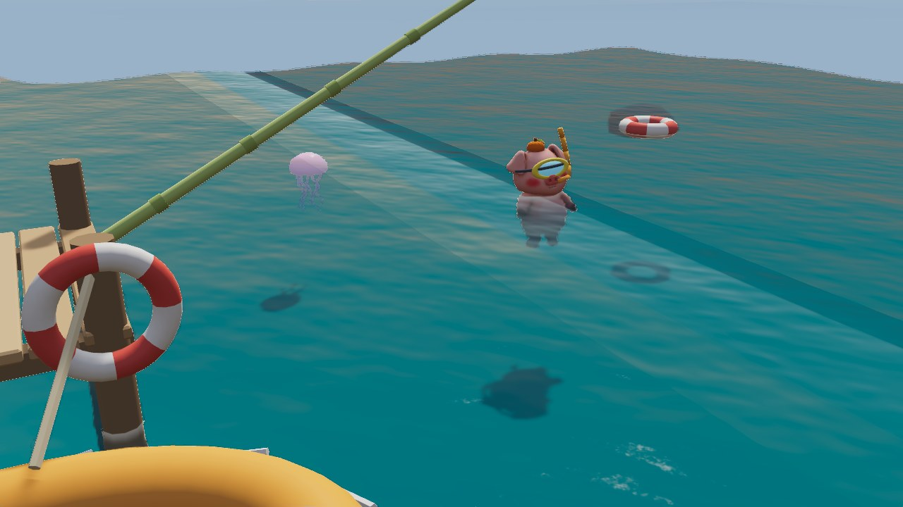

# 3d/seaside-pier：海邊小場景（沙灘、碼頭、救生艇）

俯視玩法用的一小塊海邊：沙灘、海床、石頭、兩棵椰子樹；一條木碼頭和繫在旁邊的救生艇；放進海裡的竹竿、泳圈、水母；豬大能戴的五件配件（泳帽、救生衣、皇冠、墨鏡、潛水面鏡）。海面是引擎的 `ZhudaWaterSurface`，光是 `ZhudaSceneLook`，兩者的設定都在模組裡。



|  |  |
|---|---|

- 出自遊戲中心的「豬二：打撈吧！」（`games/zhuer-fish-them-out`，2026-11-18），2026-11-26 搬進元件庫；遊戲本身沒有動。做法寫成路線 [`pole-rescue-arcade-3d`](../../../docs/routes/pole-rescue-arcade-3d.md)。
- **全部用 Blender 從數字建模**（`source/scene.py`、`source/gear.py`），沒有下載的素材、沒有貼圖，顏色是材質本身。四個檔共 27,302 個三角形、640 KB。
- 觀看台：`prefabs/viewer3d` 的 `?scene=seaside-pier`（`&gear=crown`、`&quality=0`）。

## 放進遊戲

```bash
npx zhuda-prefab-sync . 3d/seaside-pier 3d/zhuda-characters
```

```ts
import { ZhudaSceneLook, ZhudaWaterSurface, ZhudaModelLibrary, DirectoryAssetProvider } from 'zhuda-laya-engine';
import { SEASIDE_LOOK, SEASIDE_CAMERA, seasideWater, seasidePath, mountSeaside } from './common/3d/seaside-pier/seaside-pier.ts';

const look = new ZhudaSceneLook(scene, camera, SEASIDE_LOOK, { quality: 2, cameraPasses: { depth: true, opaque: true } });
const water = new ZhudaWaterSurface(scene, { ...seasideWater(phone), sun: { toward: look.towardSun, color: [0.05, 0.047, 0.042] } });
const models = new ZhudaModelLibrary({ provider: new DirectoryAssetProvider({ baseUrl: './' }) });
const [shore, dock, props, gear] = await Promise.all((['shore', 'dock', 'props', 'gear'] as const).map((id) => models.instantiate(seasidePath(id))));
const { raft, pole, ring, jelly, gear: gearOf } = mountSeaside(scene, { shore, dock, props, gear });
// 每幀：look.update(eye, target, SEASIDE_CAMERA.fov, aspect, dt); water.render();
```

`mountSeaside` 把沙灘和碼頭放進場景（沙灘只收影子、碼頭和救生艇會投影），把道具和配件留在場景裡但關掉，當作複製的來源。位置常數（`DOCK`、`RAFT`、`SEA`、`PIER_END`、`WATER_Y`）和模型裡的位置一致，測試會對。

配件照豬大的**靜止姿勢**建模（腳在原點）：複製一份、放到角色的位置、掛到 `GEAR_BONE` 寫的那根骨頭上（LayaAir 換父節點時會保持世界位置），之後就跟著頭或身體動。觀看台的 preset 就是這樣做的。

## 檢查過的

- 2026-11-26，這台 Mac（Apple M4），無頭 Chrome，`prefabs/viewer3d`：三個畫面（原遊戲的鏡頭、皇冠、潛水面鏡），引擎回報的繪製錯誤 0、頁面錯誤 0。上面三張圖就是那次拍的。
- `prefabs/tests/seaside-pier.test.mjs`：四個檔的節點名、三角形數、沒有貼圖；碼頭頂面、救生艇位置和模組的常數一致。
- 用 Blender 5.2.2 LTS 重跑兩支腳本：`shore.glb`、`dock.glb` 逐位元組相同；`props.glb`、`gear.glb` 大小相同、JSON 相同、頂點位置差不超過 1.5e-8 公尺，但有一千多個位元組不同（沒有追是哪一段）。

## 沒檢查的

- 沒有上手機。原遊戲在手機上用畫質 1、水面解析度 512（`seasideWater(true)`）。
- 沒有和原遊戲逐像素比對（原遊戲沒有動，也沒有拆掉）。
- 場景是照原遊戲那個固定鏡頭擺的：轉到別的角度會看到海床的邊（海面上一條深色的線）。
- 沒有人看過，只有我看圖。
