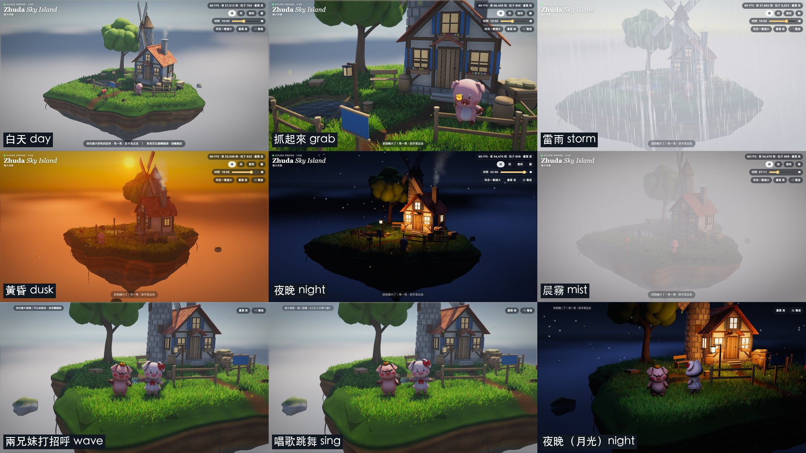
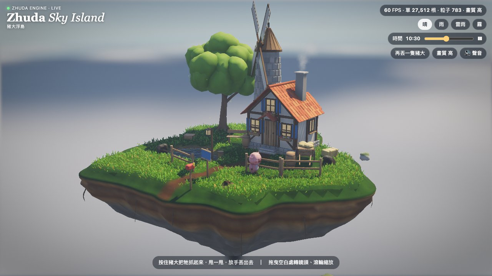
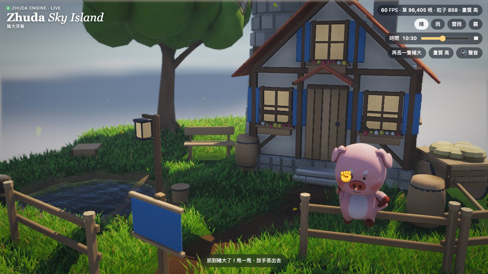
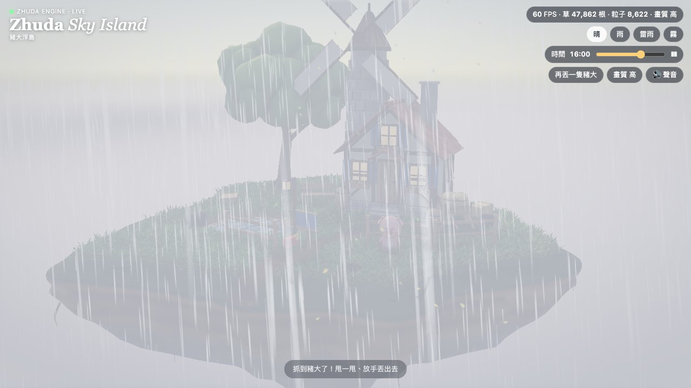
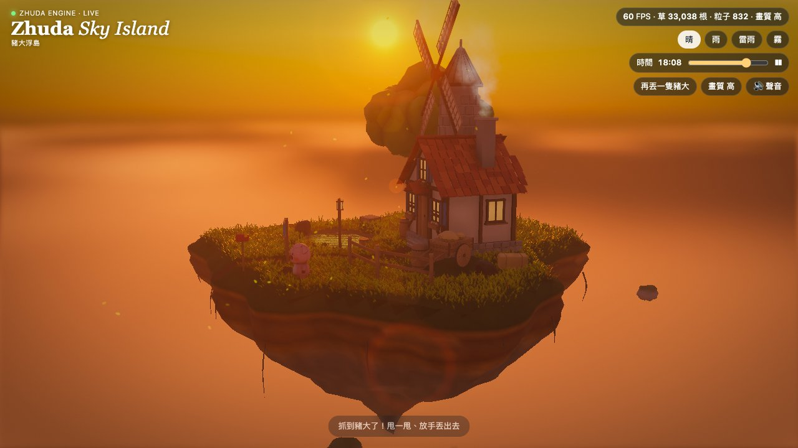
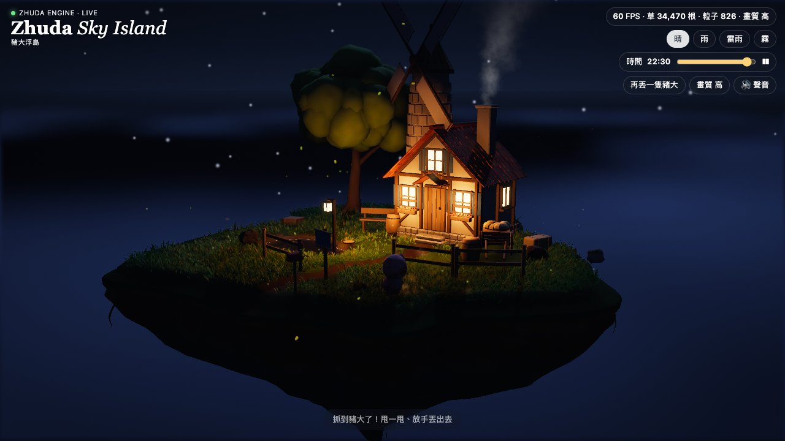
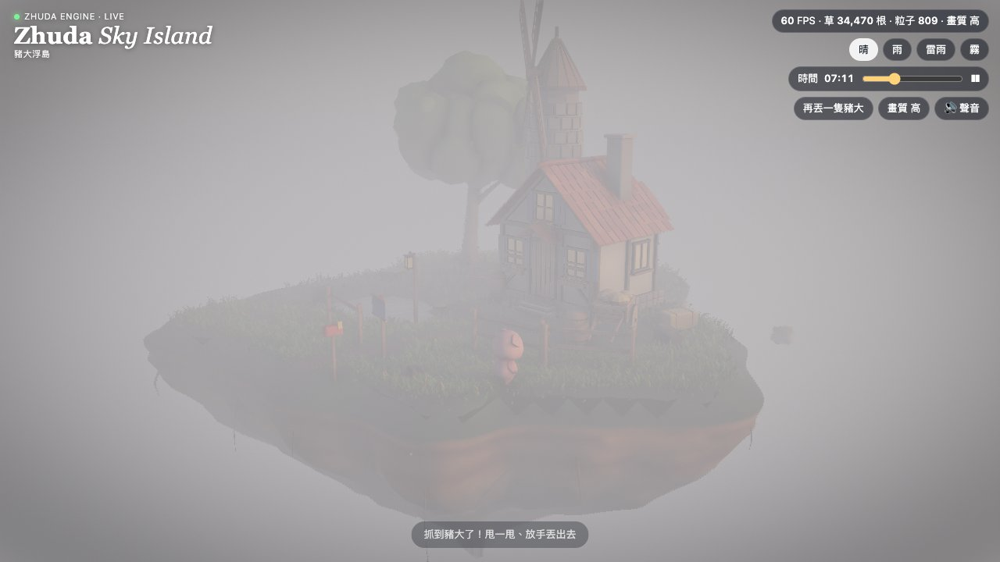
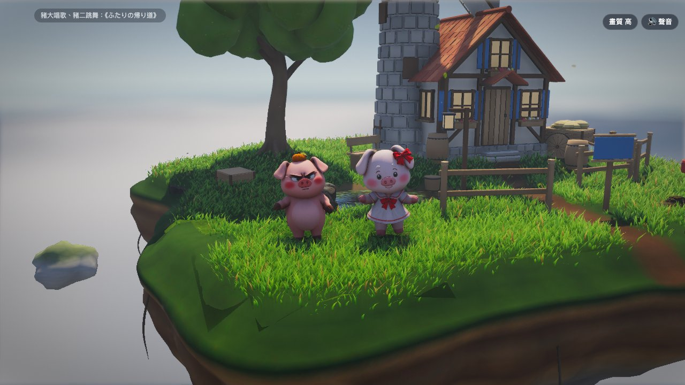
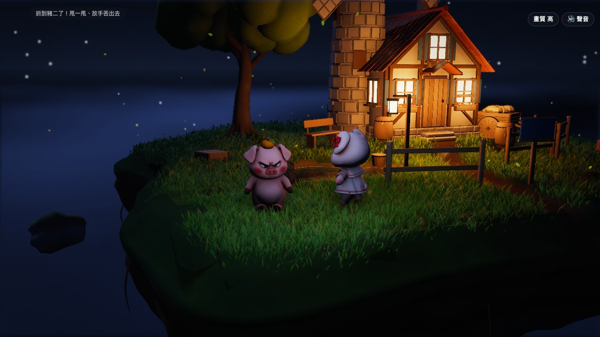

# 3d/sky-island：豬大浮島（雲海上的小島）

雲海上一座 17 公尺寬的小浮島：風車小屋（葉片隨風轉）、池塘（引擎的水面：倒影、折射）、圓滾滾的大樹（樹冠隨風擺）、木箱在池裡漂、柵欄推車木桶長椅告示牌路燈水桶乾草郵筒、`3d/nature-pack` 的蕨類灌木石頭樹樁、滿地會被風吹的草（角色站的地方會被壓倒），晚上窗戶和燈會亮並照亮周圍；晴、雨、雷雨、霧和一天的時間（`3d/day-look`），雨絲、濺環、池面雨點、落葉、煙囪的煙、陽光浮塵、螢火蟲、星空等粒子。



| 白天 | 抓起來 | 雷雨 |
|---|---|---|
|  |  |  |
| **黃昏** | **夜晚** | **晨霧** |
|  |  |  |
| **兩兄妹打招呼** | **唱歌跳舞** | **兩兄妹的夜晚** |
|  |  |  |

（預覽圖是觀看台 `viewer3d` 的 `sky-island`、`home-island` 兩個 preset，無頭 Chrome、1280×720、畫質「高」。）

這個模組只管「地方」。住在島上的角色是 `3d/island-pig`，聲音是 `3d/island-sound`，右上角的介面是 `ui/scene-controls`。整套怎麼接起來，看觀看台的兩個 preset：`viewer3d/src/presets/sky-island.ts`（豬大浮島遊戲：一隻豬大）、`viewer3d/src/presets/home-island.ts`（官網首頁：豬大和豬二、唱歌跳舞、頁面指令）。它們就是遊戲該寫的那一層，可以整份抄進新遊戲再改。

## 放進遊戲

```bash
cd <repository root>
# 只要島：
node prefabs/scripts/sync.mjs games/<遊戲> 3d/sky-island
# 島＋角色＋聲音＋介面（像浮島遊戲那樣）：
node prefabs/scripts/sync.mjs games/<遊戲> 3d/sky-island 3d/island-pig 3d/island-sound 3d/zhuda-characters ui/scene-controls
```

依賴會一起帶進去：`3d/math`、`3d/day-look`、`3d/quality-tiers`、`3d/nature-pack`。模型在 `public/common/3d/sky-island/assets/`（island、house、props、tree，共約 4.9 MB）和 `public/common/3d/nature-pack/assets/`，模型庫的 provider 要以頁面為根（`baseUrl: './'`）。

```ts
import { ZhudaEngine, Zhuda3D, ZhudaModelLibrary, DirectoryAssetProvider } from 'zhuda-laya-engine';
import { createSkyIsland } from './common/3d/sky-island/sky-island.ts';
import { createIslandDay } from './common/3d/sky-island/day.ts';
import { HOME_VIEW } from './common/3d/sky-island/layout.ts';
import { skyAt } from './common/3d/day-look.ts';
import { makeTiers, SKY_ISLAND_GRASS } from './common/3d/quality-tiers.ts';
import { add, random, scale, type V3 } from './common/3d/math.ts';

const FOV = 38;
const tier = makeTiers(SKY_ISLAND_GRASS)[2]; // 高
const context = await ZhudaEngine.boot({ container, width: 1280, height: 720, dprCap: tier.dpr, features: ['core', '3d', 'gltf', 'postProcess'], bgColor: '#9fb6d2' });
const scene = Zhuda3D.createScene3D(context.rootScene);
const camera = Zhuda3D.createCamera(scene, { position: [9, 7, 14], rotationEuler: [-20, 30, 0], fov: FOV, near: 0.1, far: 600 });
const models = new ZhudaModelLibrary({ provider: new DirectoryAssetProvider({ baseUrl: './', timeoutMs: 240_000 }), timeoutMs: 240_000 });
const day = createIslandDay({ hour: 9.5, weather: 'clear', clockRuns: true, rand: random(5) });
const island = await createSkyIsland(scene, camera, {
  look: skyAt(day.hour, day.mix, 20, 0).look, quality: tier.look, fov: FOV, models, grass: tier.grass,
  onProgress: (n, total) => console.log(`${n} / ${total}`),
});
island.setQuality({ look: tier.look, renderScale: 1, particles: tier.particles, grass: tier.grass });

let seconds = 0;
const { target, yaw, pitch, distance } = HOME_VIEW;
context.runtime.start((dt) => {
  seconds += dt;
  day.step(dt);
  const eye: V3 = add(target, scale([Math.sin(yaw) * Math.cos(pitch), Math.sin(pitch), Math.cos(yaw) * Math.cos(pitch)], distance));
  camera.transform.position = new Laya.Vector3(...eye);
  camera.transform.lookAt(new Laya.Vector3(...target), new Laya.Vector3(0, 1, 0), false);
  const sky = skyAt(day.hour, day.mix, distance, day.flash);
  island.update({ dt, seconds, eye, target, sky, flash: day.flash, storm: day.mix.storm });
});
```

加角色：`new Pig(model, island.world, events, rand, eyeNow, options)`（`3d/island-pig`），把它的 `root` 加進場景，每幀 `pig.update(dt, seconds)`，再把腳的位置當 `benders` 傳給 `island.update`；事件裡用 `island.fx` 的 `dust`、`shock`、`droplets`、`waterRing`、`ripples`、`drips`、`shakeDrops`、`stars`、`sparks`、`sweat`、`hearts`、`poof`、`splashes`、`speed` 放特效。模型要和島一起載入（同一個進度），用 `alsoLoad`。

## 介面

`createSkyIsland(scene, camera, options)` → `Promise<SkyIsland>`

| 選項 | 說明 |
|---|---|
| `look`、`quality` | 第一個畫面設定（`skyAt(...).look`）與光影等級 1..3；島自己建 `ZhudaSceneLook`（`island.look`） |
| `fov` | 鏡頭的垂直視角（水面與光影要用） |
| `models` | `ZhudaModelLibrary`（provider 以頁面為根） |
| `alsoLoad` | 跟島同一批載入的模型（角色），`[{ path, independentMaterials }]`，結果在 `island.extra` |
| `grass` | 草的密度與距離（`makeTiers(SKY_ISLAND_GRASS)[i].grass`），`null` 不要草 |
| `moonlight` | 晚上跟著一個點的柔和月光（官網版跟著兩兄妹），每幀給 `moonlightAt` |
| `onProgress(arrived, total, retrying)` | 載入進度；網路斷了會自動重試（約 4 分鐘內，間隔 3 秒倍增到 30 秒） |

`island.update(frame)` 每幀一次：`{ dt, seconds, eye, target, sky, flash, storm, benders?, moonlightAt? }`。它依序做：池裡木箱、畫面設定（每 0.1 秒，閃電時每幀）、水面、`look.update`（**遊戲不要再呼叫一次**）、窗與燈、月光、風（草、風車、煙、落葉）、草、樹冠、粒子。

`island.setQuality({ look, renderScale, particles, grass })`：套一級畫質（`look: null` 表示不動光影等級）；草只有設定變了才重建。搭 `ZhudaQualityGovernor` 和 `ladder()` 的寫法見 preset。

`island.world`（＝`SKY_ISLAND_WORLD`）、`island.obstacles`、`island.windmill`（風車吱嘎聲的位置）、`island.stats`、`island.dispose()`（不釋放模型庫，那是遊戲的）。

其他檔案：

- `ground.ts`：`groundAt(x, z)`（0.2 m 格子雙線性，島外 `null`）、`insideBy`（離島緣多遠）、`rimAt`、`pondDistance`（< 1 在池裡）、`pathDistance`、`WATER_Y`、`HOUSE`、`TREE`、`POND`。資料在 `island-data.ts`（`source/island.py` 產生，不要手改）。
- `layout.ts`（沒有引擎，Node 測試能用）：`PROPS`、`NATURE`、`TREE_PLACE`、`LAMPS`、`CHIMNEY`、`WINDMILL`、`ROOF`、`TOWER`、`roofAt`、`OBSTACLES`、`grassGrows`、`crateAt`、`SKY_ISLAND_WORLD`、`HOME_VIEW`（兩款遊戲的開場鏡頭）、`STAGE`（左前方空地，兩兄妹表演的地方）。
- `day.ts`：`createIslandDay({ hour, weather, clockRuns, hoursPerSecond, rand, onBolt })`：時鐘（預設 0.08 小時／秒＝五分鐘一天，官網版 1/3600＝真實時間）、天氣往選定的慢慢變（`weather =`）或立刻變（`setWeatherNow`）、雷雨時的閃電與 `onBolt(far)`（雷聲在 150 + far × 2200 ms 後）。`rand` 用遊戲的種子亂數；不管有沒有人聽雷，取亂數的次數一樣。
- `fx.ts`：`IslandFx`，所有粒子（貼圖用數字畫的，沒有圖檔）。

## 觀看台

`viewer3d`：`node tools/serve.mjs 8930` 後開 `http://127.0.0.1:8930/index.html?scene=sky-island` 或 `?scene=home-island`；首頁列出每個 preset 的 `views`。

網址參數（兩個 preset 都有）：`hour=18`（固定時間）、`weather=rain|storm|mist`、`fx=low|mid|high|max`（沒帶：手機低、其他中）、`governor=0`（不自動降畫質）、`quality=0..3`（只固定光影等級）、`dpr=1`、`off=fog,dof,blur,ssr,ao,clouds,exposure,flare,shafts,msaa`、`grass=0`、`seed=5`、`distance=`、`fstop=`。

- `sky-island`：`cast=zhuda2|zhuer`（改版豬大或豬二代替影片版豬大）、`grab=1`（開場就把豬大拎起來，給「抓起來」那個 view）。
- `home-island`：`embed=1`（官網嵌入：沒有標題和天氣，滾輪捲頁面）、`clock=fast`（五分鐘一天，否則跟訪客時鐘）、`show=sing|wave|hands|talk|bow|sit`（開場叫他們表演）。

`window.__SCENE__`（給 `tools/play.mjs` 的 `S`）有原遊戲 `window.__ISLAND__` 的全部：`pig`（官網版是 `zhuda`、`zhuer`、`STAGE`、`perform()`、`endShow()`）、`press`、`move`、`release`、`project`、`fx`、`sound`、`state()`、`set({ hour, weather, run, yaw, pitch, distance })`、`errors()`，另有 `ready`、`island`。原遊戲的情境檔改 `I.` → `S.` 就能跑：`viewer3d/scenarios/sky-*.json`、`home-*.json`。

## 驗證過的（2026-11-25，Apple M4，無頭 Chrome 158，1280×720）

和原遊戲逐像素比對：兩款原遊戲複製到暫存（引擎改釘 def94aa、不用 `ZHUDA_ENGINE_ROOT`），和觀看台 preset 跑同一份情境。為了能比到像素，用「虛擬時鐘」跑：每幀固定 1/60 秒，`performance.now`、`Date`、`setTimeout` 跟著它走，`Math.random` 固定種子，場景第一幀前停住，截圖時畫面停著（官網版的歌不給，讓舞跟著場景時鐘；`grab`、`pond` 兩份另外關掉 CSS 漸變，免得下方提示淡到一半被拍到）。

| 情境（原遊戲的情境檔，網址） | 截圖 | 觀看台和原遊戲 |
|---|---|---|
| 浮島 `hero.json`（`fx=high&governor=0`） | 白天、抓著、雷雨、黃昏、夜晚、晨霧 | 6 張都 0 像素不同 |
| 浮島 `grab.json`（同上） | 全景、拎起、甩、丟出、落地 | 5 張都 0 |
| 浮島 `pond.json`（同上） | 腳印、落水、游泳、甩水 | 4 張都 0 |
| 官網 `home.json`（`embed=1&fx=high&governor=0`） | 白天、打招呼、唱、唱（3 秒後）、牽手、抓著、晚上 | 7 張都 0 |
| 官網 `back.json`（`fx=high&governor=0`） | 房子後面、抓著往前拉、重生 | 3 張都 0 |

- 每張截圖時角色的位置、狀態、粒子數、草的數量，以及情境腳本的回傳值（例如重生落點），觀看台和原遊戲完全一樣。
- 原遊戲自己重跑也會有兩種畫面：差 1～130 個像素（每像素差 ≤ 8，在邊緣、水面、角色旁），位置和狀態都相同，看來是 GPU 那邊每次跑的細微差異。觀看台也會出現這兩種，上表的 0 是和原遊戲出現同一種的那次相比。
- 兩個 preset 沒有渲染錯誤、沒有頁面錯誤；一般（真實時間）的 `tools/play.mjs` 跑 `sky-sound.json`、`home-home.json`、`sky-hero.json` 也沒有錯誤，聲音點一下後解鎖、載入、播放事件；官網版的歌會載入並開始播放（數字見交接報告）。
- 照 `source/official-site/` 的步驟建過一次官網用的 WebGL 客戶端（建置、型別、體檢都過）；沒有執行 `register-official.mjs` 和官網發布。
- 原遊戲的紀錄（2026-11-16）：WebGPU 與 WebGL 兩個後端都跑過 hero 情境；線上版首次載入約 30 MB（浮島）／25 MB（官網 WebGL 版，歌 7 MB 最後才載）。

## 沒驗證／已知限制

- 沒上過真手機（vivo V40、iPhone 都還沒跑）；幀率只在桌機無頭 Chrome 看過。官網版的全螢幕、觸控抓取、聲音解鎖、記憶體也沒在手機試過。
- 聲音只驗證「載入、解鎖、播放事件、沒有錯誤」；好不好聽、音量平衡要人耳聽。
- 粒子在天空前面時仍會被光霧影響（已用 `lightFog.maxDistance` 限制）。
- 歌的第一拍位置（`SONG_FUTARI.offset`）沒量，是 0；對拍準不準要人看人聽。
- 角色的路徑搜尋只找島中央 ±`reach`（10 m）內；島的中央要在原點。

## 素材怎麼來的（`source/`，不會複製進遊戲）

| 檔案 | 怎麼來的 |
|---|---|
| `assets/island.glb`、`island-data.ts` | `source/island.py`：浮島（草地頂面、池塘凹地、小路、土層斷面、岩石底、垂根、浮石），顏色烘成一張貼圖；同一個函式寫出遊戲用的高度表 |
| `assets/house.glb` | `source/props.py`：木骨架灰泥小屋、紅瓦屋頂、煙囪、石塔風車（葉片是獨立節點 `sails`，繞自己的 z 轉）；窗和燈用材質 `glow` |
| `assets/props.glb` | `source/props.py`：木箱、柵欄、推車、木桶、長椅、告示牌、路燈、水桶、乾草捆、郵筒（每個一個節點） |
| `assets/tree.glb` | `source/tree.py`：大樹，樹冠是獨立節點 `canopy` |

```bash
cd prefabs/3d/sky-island
blender -b --factory-startup -P source/island.py     # assets/island.glb + island-data.ts
blender -b --factory-startup -P source/props.py      # assets/house.glb + assets/props.glb
blender -b --factory-startup -P source/tree.py       # assets/tree.glb
```

三個腳本和原遊戲 `tools/` 的一樣，只改了輸出位置（寫到這個模組的 `assets/` 和 `island-data.ts`）。改了島的形狀要重跑 `island.py`（模型和高度表一起變），再跑 `npm run verify`。

官網首頁那份怎麼重建：見 [`source/official-site/README.md`](source/official-site/README.md)。

## 來源

`games/zhuda-sky-island`（豬大浮島，2026-11-16，線上 game.qianlongxundao.com/zhuda-sky-island/）與它的官網版 `games/zhuda-home-island`（豬大與豬二的小島，zhudaandzhuer.com 首頁）。兩款的 `ground.ts`、`fx.ts`、`island-data.ts` 和島的模型逐位元組相同；2026-11-25 收進函式庫，`Main.ts` 裡「地方」的部分變成 `createSkyIsland()`。
