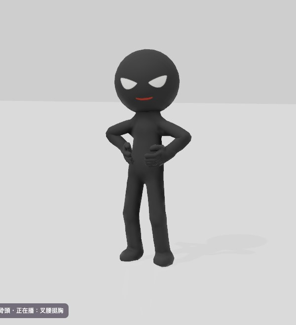
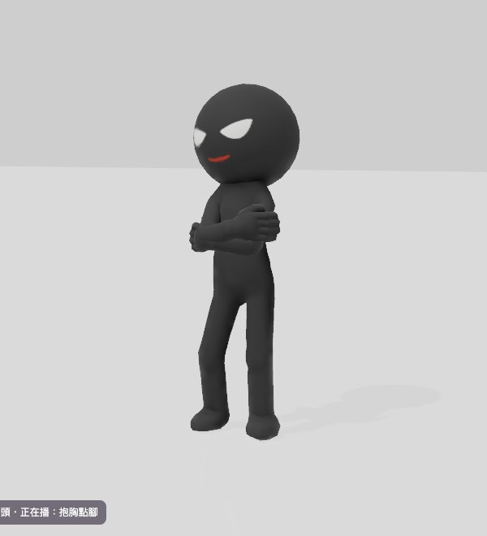

# 3d/stickman：囂張小黑人

> 2026-11-26：這一頁有幾處還停在 11-25 的模型（重疊率 0.934／0.944、手 600 面、色票貼圖、9 個測試）。現在的模型見同資料夾的 `HANDOFF.md` 和路線 [`low-poly-character-from-shapes`](../../../docs/routes/low-poly-character-from-shapes.md)：三張 512 貼圖、手 699 面、10 個測試、重疊率 0.892／0.936。

低模、帶骨架的黑色大頭小人，兩段可以互相 crossfade 的 idle。原本是 需求者（LayaAir 社群）的需求：「做個這個低模＋動畫，囂張點的站立，兩個 idle、能 crossfade、面數 3000 三角面」，參考圖是賽車遊戲車庫旁邊站著的黑色小人。

| 叉腰挺胸 `Idle_HandsOnHips` | 抱胸點腳 `Idle_ArmsCrossed` |
|---|---|
|  |  |

六個角度：[preview/sheet.jpg](preview/sheet.jpg)（引擎 LayaAir 3.4.2 執行時、無頭 Chrome 截圖，攝影棚光）；戶外光：[preview/outdoor.jpg](preview/outdoor.jpg)；crossfade 影片：[preview/crossfade.mp4](preview/crossfade.mp4)（9.3 秒，叉腰 → 抱胸 → 叉腰，虛擬時鐘逐格錄）。

**身材照三視圖做**：先用 gpt-image-2.6 照參考圖生成正面／側面／背面三視圖（[preview/turnaround.jpg](preview/turnaround.jpg)，`source/turnaround/`），從剪影逐行量出各部位尺寸再做模型；做完把模型的 A 字手剪影疊回三視圖比對（[preview/turnaround-compare.png](preview/turnaround-compare.png)：深灰＝兩邊都有、藍＝模型少了、紅＝模型多了），現在重疊率是**正面 0.934、側面 0.944**。重疊率看不出局部的形狀，所以另外逐部位量：`source/measure-parts.mjs` 用同樣的正交投影、同樣的比例，每 5 cm 一列印出三視圖和模型的身體寬、手臂內外緣、側面前後緣；正面每一列都在 0.5 cm 以內。同比例並排（上三視圖、下模型，攝影棚光、近正交的鏡頭）：[preview/turnaround-vs-model.jpg](preview/turnaround-vs-model.jpg)；手放大並排：[preview/hands-compare.jpg](preview/hands-compare.jpg)。

**改過的地方（使用者與 需求者 的意見）**：
- **不夠圓潤、四肢太短、形狀不對** → 先生三視圖、量尺寸、疊回去比。
- **頭要正圓、要大到看不到脖子** → 測地線正圓球，和三視圖一樣大（半徑 0.18 m）；肩膀一離開頭就斜下來，頭直接坐在斜肩上，看不到脖子。
- **顏色要像三視圖那樣**（經過「太霧 → 太亮 → 有質感的黑」幾輪）→ 中性炭灰 `#404040`、粗糙度 0.75（只有很柔的反光，像霧面軟膠）。顏色＝材質×光：三視圖是白色攝影棚（光從四面八方均勻來、亮暗只差 1.45 倍），所以觀看台預設改成攝影棚（`?look=studio`），在那裡量身體：平均 #373838、暗部 #303131、亮部 #414141，三視圖是 #363635、#2b2b2b、#414040。戶外大太陽的遊戲場景（`?look=outdoor`）會看起來更黑，那是場景的光。
- **身上凹凸** → 原本是等值面自動減面（三角形大小不一，細手腳一圈有時 5 邊、有時 7 邊）；現在減面後再做表面鬆弛，三角形大小均勻。
- **腰鼓包** → 兩個原因都修了：
  - 骨盆那顆橢球把身體撐成梨形 → 改成一根往下微微變寬的圓錐柱。
  - 蒙皮時腰側分到 29% 的前臂權重，叉腰時被拉出包 → 改成分部位蒙皮，腰只剩 2.5%。
- **crossfade 是「先垂手、再閃現」** → LayaAir 3.4.2 的 bug，見下面 `repairGltfCrossFade`。
- **叉腰太像老頭** → 以前手放得低又偏後、手肘往後收、上身往後仰、膝蓋微彎，像扶腰伸懶腰；現在上身挺直、手掌扣在腰側偏前、手肘往兩側撐開。
- **手部面數要調整** → 兩隻手從 460 面（四根細手指＋指節）降到 260 面的簡潔手套手；手肘蒙皮過渡從 ±3 cm 放寬到 ±4.5 cm，彎起來不尖。後來對三視圖時發現手差最多，改成三視圖那種大手套（見下兩條），兩隻手 600 面。
- **身體不要有人類的高低差，手摸過去是一個平面**（需求者）→ 身體改成一根粗細幾乎不變的圓柱（半徑 0.094 → 0.090，前後壓成 72%），手臂、腿是等粗的圓管；腿的外側貼齊身體側邊。用 `source/measure-contour.mjs` 量：上一版的胯部外側凸 7 mm（鼓包）、肚子凸 10 mm、屁股凸 7 mm；現在身體前緣、後緣都是平的，身體接到腿只有平順的弧度、沒有凸起。
- **腋下有一片肉**（使用者：火柴人不是這樣）→ 手臂和身體原本用 3.5 cm 的大圓角，綁定姿勢時手臂和身體中間的角被填成一片蹼，蒙皮又讓腋下分到最多 47% 的手臂權重，叉腰時被拉成蝙蝠翅膀。現在圓角 0.8 cm、腋下（肩關節以下）手臂和身體的蒙皮只在 0.6 cm 內混合（腋下最多 13%、腰 0），手臂像管子直接接在肩膀上。
- **手臂和身體的接合處難看，是手的姿勢嗎**（使用者）→ 一半是姿勢、一半是形狀。姿勢：手臂照三視圖做得很長（垂下時手腕在胯下），手要扣在腰上，手肘就一定被頂到約 0.70 m 高（跟手肘往哪撐無關），所以叉腰一定是雞翅膀手；手肘改成往外略往下撐。形狀：身體頂端和胸一樣寬、手臂接在頂端的角上，像衣架的直角肩 → 身體改成上窄下寬的直線錐柱（頂端半徑 0.078），肩關節往內往下移，像三視圖的斜肩；肩關節以上手臂和身體在 2 cm 內混合，手一抬肩膀上緣平順地跟著，不會折出一道痕。綁定姿勢對三視圖：[preview/turnaround-vs-model.jpg](preview/turnaround-vs-model.jpg)。
- **「你沒仔細比對啊？差距還是很大」**（使用者）→ 之前的並排是透視鏡頭、比例也不一樣，看不出差在哪。改成同比例的近正交並排，再用 `measure-parts.mjs` 逐高度量，找到並改掉：
  - 肩膀：頭底下一段平台、外側一個直角（衣架肩）→ 一段從頭下緣斜下來的圓錐，0.85 m 寬 8.3 cm、0.80 m 寬 12.6 cm（三視圖 8.4、12.5），直接接到手臂外緣。
  - 頭比三視圖低 2 cm → 和三視圖同高（頭中心 1.016 m，總高 1.19 m）。
  - 手肘有折角、手垂太低 3 cm → 前臂 22° → 26°（三視圖的手臂幾乎是直的）、前臂短 1 cm，手掌在 0.41～0.52 m（和三視圖一樣）。
  - 胯下低 3～4 cm、側面屁股那段太薄 → 身體底下墊一顆和身體一樣寬、上下扁的橢球：胯下在 0.47 m，正面身體兩側直直接到腿外側，側面 0.50 m 厚 12.5 cm（三視圖 13.3）。
  - 腿側面薄 1 cm → 腿的圓管左右壓扁一點（正面寬不變、側面厚 10 cm）。
  - 腳像喇叭褲管 → 腳和小腿的圓角 3 cm → 1.4 cm，看得出是一隻圓頭靴。
  - 手是一片尖尖的扁手 → 三視圖那種大手套：手背寬 8 cm、四根指頭往掌心彎、粗拇指在最前面。減面分兩段（先只減身體、再只減手），手指不做表面鬆弛：一起減的話指縫會先被減掉，鬆弛會讓四根指頭黏成一團。
- **手指的感覺還是比三視圖差**（使用者）→ 單獨把手拿出來、用不同面數各做一次並排，找到三個原因：
  - 形狀：指頭細長又張開（為了低面數下分得開），三視圖是胖胖的、併在一起、圓頭、往掌心勾的半握拳。→ 指頭加粗到 2.2 cm、併攏只留淺指縫、每根兩節（後半往掌心勾）；手掌縮短、手指拉長到約 5 cm（三視圖側面的比例）；拇指加粗、靠近四指。
  - 面數：每隻手約 200 面時，每根指頭只有六邊形的截面、指尖收成尖角。→ 每隻 300 面（從身體挪 200 面，總數不變）。
  - 光影：三視圖的指縫有陰影、每根指頭有一道亮光。我們沒有做（要烘焙法線貼圖或環境遮蔽，沒做、也沒驗證 LayaAir 執行時讀不讀得到）。
  - 另外修了手腕一圈台階：以前整隻手不做表面鬆弛、旁邊的前臂有做，交界的頂點錯開；現在只有手指不鬆弛，手掌、手腕照常鬆弛。
  - 面數和形狀的關係（同一個形狀減到不同面數，量網格離真正的形狀最遠幾 mm；手的樣子見 [preview/hands-by-budget.jpg](preview/hands-by-budget.jpg)）：身體 1730 面 14.5 mm、3500 面 5.3 mm、7000 面 2.6 mm、14000 面 1.6 mm；一隻手 300 面 12.3 mm、600 面 4.6 mm、1200 面 2.6 mm。近看要和三視圖一樣圓，大約要身體 7000＋手各 1200＋更細的頭，總共約 1 萬 1 千面；3000 面是遊戲裡畫面大小的取捨。
  - 沒有用 Pixal3D（圖轉 3D）：它做出來的是幾十萬面、沒有骨架的靜態模型，放進 3000 面的動畫角色，手一樣要減到兩三百面，卡在同一個地方。

## 規格

| 項目 | 數值 |
|---|---|
| 檔案 | `assets/stickman.glb`（glTF 2.0 二進位，186 KB） |
| 三角形 | **2994**（身體 1730、兩隻手共 600、頭 500、眼睛 120、嘴 44），要求是 3000 以內 |
| 網格／材質 | 1 個蒙皮網格、1 個 primitive、1 個材質：Khronos 驗證器算出來是 **1 個繪製呼叫**（陰影另算） |
| 貼圖 | 32×32 色票 PNG（身體中性炭灰 `#404040`、眼白 `#ececea`、嘴 `#d8462e`），NEAREST 取樣、不做 mipmap，顏色不會暈開；粗糙度 0.75（霧面軟膠，只有很柔的反光） |
| 骨架 | 20 根骨頭：`root` `hips` `spine` `chest` `neck` `head`，左右各 `clav` `arm` `fore` `hand` `thigh` `shin` `foot`（L／R）。綁定姿勢是 A 字手，骨頭在綁定姿勢不轉 |
| 頭 | **正圓球**，半徑 0.18 m（和三視圖一樣，直徑約身高 30%），坐在斜肩上、看不到脖子：測地線球（二十面體每面細分 5×5，500 個一樣大的三角形），頂點全在球面上，三角形中心最多凹進 2.06 mm（半徑的 1.1%） |
| 身體 | 一整張連續的表面（含手，手腕沒有交會線）：等值面 → 減面分兩段（先鎖住手只減身體到 1730 面，再鎖住身體只減手到 600 面）→ 表面鬆弛 15 輪（三角形大小均勻；手指不鬆弛），法線取真正的表面；胯下、肩膀、腋下的圓角都在同一張表面上 |
| 蒙皮 | 分部位：身體跟脊椎那幾根（照高度平滑分配）、手臂跟手臂、腿跟腿、腳跟腳；手臂和身體之間，腋下 0.6 cm、肩膀上緣 2 cm 內混合，其他部位之間 1.5 cm；手肘、膝蓋前後 ±4.5／±3 cm 平滑交接 |
| 尺寸 | 高 1.19 m，腳底在 y = 0，面向 +Z。都照三視圖逐高度量：火柴人的身體是上窄下寬的直線錐柱（半徑 0.08 → 0.10，前後壓成 83%），底下一顆扁橢球當胯（胯下 0.47 m）；斜肩從頭下緣斜到手臂；手臂是微微往下收的圓管（直徑 6.8 → 5.8 cm），上臂離開身體 33°、前臂 26°；手掌在 0.41～0.52 m；腿正面寬 9.2 → 8.2 cm、側面厚 10 → 9 cm，外側貼齊身體側邊；眼睛在頭中心下方 4.2 cm、嘴在下方 12.7 cm |
| 動作 | `Idle_HandsOnHips` 4 秒、`Idle_ArmsCrossed` 3.2 秒，每秒 30 格，都循環（最後一格＝第一格） |

### 兩段 idle

- **`Idle_HandsOnHips` 叉腰挺胸（4 秒）**：上身挺直、胸口往前頂，手掌扣在腰側偏前、手肘往兩側撐開；重心壓在右腳、骨盆往右推，呼吸兩次；慢慢轉頭往一邊斜眼看過去，停一下，「哼」地把下巴一抬轉回來。
- **`Idle_ArmsCrossed` 抱胸點腳（3.2 秒）**：雙手抱胸、歪頭，右腳尖不耐煩地點地三下，然後把臉別開，再轉回來。

**為什麼能順順地 crossfade**：

1. 兩段的腳踩在同一個位置（左腳兩段都不動；右腳只有在抱胸那段以腳跟為支點翹腳尖），換段時腳不會滑。
2. 每段都寫滿 20 根骨頭的轉動和根骨頭的位移，沒有哪根骨頭只有一段在動，換段時不會有骨頭卡在上一段的姿勢。
3. 兩段都從一個完整的站姿開始、在同一個姿勢結束，自動輪播時在一輪剛結束時換。

## 用法

### 放進用豬大引擎的遊戲

```bash
node prefabs/scripts/sync.mjs games/<遊戲> 3d/stickman
```

模型會在 `public/common/3d/stickman/assets/stickman.glb`（網址 `common/3d/stickman/assets/stickman.glb`）。

```ts
import { ZhudaModelLibrary, DirectoryAssetProvider } from 'zhuda-laya-engine';
import { STICKMAN_CLIPS, StickmanIdles, fadeShare, repairGltfCrossFade, stickmanPath, type StickmanClip } from './common/3d/stickman/stickman.ts';

const models = new ZhudaModelLibrary({ provider: new DirectoryAssetProvider({ baseUrl: './' }) });
const man = await models.instantiate(stickmanPath());
scene.addChild(man.node);

// 找到 Animator，兩段都設成循環（glTF 沒有循環旗標）。
const find = (n: Laya.Node): Laya.Animator | null =>
  ((n as Laya.Sprite3D).getComponent?.(Laya.Animator) as Laya.Animator | null) ?? [...Array(n.numChildren)].map((_, i) => find(n.getChildAt(i))).find(Boolean) ?? null;
const animator = find(man.node)!;
for (const name of STICKMAN_CLIPS) animator.getControllerLayer(0).getAnimatorState(name).clip!.islooping = true;
// 一定要：LayaAir 3.4.2 讀 glTF 動作有字典 bug，不修的話 crossFade 會先混向綁定姿勢、最後一格才跳到目標動作。
repairGltfCrossFade(animator);

// 自動輪播：一段播 2～3 輪，在一輪結束時 0.35 秒 crossfade 到另一段。
const play = (clip: StickmanClip, seconds: number) => {
  const playing = animator.getCurrentAnimatorPlayState(0)?.animatorState?.clip?.duration() ?? 0;
  const share = fadeShare(seconds, playing);
  share > 0 ? animator.crossFade(clip, share, 0, 0) : animator.play(clip, 0, 0);
};
const idles = new StickmanIdles(play);
// 每幀：idles.update(dt)。要停在某一段：idles.hold('Idle_ArmsCrossed')；恢復：idles.resume()。
```

**注意**：LayaAir 的 `crossFade(name, transitionDuration)` 的過渡長度是「正在播的那一段」長度的比例（0..1），不是秒數；`fadeShare(秒數, 正在播那段的秒數)` 幫你換算。

**一定要先叫 `repairGltfCrossFade(animator)`（LayaAir 3.4.2 的 bug）**：
- LayaAir 的 glTF 讀取器（`laya.gltf.js`）把每段動作的 `_nodesDic` 填成「路徑 → 路徑字串」；讀 `.lani` 時填的是「路徑 → 節點」。
- `Animator.crossFade` 用這個字典找目標動作的節點。拿到字串就找不到，過渡期間目標動作被當成綁定姿勢，過渡結束才一格跳過去。
- 結果就是「雙手先垂回身體兩側、再閃現成抱胸」。
- 實測（無頭 Chrome，逐格讀手的位置）：
  - 沒修：叉腰 → 抱胸時，左手先走到綁定姿勢的手腕位置 (0.253, 0.527)，在 356 ms 一格跳 35 cm。
  - 修了：手從腰直接往前往內移到胸前，兩個方向每格最多 1.1 cm，全程連續。
- 觀看台加 `?repair=0` 可以看修之前的樣子。

### 放進一般的 LayaAir 3 專案（沒有用豬大引擎）

`stickman.glb` 是標準 glTF，LayaAir 3 直接讀。動作名稱是 `Idle_HandsOnHips`、`Idle_ArmsCrossed`：用 `animator.play(...)` 播，用 `animator.crossFade(名稱, 秒數 / 正在播那段的秒數)` 換段，兩段的 clip 都設 `islooping = true`。**runtime 載入 .glb 的話，第一次 crossFade 前一定要修字典**（見上面 `repairGltfCrossFade`，它不依賴豬大引擎，複製那個函式就能用）。在 LayaAir IDE 裡匯入、轉成 `.lani` 的動作可能沒有這個問題，但沒試過。
在 LayaAir IDE 裡匯入後，記得把兩個動作狀態設成循環。**IDE 匯入沒有實際試過**（這裡驗證的是豬大引擎裡的 LayaAir 3.4.2 執行時）。

### 看

```bash
cd prefabs/viewer3d && npm run build && npm run view
# http://127.0.0.1:8930/index.html?scene=stickman
#   左上角「叉腰挺胸」「抱胸點腳」換段（0.35 秒過渡），「自動輪播」讓它自己換；拖曳轉視角、滾輪拉近
#   ?clip=Idle_ArmsCrossed&auto=0 從抱胸開始、不自動換；?yaw=0 正面
#   ?look=studio（預設，像三視圖的白色攝影棚）／?look=outdoor（戶外天光＋太陽）；?bind=1 不播動作、停在綁定姿勢（A 字手）
```

## 怎麼做出來的（`source/`）

照路線 [`low-poly-character-from-shapes`](../../../docs/routes/low-poly-character-from-shapes.md)：

- `source/turnaround/`：需求者 的參考圖（`reference.png`）、gpt-image-2.6 生成的兩張三視圖（批次檔 `turnaround-batch.json`、回執）。
- `source/stickman-def.mjs`：骨架、形狀（橢球和圓錐掛在骨頭上，尺寸都從三視圖量）、臉、兩段 idle 的姿勢函式（腳用雙骨 IK 釘在地上、手用 IK 放到腰上或胸前）。
- `source/compare-turnaround.mjs`：模型剪影疊回三視圖、算重疊率。`source/measure-parts.mjs`：逐高度量三視圖和模型的寬度（正面身體／手臂、側面前後緣）。`source/measure-contour.mjs`：剪影外緣有沒有凸凹。
- `source/build.mjs`：引擎的距離場與等值面網格 → meshoptimizer 簡化到預算 → 表面鬆弛（`source/surface.mjs`）→ 頭用測地線球、臉貼在頭上 → 分部位蒙皮 → 每秒取樣 30 次 → 寫 `assets/stickman.glb` 與 `source/build-report.json`（面數、表面誤差、身體各高度分到的手臂權重新舊對照、腳有沒有滑、循環接縫）。約 2 秒。
- 試材質：`STICKMAN_OUT=<別的檔> STICKMAN_ROUGHNESS=0.5 STICKMAN_BODY=#1e1e22 node 3d/stickman/source/build.mjs`（不動 `assets/`、不寫報告）；觀看台預設只用天空本來的光，`?amb=`、`?ground=` 只在試光時加。
- 人物工具：倉庫的 `games/tools/characters/`（`kit.mjs`、`rig-glb.mjs`、`humanoid.mjs`、`hero-kit.mjs`、`raster.mjs`）。2026-11-26 之前這裡有一份複本（`source/kit/`），多改的兩處（`writeRiggedGlb` 的 `sampler`／`generator`、`raster.mjs` 的 `pngBytes()`）已併回那邊，複本刪掉了。

```bash
cd prefabs
node 3d/stickman/source/build.mjs                       # 重做 assets/stickman.glb
node 3d/stickman/source/build.mjs --preview <資料夾>     # 另外用軟體算圖畫檢查用的圖（不經瀏覽器）
```

改了模型就：跑 `compare-turnaround.mjs`、`measure-parts.mjs` 看剪影有沒有跑掉 → 更新 `stickman.ts` 的 `STICKMAN`（面數、高度）→ `npm run verify` → `cd viewer3d && node ../scripts/sync.mjs . && npm run verify` → 重拍 `preview/`。

## 驗證過的

- `tests/stickman.test.mjs`（9 項）：一個網格／一個材質／色票 NEAREST／半光澤；面數 ≤ 3000 且和 `STICKMAN`、建置報告一致；權重和為 1；兩段的名稱與長度；**每段都動到全部骨頭**（crossfade 不漏骨頭）；每段最後一格＝第一格；腳不滑（左腳踝、右腳跟都在 0.5 mm 內）；`fadeShare`；`StickmanIdles` 的輪播與停住；`repairGltfCrossFade` 把字串換回節點、重複叫不會再改。
- Khronos glTF 驗證器（2.0.0-dev.3.10）：0 錯誤、0 警告、0 提示；1 個繪製呼叫、1536 個頂點、2994 個三角形。
- 觀看台 `?scene=stickman`，無頭 Chrome：引擎讀到 1 個網格、1 個材質、兩段動作（4 秒、3.2 秒）。crossfade 逐格讀手的位置（每個 requestAnimationFrame 一次）：叉腰 → 抱胸、抱胸 → 叉腰，手每格最多移動 1.7 cm、全程連續、最低不低於 0.594 m（綁定姿勢的手腕在 0.52 m，沒有往那裡垂）；自動輪播在一輪結束時自己換段；繪製器與頁面都沒有錯誤。
- 腰鼓包、腋下的肉：建置報告的 `armWeightOnBody`，身體各高度分到的手臂權重（不分部位的蒙皮 → 現在）：0.50～0.68 m 5%～33% → 0；腋下 0.68～0.74 m 28% → 6.6%。
- 三視圖比對：`node 3d/stickman/source/compare-turnaround.mjs`（重疊率正面 0.934、側面 0.944）；`node 3d/stickman/source/measure-parts.mjs`（逐高度的寬度表，正面每列 0.5 cm 以內；側面 0.85 m 那列差 2 cm，是三視圖的下巴往前凸、我們的頭是正圓球）；同比例並排：[preview/turnaround-vs-model.jpg](preview/turnaround-vs-model.jpg)、手：[preview/hands-compare.jpg](preview/hands-compare.jpg)。
- 身體平不平：`node 3d/stickman/source/measure-contour.mjs [glb]`，正面外側、側面前緣、側面後緣（側面不算垂在旁邊的手臂和手），每 5 mm 一列量到哪裡比上下各 3 cm 凸出或凹進：正面外側最多 2.5 mm；側面是身體收到腿那段的弧（最多 5 mm，三視圖也是同樣的收法），沒有台階。更早的版本胯部外側凸 7 mm、肚子 10 mm、屁股 7 mm。
- 用虛擬時鐘逐格錄了一段叉腰 → 抱胸 → 叉腰的影片（`prefabs/tools/detplay.mjs`，每格固定 1/30 秒），交付給 需求者 的資料夾裡有。

## 沒有驗證的

- 沒上手機、沒量手機上的幀時間。
- 沒有在 LayaAir IDE 裡匯入過，也沒有在豬大引擎以外的 LayaAir 專案跑過。
- 觀看台用 `renderer: auto`，沒有分別在 WebGL 和 WebGPU 上各驗一次。
- 手是三視圖那種手套手（四根胖指頭加拇指、沒有指節、手指不能各自動），兩隻共 600 面；正面看比三視圖薄一點（0.45 m 那列：三視圖 5.3 cm 一整塊，我們的拇指和指頭之間還有一道縫）；指縫沒有陰影。需求者 說過「手部面數要調整」（我們理解成太多），這次為了對上三視圖從 260 加到 600，要省的話調 `BUDGET.hands`（每隻 200 面時指尖會尖）。
- 沒有走路、跑步等其他動作；骨架是一般人形，要加動作在 `stickman-def.mjs` 寫新的姿勢函式。
- 頭轉動時，頭和身體是兩個網格互相插著接（看不到脖子），角度很大（超過 40°）時可能看到交界。
- 網格離真正的表面最多 11.6 mm（在表面內，胯下、腋下這種凹處的大三角形，和指尖）、7.5 mm（在表面外）；畫面上看不出來，但不是零。
