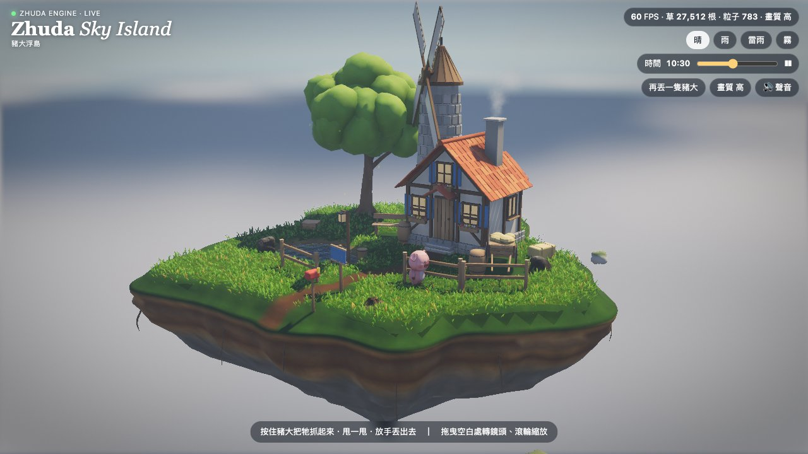
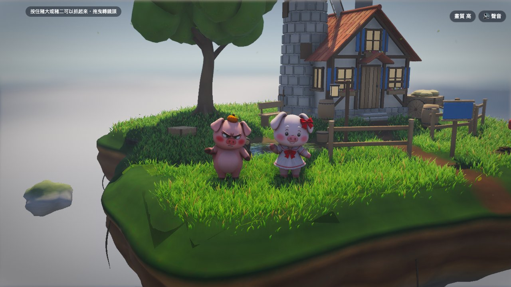
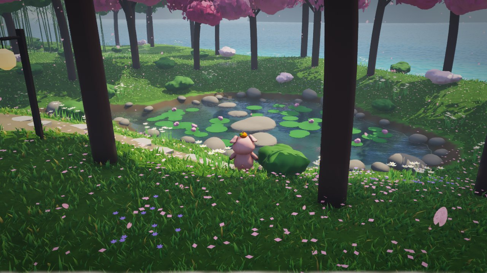
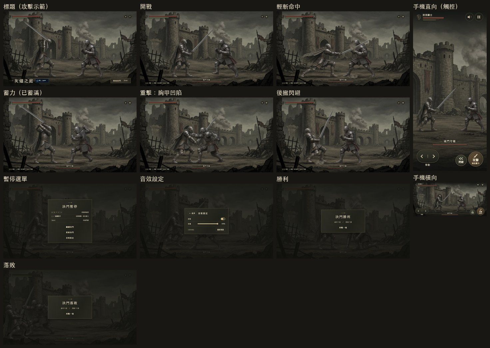
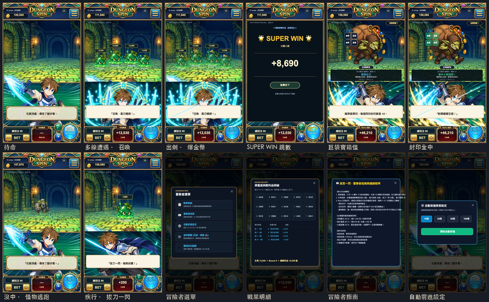
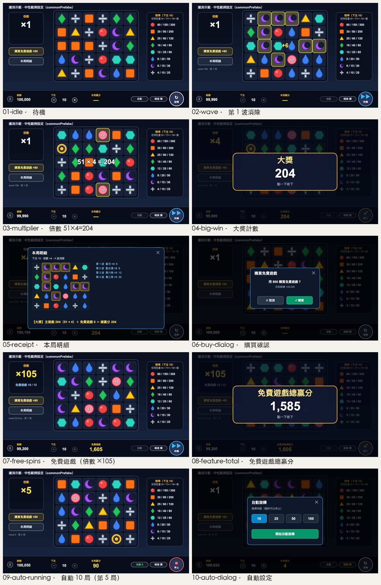

# prefabs：豬大引擎的共用元件庫

> 2026-11-26 起這個庫在引擎倉庫（`zhuda-laya-engine`）的 `prefabs/`，隨 2.0.0 的 npm 套件一起發布；之前是遊戲中心的 `commonPrefabs/`（到 0.10.0）。英文的總說明在 [`docs/prefab-library.md`](../docs/prefab-library.md)。
> 遊戲裡拿模組：`npx zhuda-prefab-sync . <模組…>`（等同 `node node_modules/zhuda-laya-engine/prefabs/scripts/sync.mjs . <模組…>`）；在引擎倉庫裡是 `node prefabs/scripts/sync.mjs <遊戲資料夾> <模組…>`。下面例子裡的 `games/<遊戲>` 指遊戲中心的遊戲資料夾（在這個倉庫外面）。

放各款遊戲都能再用的 2D／3D 資產、介面元件、輸入與系統模組。**開新遊戲或加新介面前，先來這裡找；有就用，沒有就做在這裡，再複製進遊戲。**

**做 2D 遊戲前先看 [2D 場景與遊戲](#2d-場景與遊戲0802026-11-25)（決鬥、地城拉霸、連消老虎機、Go 伺服器）；做 3D 場景前先看 [3D 場景](#3d-場景0702026-11-25)：三座完整的島（浮島、兄妹小島、花園島）、會被抓起來丟的豬大豬二、第三人稱走路、一天的光與天氣、畫質分級，都能直接叫出來看、直接放進遊戲。**

## 目前有的（0.9.1）

| 模組 | 種類 | 做什麼 | 在用的遊戲 |
|---|---|---|---|
| `ui/virtual-stick` | 2D 介面 | 浮動虛擬搖桿：按下就移到拇指下、拖曳傾斜（單位圓內）、放開任何地方或視窗失焦都會回位；第二根手指不會搶走；畫面被 CSS 轉向時用 `toLocal`／`bounds` 換算座標（路線 [mobile-always-landscape](../docs/routes/mobile-always-landscape.md)） | 雨夜殺人事件、豬大旋風1 |
| `ui/page-lock` | 2D 介面 | 手機遊戲頁面鎖：點兩下、雙指都不會放大（viewport 鎖縮放、`touch-action`、iOS `gesture*`、兩指移動、Ctrl＋滾輪）；非 iOS 的觸控裝置點一下就進原生全螢幕（隱藏網址列），退出後下次點再進，`fullscreenWhen` 可讓對戰中先不切；iPhone 瀏覽器（不含微信）第一次進來有上滑層（`iosSwipeUp`），滑一下讓 Safari 收起網址列。做法取自一個正式上線的 H5 平台（不在這個倉庫），整套策略在路線 [mobile-web-fullscreen](../docs/routes/mobile-web-fullscreen.md)。會捲動的面板要自己設 `touch-action: pan-x pan-y` | 豬大旋風1 |
| `ui/visual-novel` | 2D 介面 | galgame 式劇情播放器：背景、左右立繪（說話的人亮、另一位變暗）、全螢幕 CG、名牌、逐字打字＋▼、配音（播完才自動下一句）、閃白轉場、自動／快轉／回顧（點回顧裡的台詞重聽）；文字經遊戲的 `t()`，換語言 `relabel()` | 數豬豬 |
| `ui/dialog` | 2D 介面 | 對話框（說話者標籤、主角／配角兩色、旁白斜體、逐字打字、▼）＋選項框 | 雨夜殺人事件 |
| `ui/toast` | 2D 介面 | 上方短提示：彩色標籤＋一行字，幾秒後淡出 | 雨夜殺人事件 |
| `ui/collection-book` | 2D 介面 | 圖鑑：多個分頁（角色、線索、道具…）、卡片列＋細節、上鎖剪影＋「去哪裡找」、新內容黃點與 NEW，各分頁記住自己的選擇 | 雨夜殺人事件 |
| `ui/game-menu` | 2D 介面 | 遊戲選單：標題、暫停、結算的直列選項（↑↓／W S 移動、Enter 確定、Esc 先關面板再返回），子面板（設定、操作、製作名單）疊在上面；只用 `cp-*` class，不怕遊戲的寬鬆選擇器 | Pigfall、灰燼之庭 |
| `ui/settings-form` | 2D 介面 | 設定表單：給欄位清單（滑桿、開關、選項按鈕）就產生，改了立即套用、顯示是否已存、可還原預設 | Pigfall、數豬豬、灰燼之庭 |
| `ui/dom` | 2D 介面 | `press()`：觸控、滑鼠、鍵盤都能按，拇指按著搖桿時第二根手指也有效 | （上面幾個都依賴它） |
| `input/move-input` | 輸入 | WASD／方向鍵＋搖桿合成移動向量；滑鼠瞄準與移動「最後碰的贏」 | 雨夜殺人事件 |
| `input/hold-input` | 輸入 | 按住型動作（蓄力斬、按住移動、按住格擋）：每個動作同一時間只屬於一根手指、滑鼠或按鍵，從按下到放開；別的手指搶不走，手指滑出按鈕也不會斷（pointer capture），取消觸控算「取消」，`clear()` 在暫停、轉向、切到背景時靜默清掉。`padDirection()` 讀左右兩半的移動盤，中間有死區，滑過中線就換向 | 灰燼之庭 |
| `systems/cloth-presets` | 系統 | 布料種類與風場：Laya 官方人員給的 MagicCloth 外掛（Unity MagicCloth2 移植）預設數值，換算成引擎 `ZhudaCloth` 的設定（`skirt`／`softSkirt`／`cape`：重力遠低於真實、擺動很快收住、速度上限、先穩定再顯示），加上主風＋陣風、每塊布自己的相位。純數值，沒有用外掛的程式碼 | 豬大道（豬二的裙子）；來源是時空 3D |
| `systems/pig-combat` | 系統 | 豬大三職業（豬拳者、豬忍者、豬道者）的戰鬥規則與命中判定：五連擊＋技能、接招、熱度、符紙、近身弧／投射／地面法術／冰凍、自動瞄準。純規則 | 木筏（重生之我在海上当猪大）；來源是時空 3D |
| `systems/storage` | 系統 | 有保護的 localStorage（無痕、iframe、配額滿都不會壞）、跨次保存的 id 集合 | 雨夜殺人事件、數豬豬、灰燼之庭 |
| `systems/i18n` | 系統 | 介面語言：來源語言為準、查表、組合句逐段翻、`{n}` 代入、記住選擇、`data-i18n` 整頁翻 | 雨夜殺人事件、數豬豬 |
| `ui/scene-controls` | 2D 介面 | 3D 場景的介面層：標題、狀態列、天氣、時間滑桿與暫停、畫質、聲音、提示、抓取時的手、閃電白光；`embed` 只留畫質與聲音 | 觀看台（浮島、兄妹小島） |
| `systems/circle-merge` | 系統 | 圓形物理＋合成：丟進容器的圓會落下、滾動、堆疊，兩個同階相碰合成下一階（最高階相碰消失）；純規則、不碰引擎，同樣的丟法得到同樣的結果；半徑與分數表由遊戲給 | 來源是合一合（還沒改用這一份） |
| `systems/minigame-host` | 系統 | 小遊戲主機橋接：有 `wx` 走微信、沒有走瀏覽器。數字存檔、震動、膠囊鈕與瀏海的安全區、分包載入、分享、隱藏事件、激勵影片與插屏的節奏；微信 iOS 缺的 `TextDecoder`／`structuredClone` 補丁；從包內讀檔的 `AssetProvider` | 來源是木筏亂鬥（還沒改用這一份） |
| `audio/casual-sfx` | 聲音 | 41 個休閒遊戲音效（介面、數數與獎勵、角色反應、場景事件、環境底噪），全部在頁面裡合成（`source/sfx-lab.html`），AAC `.m4a` 共 540 KB | 來源是數豬豬（還沒改用這一份） |

機器可讀的清單在 [`catalog.json`](catalog.json)（每個模組的檔案、依賴、哪些遊戲在用）。

3D 模組在下一節；2.0.0 之後加了分層絲襪 [`3d/layered-hosiery`](3d/layered-hosiery/README.md) 和 Spine 褲襪 [`2d/spine-tights`](2d/spine-tights/README.md)（兩個撕襪試驗專案做成的元件）；2.0.0 另外加了海邊小場景 [`3d/seaside-pier`](3d/seaside-pier/README.md)（觀看台 `?scene=seaside-pier`）和 `3d/zhuda-characters` 的輕量版豬大（`zhuda-lite`，8,990 面）。還沒有：pigfall 的補給箱、無線電台、候車亭等單件 3D Prefab，2D 元件的獨立預覽頁。

## 3D 場景（0.7.0，2026-11-25）

三座島原本是三個遊戲專案（`games/zhuda-sky-island`、`games/zhuda-home-island`、`games/zhuda-garden-island`），2026-11-25 拆成下面的模組後，原專案移到垃圾桶。**拆完的模組和原遊戲逐像素比對過**：同一個引擎（`def94aa`）、同一個 Chrome、虛擬時鐘逐格跑原本的情境，花園島 6 張、浮島 15 張、兄妹小島 10 張都是 0 像素差。浮島和兄妹小島的原遊戲重跑時自己就會在兩種畫法之間換（差在邊緣、水面、角色周圍，最多 130 個點、每點亮度差 ≤ 8）；拆完的模組也畫出這兩種之一，和原遊戲同一種逐點相同。

| 浮島 `sky-island` | 兄妹小島 `home-island` | 花園島 `garden-island` |
|---|---|---|
|  |  |  |
| 雲海上的小浮島，豬大可被抓起來甩、丟 | 官網首頁那座島，豬大和豬二會唱歌跳舞 | 程式生成的花園島，第三人稱走動 |

整張預覽：[浮島與兄妹小島](3d/sky-island/preview/sheet.jpg)、[花園島](3d/garden-island/preview/sheet.jpg)。每個模組資料夾都有自己的 `README.md`（怎麼叫、參數、程式範例、驗證、已知限制）。

| 模組 | 種類 | 做什麼 | 大小 |
|---|---|---|---|
| `3d/sky-island` | 3D 場景 | 豬大浮島：雲海上的小浮島（風車小屋、池塘水面、大樹、道具、自然小物、會被壓倒的草、夜裡亮燈、天氣粒子）。`createSkyIsland()` 一次蓋好，`update()` 每幀；時間、天氣、閃電用 `createIslandDay()`。官網首頁版的重建步驟在 `source/official-site/` | 6 MB |
| `3d/island-pig` | 3D 系統 | 島上的豬大、豬二：自己走、打招呼、坐、打瞌睡；拎後頸甩、丟、落地頭暈、游泳甩水、滑下屋頂、掉出島再從天而降；照拍子唱歌跳舞。島用 `PigWorld` 注入（任何島都能用），`createHand()` 是抓取與鏡頭 | 64 KB |
| `3d/island-sound` | 3D 素材 | 島的聲音：依時間天氣的環境音（串流）、3D 效果音、豬大 37 句／豬二 24 句台詞（一次一句、不連續重複）、歌〈ふたりの帰り道〉（使用者的原創曲）與對拍用的播放時間 | 11 MB |
| `3d/garden-island` | 3D 場景 | 豬大花園島：全程式生成（睡蓮池＋溪流＋小水潭一張水面、燈籠石板路、竹林、海邊圓石台與石環門、四色花樹與葉片、會動的海與遠島、花瓣／螢火蟲／星空）。`createGardenIsland()` 一次建好、每幀一個 `update()`；地面與可走範圍查詢、九個取景點、vivo V40 實測表 | 2 MB |
| `3d/island-walker` | 3D 系統 | 在任何島上第三人稱走動：`Walker`（Idle／Walk、沿岸滑行，地面由場景以 `WalkWorld` 給）、`FollowCamera`（跟隨環繞、樹冠擋住就拉近、不鑽地）、`WalkInput`（WASD、觸控左側搖桿、拖曳轉視角、滾輪／捏合縮放） | 36 KB |
| `3d/zhuda-characters` | 3D 素材 | 豬大、豬二遊戲模型（改版，各 19 段動作：走、被抓、被丟、落地、頭暈、甩水、揮手、鞠躬、唱、跳、坐、睡…）＋守夜人版豬大（9 段）；耳朵尾巴有彈簧骨末端。母檔在 `~/zhuda-zhuer-world/01_角色/*/改版3D/遊戲版/` | 11 MB |
| `3d/nature-pack` | 3D 素材 | 十個掃描植物與石頭（Poly Haven CC0 的遊戲版）：蕨、灌木、蕁麻、苔、大中小石、長苔石組、樹樁 | 3 MB |
| `3d/stickman` | 3D 素材 | 囂張小黑人：低模黑色大頭小人（2994 個三角形、1 個網格 1 個材質＝1 個繪製呼叫、20 根骨頭），兩段可以互相 crossfade 的 idle（叉腰挺胸、抱胸點腳）；`StickmanIdles` 自動輪播、`fadeShare` 把秒數換成 LayaAir `crossFade` 要的比例。用形狀做出來（`source/`），改數字就能重做。預覽在 [3d/stickman/preview/](3d/stickman/preview/sheet.jpg)，觀看台 `?scene=stickman` | 186 KB |
| `3d/layered-hosiery` | 3D 素材 | 分層絲襪：建模的下半身（MakeHuman 基礎網格，CC0）穿 15 種絲襪、13 種下身。絲襪和褲子是貼著皮膚的逐頂點位移層（`meshleg.ts`），能拉扯、撕出破洞與抽絲，從褲子的破洞還能拉到底下的絲襪；裙子是引擎的布料、以腿當碰撞體。`createHosieryWearer` 不碰指標也不管時鐘：遊戲給射線、每幀叫 `step`。附三個表面著色器掛鉤、試驗台的光與取景、DOM 面板。說明在 [3d/layered-hosiery/README.md](3d/layered-hosiery/README.md)，觀看台 `?scene=layered-hosiery` | 1.6 MB |
| `3d/day-look` | 3D 系統 | 一天的光：時間＋天氣（晴、雨、雷雨、霧、閃電）→ `ZhudaSceneLook` 的設定；地點設定 `CLOUD_SEA`（雲海上的小島）、`OCEAN`（海上的島） | — |
| `3d/quality-tiers` | 3D 系統 | 畫質四級（低中高滿：光影、解析度、粒子＋場景自己的草）、`?fx=` 起始、給 `ZhudaQualityGovernor` 的降級階梯 | — |
| `3d/math` | 3D 系統 | 小向量與四元數工具 | — |

### 看

```bash
cd prefabs/viewer3d
npm install          # 第一次（引擎釘在 def94aa）
npm run build && npm run view
# 開 http://127.0.0.1:8930/index.html：列出所有場景與常用畫面
#   ?scene=sky-island&weather=storm   ?scene=home-island&show=sing   ?scene=garden-island&view=pond   ?scene=nature-pack
```

不想跑也能看：每個場景模組的 `preview/` 有圖。觀看台本身也是 3D 模組的整合測試（`npm run verify`：同步檢查、建置、型別、體檢、測試），`tools/play.mjs` 照 `scenarios/*.json` 在無頭 Chrome 跑情境、截圖（`window.__SCENE__` 是頁面上的操作掛鉤）。

### 放進遊戲

和其他模組一樣用 `scripts/sync.mjs`；模型和聲音（`assets/`）會原樣複製到遊戲的 `public/common/…`，網址是 `common/…`。最短的完整範例在各模組 README；觀看台的 `src/presets/*.ts` 就是三個原遊戲用這些模組重寫的樣子，可以直接照抄成新遊戲的 `Main.ts`。

```bash
node prefabs/scripts/sync.mjs games/<遊戲> 3d/garden-island 3d/island-walker 3d/zhuda-characters   # 花園島＋走路
node prefabs/scripts/sync.mjs games/<遊戲> 3d/sky-island 3d/island-pig 3d/island-sound 3d/zhuda-characters ui/scene-controls   # 浮島＋抓豬
```

遊戲的 `zhuda.config.json` 要有 `"features": ["core", "3d", "gltf", "postProcess"]`，引擎版本至少是 `def94aa`（草被壓、雲海、霧距離都要它）。

### 3D 模組的資料夾規則

- `*.ts`：會同步進遊戲的程式；不碰引擎的部分（地形查詢、規則、台詞表）另外放一個檔，才能用 node 測試。
- `assets/`：會原樣同步的模型、聲音（每個檔都要列在 `catalog.json`）。
- `source/`：怎麼做出來的（Blender 腳本、合成音效的程式、台詞稿、拍片分鏡、官網重建步驟），**不同步**。
- `preview/`：圖，**不同步**。換了外觀就重拍，並看過再交。
- `README.md`：繁體中文，寫怎麼叫、參數、範例、驗證過什麼、沒驗證什麼。


## 2D 場景與遊戲（0.8.0，2026-11-25）

三款 2D 遊戲（`games/ashfall-duel`、`games/dungeon-spin`、`<original-cascade-slot>`）2026-11-25 拆成下面的模組後，原專案移到垃圾桶。
和原遊戲比對過（同引擎 `def94aa`、同 Chrome、虛擬時鐘 `prefabs/tools/detplay.mjs`，同時比畫面與遊戲狀態）：
灰燼之庭 18 個畫面、迷宮一閃 26 個畫面逐像素相同；灰燼之庭的決鬥規則 240,000 步逐步相同；
老虎機的數學 Go 伺服器 11 萬局、TS 用戶端 6 萬多局逐局相同，模擬器報表逐數字相同。

| 灰燼之庭 `ashfall-duel` | 迷宮一閃 `dungeon-spin` | 連消老虎機 `cascade-slot` |
|---|---|---|
|  |  |  |
| 寫實側視一對一決鬥（原作者 CCW） | 直式地城連線拉霸 | 隨處消除連消＋倍數（中性範例） |

| 模組 | 種類 | 做什麼 |
|---|---|---|
| `2d/ashfall-duel` | 2D 場景 | 灰燼之庭：`startAshfallDuel()` 一次跑起整個遊戲：120 Hz 固定模擬、輕斬／蓄力重斬／後撤、沿畫出的劍刃判定命中、胸甲凹陷回彈、灰塵碎屑、鍵盤／滑鼠蓄力／雙拇指觸控、暫停選單、音效設定、勝敗。`source/` 有完整 git 歷史（`ashfall-duel.bundle`）和上一版公開發行包 |
| `2d/cel-motion` | 2D 系統 | 側視角色的「關鍵姿勢圖集＋烘好的中間幀」動作（不用骨架、不用 Spine）：十個關節釘、時間表插值、被打斷時沿中間幀走、依實際距離交替落腳、16×20 網格跟著關節變形、接觸點凹陷回彈 |
| `2d/dungeon-spin` | 2D 場景 | 迷宮一閃：直式 572×1024 地城連線拉霸。三個 Prefab（模板背景、10 隻怪物、主角 6 姿勢）、十組情境、巨袋寶箱怪 Bonus、大獎跳數 |
| `2d/prefab-atlas` | 2D 系統 | 從通過檢查的 Prefab 實例取解碼好的圖集貼圖、切格子，場景不另開網址或快取 |
| `systems/slot-round` | 系統 | 拉霸類「一顆按鈕一局」的回合狀態機（前進／加速／收下／停止）、先記帳再演出的本機試玩帳本、自動前進 1–999 局；選項 `fsm`、`beforeRound`、`contractVersion`；不碰引擎 |
| `2d/cascade-math` | 2D 系統 | 隨處消除連消倍數數學：和 Go `server/slotmath` 同種子同結果、種子局、腳本局管線、中性範例設定（RTP 約 93%） |
| `2d/slot-client` | 2D 系統 | slot 用戶端其餘部分：畫面資料契約、伺服器回合轉換、連 Go 伺服器的用戶端與伺服器權威 session、管線、事件、狀態、語系、資產尋址 |
| `2d/slot-ui` | 2D 介面 | 連消老虎機畫面（程式繪製的中性外觀）：演出播放器、逐格時鐘、盤面、大獎、五態控制列、倍數看板、自動／購買／明細對話框、音效橋 |
| `2d/spine-tights` | 2D 素材 | Spine 褲襪：一套 Spine 4.2 骨架（照片切件，1024×1536）加驅動程式 `createSpineTights`。百褶裙掛在九條褶鏈上、帶 Spine 物理，抓住哪條褶就用 IK 跟手指；褲襪在十個撕裂點各有一根骨頭，拉開會彈回，拉夠遠換上小洞、大洞的貼片。走引擎的 `ZhudaSpineCharacter`，遊戲要開 `spine42`。製作腳本、生成原圖與提示詞在 `source/`。說明在 [2d/spine-tights/README.md](2d/spine-tights/README.md)，觀看台 `?scene=spine-tights` |

奧林匹斯拉霸的主題（名稱、宙斯、照 Pragmatic Play 原作風格生成的美術、那套符號與賠率表）**沒有收**，只收不帶主題的技術。

### 看

```bash
cd prefabs/viewer2d
npm run build && npm run view      # 固定 WebGL；開 http://127.0.0.1:8931/index.html
#   ?scene=ashfall-duel&view=impact   ?scene=dungeon-spin   ?scene=cascade-slot
```

開場有約 5 秒引擎標誌，截圖或比對要等它過去（場景的 `window.__SCENE__.ready`）。

### 放進遊戲

```bash
node prefabs/scripts/sync.mjs games/<遊戲> 2d/ashfall-duel            # 決鬥（含 cel-motion 與介面元件）
node prefabs/scripts/sync.mjs games/<遊戲> 2d/dungeon-spin            # 地城拉霸
node prefabs/scripts/sync.mjs games/<遊戲> 2d/slot-ui 2d/cascade-math # 連消老虎機
```

2D 模組的資料夾規則和 3D 一樣（`assets/` 同步、`source/`／`preview/` 不同步）。

## 遊戲伺服器（Go，`server/`）

遊戲伺服器共用的 Go 套件，**不經 sync**，遊戲的 `server/go.mod` 用 `replace` 指過來（見 [`server/README.md`](server/README.md)）。檢查：`npm run verify:go`。

| 套件 | 做什麼 |
|---|---|
| `slotmath`、`slotsim`、`slotgateway`、`wallet`、`authjwt`、`replay`、`cmd/slotserver`、`cmd/slotsim` | 老虎機權威伺服器：數學引擎、RTP 模擬器、HTTP 閘道（JWT、局失敗退注、CORS 白名單）、冪等錢包接縫、重播；和原遊戲逐局相同，原本的安全問題已修 |
| `dungeonmath`、`dungeonauthority`、`dungeongateway`、`dungeonserver` | 迷宮一閃的伺服器（原樣）。**不是真正的權威**：局的結果由客戶端指定、玩家 ID 可冒用、沒有冪等；當正式伺服器前要先補，見路線 `go-game-server` |
| `matchrelay`、`matchrelay/relayclient` | 兩人 lockstep 線上對戰的配對＋輸入轉送（WebSocket，伺服器不跑遊戲）：洲別快速配對、房間碼、依 RTT 定輸入延遲、驗證並照順序轉送輸入、雜湊與結束比對、再戰、斷線續玩、Origin 白名單、限速；Go 用戶端與 lockstep 機器人。這個 module 唯一的外部依賴 `github.com/coder/websocket` 就是為它加的（見 `server/README.md`） |

做法寫成路線：`docs/routes/side-view-duel.md`、`pose-atlas-motion.md`、`dungeon-line-slot.md`、`prototype-to-center.md`、`cascade-slot.md`、`go-game-server.md`、`online-lockstep-match.md`。
## 怎麼用

```bash
cd <repository root>
# 加入或更新模組（依賴會一起帶進去）
node prefabs/scripts/sync.mjs games/<遊戲>/client ui/dialog systems/i18n
# 照遊戲的 lock 檔，全部更新到函式庫最新版
node prefabs/scripts/sync.mjs games/<遊戲>/client
# 檢查遊戲裡的複製品有沒有被改過、是不是最新（不一致就 exit 1）
node prefabs/scripts/sync.mjs games/<遊戲>/client --check
```

- TypeScript 複製到 `<client>/src/common/…`，用相對路徑 import，例如 `import { createDialog } from './common/ui/dialog/dialog.ts'`。
- CSS 複製到 `<client>/public/common/…`，在 `index.html` 用 `<link rel="stylesheet" href="common/ui/dialog/dialog.css">` 引入（引擎建置會把 `public/` 整包放進輸出），並放在遊戲自己的 `<style>` **前面**，讓遊戲能覆寫。
- `<client>/common-prefabs.lock.json` 記錄函式庫版本、模組和每個檔案的 SHA-256。

為什麼用複製而不是 npm 套件：引擎建置與體檢只看遊戲自己的專案，Node 也不允許在 `node_modules` 裡直接跑 TypeScript 測試；複製進去後，遊戲可以獨立建置、打包、上架，也不會因為函式庫改了而在不知情時壞掉。

## 規則

1. **只改這裡，不改複製品。** 複製品第一行寫明來源；要改就改 `prefabs/…`，跑 `npm run verify`，再對每個在用的遊戲跑 sync 和它自己的驗證。
2. **差異用參數或主題調，不要另外複製一份來改。** 顏色用 CSS 變數（下表），版面用遊戲自己的 CSS 覆寫（例如圖鑑幾欄、按鈕位置）；行為差異加選項。
3. **元件不放遊戲內容。** 不放台詞、角色名、圖片路徑；文字由遊戲翻譯好再傳進來，圖片由遊戲提供 `thumb()`／`views()`。
4. **每個模組都要有測試**（`tests/`，用 `tests/fake-dom.mjs` 的假 DOM），並登記在 `catalog.json`；`tests/sync.test.mjs` 會檢查每個原始檔都屬於某個模組。
5. **元件只用 `cp-*` class**，不用 `header`、`h2` 這類通用標籤當結構，避免遊戲的 `header{…}`、`.x button{…}` 之類規則波及（Pigfall 就踩過）。
6. **改了對外行為就升版本**（`catalog.json` 與 `package.json` 的 version 一起改），在下方紀錄寫清楚。

### 主題變數

| 變數 | 用在 | 預設（雨夜的配色） |
|---|---|---|
| `--cp-accent` | 主色：對話框上緣、主角標籤、圖鑑選中、分頁 | `#ff6f9c` |
| `--cp-accent-2` | 副色：提示標籤、頁標題、▼、搖桿按住時 | `#4ff0c8` |
| `--cp-mark` | 標記：黃點、NEW、配角標籤、選項題目 | `#ffc45a` |
| `--cp-text`／`--cp-dim`／`--cp-line` | 內文／次要字／細線 | 米白系 |
| `--cp-accent-glow`、`--cp-accent-wash`、`--cp-book-stage`、`--cp-mark-line`、`--cp-stick-live` | 光暈、底色等細節 | 見各 CSS 檔開頭 |
| `--cp-bottom`、`--cp-toast-top` | 對話框底部、提示上方的距離 | 安全區、86px |
| `--cp-menu-text`／`--cp-menu-dim`／`--cp-menu-accent`／`--cp-menu-glow`／`--cp-menu-line`／`--cp-menu-panel`／`--cp-menu-font` | 遊戲選單與設定表單 | 米白、卡其金 |

## 開發

```bash
cd prefabs
npm install       # 只有 TypeScript
npm run verify    # 型別檢查＋測試
```

## 紀錄

- **2.0.0 之後（2026-11-26，還沒發版）**：情境檔可以不寫座標。兩個觀看台的 `tools/play.mjs` 和 `tools/detplay.mjs` 多三種步驟：`"click": "名字"`（或 `{ "text": "按鈕上的字" }`）點舞台上找到的那個節點的正中央、`"expect": { … }` 檢查舞台（某個名字的節點有顯示、某個標籤的字、頁面掛鉤上的運算式；不成立就結束，回報第幾步和實際看到什麼）、`"probe": "檔名"` 把整棵節點樹寫出來；點擊可以加 `"hold"`。舞台是從頁面外面讀的（引擎的 `packages/compiler/stage-probe.mjs`），模組和遊戲的程式都不用改，舊的情境檔照舊。新增 `tools/detrepeat.mjs`：同一個情境在虛擬時鐘上跑 N 次，逐張比截圖、節點樹和紀錄。`detplay.mjs` 多一個 `READY=<屬性>`（掛鉤一開始就在、之後才說準備好的遊戲用）。範例：`viewer2d/scenarios/dungeon-spin-named.json`。寫法和還缺什麼見倉庫的路線 `docs/routes/ui-test-by-probe.md`。

- **2.0.0 之後（2026-11-26，還沒發版）**：`viewer3d` 多一個 preset `model-stand`（角色展示台）：`?scene=model-stand&file=<任何綁骨的 .glb>` 在引擎裡看一個角色，列出它帶的動作、用以秒計的淡入切換、能停在某一秒。自己的檔複製到 `viewer3d/dist/web/local/` 就能開，不用重新建置。它是路線 `high-quality-character` 的「每一版都要在引擎裡看」那一步；情境檔 `scenarios/model-stand.json`。注意 `?height=` 是畫布高度，角色身高是 `?tall=`。生成器給的模型（高度 1、中心在原點、面向別的方向）用 `?scale=&lift=&turn=` 在台上擺正，檔案不動；`S.set({ aim: [x, y, z] })` 讓鏡頭看某一點（拍臉、手的近照）。

- **2.0.0 之後（2026-11-26，還沒發版）**：新增 `3d/layered-hosiery` 和 `2d/spine-tights`，連同兩個觀看台的 preset（`?scene=layered-hosiery`、`?scene=spine-tights`）。它們是 2026-11-15 的兩個撕襪試驗專案（`games/stocking-tear`、`games/stocking-tear-2d`）；11-25 被判成「沒有可重用的程式」而整理到工作區外，使用者 11-26 決定做成共用元件。
  - 怎麼驗的：把兩個原專案的程式原封不動接上現在的引擎建置，和模組用同一支腳本、真顯卡、真滑鼠跑。3D 六張圖差超過 8／255 的像素都是 0.000%；2D 裙擺邊緣以下 0 個像素不同（裙子自己會擺，拍不到同一刻）。細節在兩個模組的 README 和倉庫的 `local-results/hosiery-modules/`。
  - 順帶改的：`viewer2d` 的功能多開 `spine42`（原有四個 preset 的畫面不變，42 張圖比過）；兩個觀看台的 `tools/play.mjs` 多一種步驟 `drag`（按下、移動、放開，可以 `hold`）；`games/tools/shot.mjs` 多一個 `--hook`，能等觀看台的 `__SCENE__`；兩個新 preset 等引擎的開場畫面走掉才說自己準備好（`whenZhudaSplashGone`）。
  - 沒驗證：沒有人看過圖；這一版引擎沒上手機；3D 的花費沒有在閒置的機器上量；兩個模組的製作腳本（Blender＋MPFB、zhuda-spine2D）都沒有重跑。
  - 生成紀錄（`2d/spine-tights/source/blender/*.png.json`）裡的本機路徑和登入資訊已拿掉；手機截圖裁掉了狀態列。MPFB（GPL-3）不在倉庫裡。

- **2.0.0（2026-11-26）**：整個庫從遊戲中心的 `commonPrefabs/` 搬進引擎倉庫的 `prefabs/`，版本號跟著引擎。程式和素材沒有改；改的是：路徑與說明裡的資料夾名、`3d/stickman` 的做法改用倉庫裡的人物工具（`games/tools/characters/`，原本那份複本刪掉，重建的模型除了產生器標籤以外逐位元組相同）、兩個觀看台的複製品改成驗證時才同步（不進版本庫）、`tools/` 多了從路線庫搬來的 `detplay.mjs` 和 `pixdiff.py`、根目錄多了 `npm run verify:prefabs`。同一天從四款遊戲拆出五樣東西（遊戲本身沒動，也還沒改用庫裡這一份）：`systems/circle-merge`（合一合）、`systems/minigame-host`（木筏亂鬥）、`audio/casual-sfx`（數豬豬）、`3d/seaside-pier` 和 `3d/zhuda-characters` 的 `zhuda-lite`（豬二：打撈吧！）；各有測試，海邊場景有觀看台 preset。同步出去的 TypeScript／CSS 檔頭一行換了字，所以每款遊戲升到 2.0.0 時要重新 sync 一次。引擎在 2.0.0 修了 glTF 動作 crossFade 的問題，`repairGltfCrossFade` 之後叫了也不會再改到東西。
- **0.9.1（2026-11-25）**：`3d/stickman` 照三視圖逐部位重新對過（使用者：「沒仔細比對、差距還是很大」）。新工具 `source/measure-parts.mjs` 用同樣的正交投影、同樣的比例逐高度量三視圖和模型，正面每列差 0.5 cm 以內，重疊率 0.914／0.899 → **0.934／0.944**。改了：斜肩（頭下緣斜到手臂，不再是衣架肩）、頭和三視圖同大同高（半徑 0.18、總高 1.19 m）、前臂角度與長度（手肘不折、手不垂太低）、胯（胯下 0.47 m、側面厚度對上）、腿側面加厚、腳和小腿的圓角收小（圓頭靴、不像喇叭褲）、**手改成三視圖那種大手套**（四根胖指頭併攏、往掌心勾＋粗拇指，兩隻 600 面、身體 1730 面；同一張表面分兩段減面、手指不做表面鬆弛）。`measure-contour.mjs` 的側面不再算垂在旁邊的手。面數仍 2994、1 個繪製呼叫；crossfade 逐格量手每格最多 1.7 cm、全程連續。交付資料夾 `~/Downloads/需求者需求/交付/` 已換成這一版（多一張 `手對三視圖.jpg`），**還沒傳給 需求者**。
- **0.9.0（2026-11-25）**：新增 `3d/stickman`（囂張小黑人，需求者 的需求：低模 3000 面以內、兩段能 crossfade 的 idle）與觀看台的 `?scene=stickman`。做法照 VerifyZhuda `unified` 分支（`3937ed7`）的人物工具（複製在 `3d/stickman/source/kit/`）；身材從 gpt-image-2.6 生成的三視圖量出來，模型剪影疊回三視圖的重疊率正面 0.931、側面 0.932；頭是測地線正圓球。路線寫在 `docs/routes/low-poly-character-from-shapes.md`。8 個測試；Khronos 驗證器 0 錯誤 0 警告；無頭 Chrome 在引擎裡播放、crossfade、自動輪播。
  - 照使用者與 需求者 的意見改過的：頭改成半徑 0.195 m 的測地線正圓球（大到看不到脖子）；材質改半光澤（粗糙度 0.45）；身體改成一整張連續表面＋表面鬆弛（不再凹凸）；身體改成往下微微變寬的圓錐柱，加上分部位蒙皮（腰分到的手臂權重 28.9% → 2.5%，不再鼓包）；叉腰改成挺胸、手肘往兩側撐開（不再像老頭）；兩隻手 460 → 260 面；身體改成火柴人（等粗的柱子和管子，沒有人體起伏，`measure-contour.mjs` 量剪影外緣）；腋下的圓角與蒙皮收小（不再長出一片肉）；材質最後定為像三視圖的中性炭灰（`#404040`、粗糙度 0.75），觀看台預設攝影棚光（`?look=studio`，另有 `?look=outdoor`、`?bind=1`）；身體頂端收窄成斜肩、肩膀上緣的蒙皮放寬（叉腰時接合處不再折痕）。
  - **LayaAir 3.4.2 的 crossFade bug 與繞法**：glTF 讀取器把動作的 `_nodesDic` 填成字串，`Animator.crossFade` 因此混向綁定姿勢、最後一格才跳到目標（實測一格跳 35 cm）。`3d/stickman` 的 `repairGltfCrossFade(animator)` 在載入後把字典改回節點，修後每格最多 1.2 cm、全程連續。豬大引擎的 `ZhudaModelInspector.crossFade` 對 glTF 模型一樣受影響（引擎合併中沒改，記在路線的「引擎缺口」）。
  - 交付檔（GLB、預覽、三視圖、比對圖、crossfade 影片、使用說明）放在 `~/Downloads/需求者需求/交付/`，**還沒傳給 需求者**（傳不傳、怎麼傳由使用者決定）。
  - 沒驗證：沒上手機、沒在 LayaAir IDE 裡匯入過、說明書裡「一般 LayaAir 3」的載入寫法沒有單獨跑過。
- **0.8.0（2026-11-25）**：新增 2D 區與 Go 伺服器區（見上面「2D 場景與遊戲」「遊戲伺服器」）：`2d/ashfall-duel`、`2d/cel-motion`、`2d/dungeon-spin`、`2d/prefab-atlas`、`2d/cascade-math`、`2d/slot-client`、`2d/slot-ui`、`systems/slot-round`，`server/` 的 Go 套件；新增 2D 觀看台 `viewer2d/`（固定 WebGL）。來源是灰燼之庭、迷宮一閃、奧林匹斯拉霸三款遊戲，比對結果見上；原專案移到垃圾桶。`usedBy` 拿掉已移除的 `ashfall-duel`。比對工具 `prefabs/tools/detplay.mjs` 修了一個 bug：虛擬 `Date.now()` 原本帶小數，帳本的整數檢查會讓兩邊一起失敗、畫面照樣 0 像素差卻什麼都沒比到；現在用整數毫秒，比對時要同時看 `state()`。147 個測試、Go 套件測試。
  - 原專案在垃圾桶（Finder「放回原處」可還原）：`<original-cascade-slot>`、`dungeon-spin`（都不是 git）、`ashfall-duel`（git，完整歷史也在 `2d/ashfall-duel/source/ashfall-duel.bundle`）。灰燼之庭的公開版（game.qianlongxundao.com/ashfall-duel/）不受影響；要退回上一版，上傳 `2d/ashfall-duel/source/public-release-251a602/game.zip`（上架先問使用者）。
  - 沒驗證：三款都沒上過手機、聲音沒人耳聽過；奧林匹斯原專案改釘 def94aa 後一局 24 秒內沒標成「已演出」，原因沒查（主題畫面沒收，不影響拆出的模組）；`audits/VerifyZhuda` 裡另有一份舊的灰燼之庭（引擎合併中，沒動）。

- **0.7.0（2026-11-25）**：新增 3D 區（見上面「3D 場景」）：`3d/sky-island`、`3d/island-pig`、`3d/island-sound`、`3d/garden-island`、`3d/island-walker`、`3d/zhuda-characters`、`3d/nature-pack`、`3d/day-look`、`3d/quality-tiers`、`3d/math`，以及 2D 的 `ui/scene-controls`；新增觀看台 `viewer3d/`。`scripts/sync.mjs` 開始會複製二進位檔（模型、聲音）到 `public/common/`，`--check` 逐位元組比對。函式庫的型別檢查改成對著引擎 `def94aa`（devDependency）。來源是浮島、兄妹小島、花園島三個遊戲：`day-look` 對三個原檔的 `sky.ts` 逐字輸出比對 8,730 組相同；三座島和原遊戲逐像素比對（見上）。原專案移到垃圾桶；花園島拍的微電影成品在 `films/zhuda-garden-island-a-day-off/`。86 個測試。
  - 還沒做／沒驗證：三座島在引擎 `def94aa` 上都沒上過手機（花園島的 V40 數字是舊引擎 `a5dfc6b` 量的）；兄妹小島的官網重建步驟（`3d/sky-island/source/official-site/`）只建置到 WebGL 客戶端，沒寫進官網也沒發布，官網 `HomeIsland.astro` 裡的 iframe 網址沒讀到，README 寫的是推定值；引擎路線文件 `docs/routes/floating-island.md` 的「Reference consumer」還寫著已移除的 `games/zhuda-sky-island`，應改成 `prefabs/3d/sky-island`（要在引擎 repo 提交）。
  - 原專案在垃圾桶（Finder「放回原處」可還原）：`zhuda-sky-island`、`zhuda-home-island`（兩個都是沒有 commit 的 git repo）、`zhuda-garden-island`。線上的浮島（game.qianlongxundao.com）與官網首頁小島各自有建置好的副本，不受影響。

- **0.6.0（2026-11-25）**：新增 `systems/cloth-presets`（從《時空 3D》的 `src/systems/cloth/presets.ts`、`wind.ts` 收進來：那是吸收 MagicCloth 外掛做法的布料預設與風場），2 個測試。豬大道的豬二裙子先用；時空 3D 本身還用自己的那份。

- **0.5.0（2026-11-25）**：新增 `input/hold-input`（從《灰燼之庭》的 `src/interface.ts` 抽出雙指決鬥操作：移動盤、蓄力攻擊、閃避各自歸一根手指），4 個測試。灰燼之庭搬進 `games/ashfall-duel` 後改用它，暫停／說明／結算改用 `ui/game-menu`，新增的音效設定用 `ui/settings-form`＋`systems/storage`，上方按鈕改用 `press()`。改前改後同一支 Playwright 觸控腳本（12 項）都通過；新加的「兩根拇指按住時第三指按暫停」在改前的版本會失敗（手機那時不會送 click），改後通過。

- **0.4.0（2026-11-19）**：新增 `systems/pig-combat`（從《時空 3D》的 `src/systems/combat/jobs.ts`、`targets.ts` 原樣收進來，連同它的兩組測試）。木筏亂鬥先用；時空 3D 本身還用自己的那份，之後改用這裡時要跑它的測試。

- **0.3.0（2026-11-15）**：新增 `ui/visual-novel`（從《數豬豬》的序章／終章抽出），5 個測試：台詞、背景、立繪亮暗、CG、聲音與配音、打字、語言切換、回顧重聽、鍵盤。數豬豬同時改用 `systems/i18n`、`ui/settings-form`。
- **0.2.0（2026-11-13）**：新增 `ui/game-menu`、`ui/settings-form`，Pigfall 的標題畫面與暫停選單用它們。複製品第一行不再寫版本（只記在 lock 檔），`--check` 比內容，函式庫升版但模組沒變時不算失敗、只提示。
- **0.1.0（2026-11-13）**：從《雨夜殺人事件》抽出搖桿、對話框、選項框、提示、圖鑑、輸入優先、存檔保護、介面語言。雨夜改用後，17 個測試（含整輪破案）都通過；無頭 Chrome 比對了 20 個畫面裡每個介面元素的位置與樣式，和改前一致。唯一的改變是修好一個舊 bug：搖桿在標題、對話、開面板時會跟其他按鈕一起隱藏（原本因為 CSS 優先順序一直以 70% 透明度露著）。
